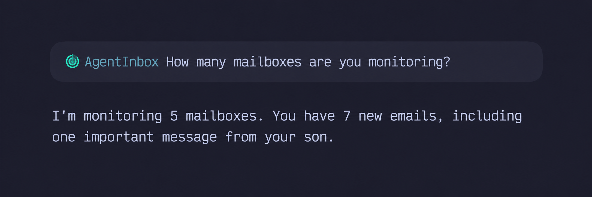
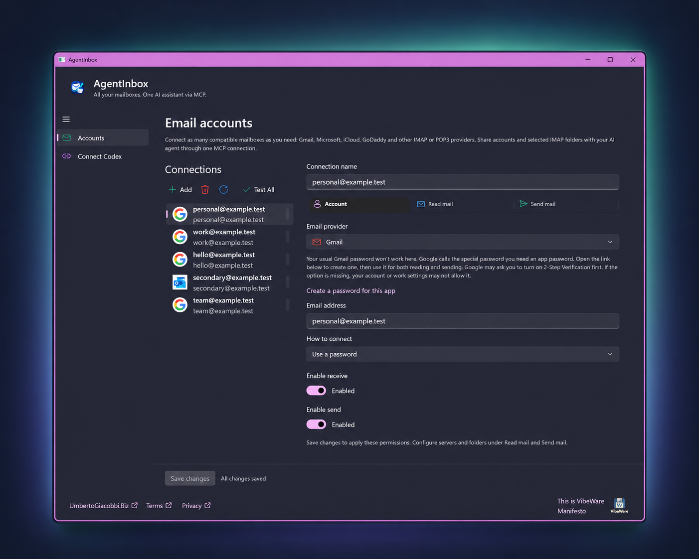
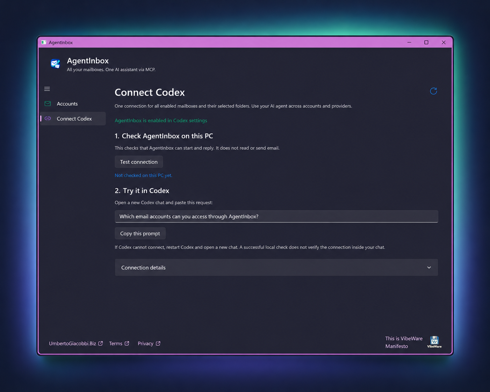
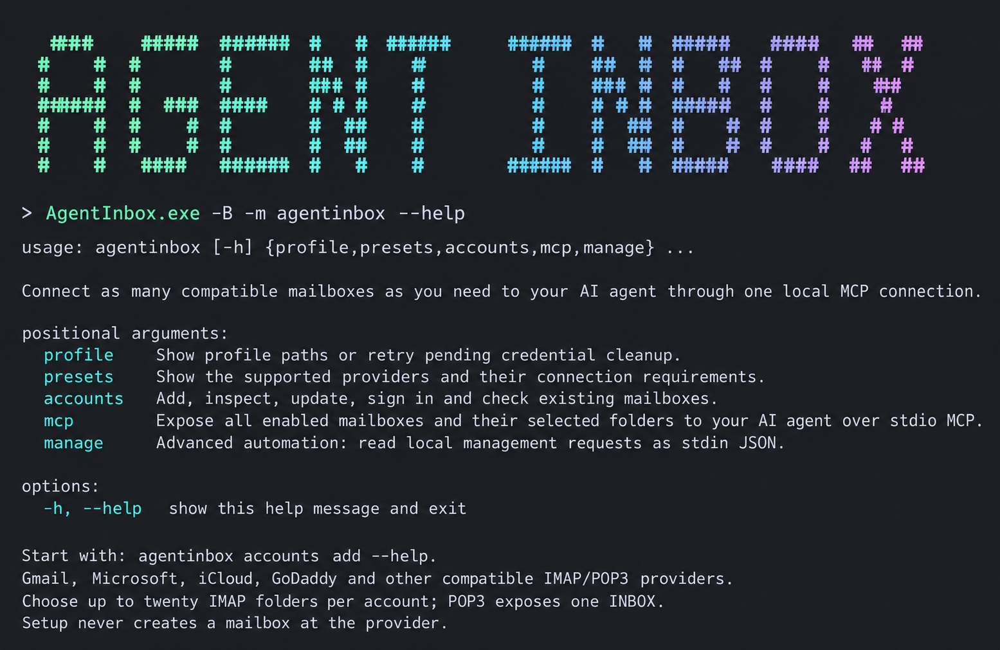
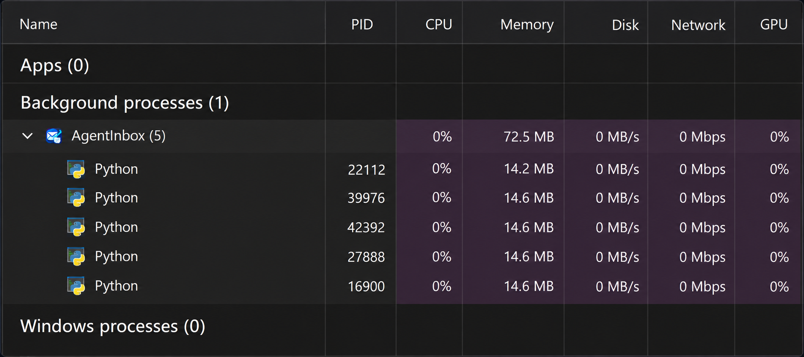

# AgentInbox

**All your mailboxes. One AI conversation.**

My email was spread across several accounts. I built AgentInbox so I could ask my assistant about all of them at once.

<table align="center">
  <tr>
    <td align="center">
      
       
      Example conversation. Mailboxes are checked when you ask.
    </td>
  </tr>
</table>

**[Build from source](docs/DEVELOPMENT.md)** · **[Setup guide](docs/GETTING_STARTED.md)** · [Privacy](docs/PRIVACY.md)

Connect as many compatible mailboxes as you need: Gmail, Microsoft, iCloud, GoDaddy and other IMAP or POP3 providers. One MCP connection lets your AI assistant work across them.

## Built with care

Email deserves careful handling. I review third-party dependencies and their sources, keep an eye on memory and performance, and design controls so you choose what your assistant can access. The checks and limits documented below describe this project, not a security guarantee.

## Get started

1. Follow the [build guide](docs/DEVELOPMENT.md) for Windows, or the [Linux setup guide](docs/LINUX_SETUP.md). Binary downloads are not yet published in VibeKit.
2. Add your mailboxes. Choose which accounts and folders to share.
3. Connect your assistant and ask a question.

> Find the latest email from my son.

### Add your mailboxes

Choose your provider, follow its sign-in steps and save. You decide whether each account allows reading, sending, or both.

### Connect your assistant

Use **Connect Codex**, or follow the [connection guide](docs/CODEX_SETUP.md) for another MCP client.

## Use the command line

**You can also control AgentInbox from the command line.** Add accounts, sign in and check connections from your terminal.

[Quick start (PDF)](docs/AgentInbox-CLI-Quick-Start.pdf) · [CLI guide](docs/CLI_SETUP_GUIDE.md) · [All commands](docs/CLI_REFERENCE.md)

## Small on purpose

I care about keeping AgentInbox light. In this snapshot, each Python process shows **about 14–15 MB** of memory. The five together show **72.5 MB**. Usage varies with the work being done.

Windows can also [share common code in memory](https://learn.microsoft.com/en-us/windows/win32/procthread/process-working-set).

## You choose what to share

- Share only the accounts and folders you want your assistant to read.
- Use dozens of folders across accounts: up to **20 per IMAP account**. POP3 has one inbox.
- Sending starts off. Enable it for the accounts you want to send from.
- Reading does not mark messages as read or delete them.

Your mail stays with its provider. Your assistant may send requested content to its AI service. See [privacy](docs/PRIVACY.md).

## Need help?

> [!TIP]
> **Help bring your mail setup to another desktop**
>
> I do not have a Mac for development or testing, so **macOS is unsupported**. If you would like to maintain a Mac version, the useful starting points are account setup, secure credential storage and the MCP connection.
>
> [Start a conversation](https://github.com/umbertotechnopreneur/VibeKit/issues/new?title=%5BAgentInbox%5D%20) with your platform and the part you can help with. Keep real email and credentials out of reports.

Windows 11 supports x64 and ARM64. On Linux, use the [GTK setup app or command line](docs/LINUX_SETUP.md) with Python 3.11 or newer. Debian-based systems can install local `.deb` builds.

[Accounts and passwords](docs/AUTHENTICATION.md) · [Troubleshooting](docs/RECOVERY.md) · [Build and contribute](docs/DEVELOPMENT.md) · [How it works](docs/ARCHITECTURE.md)

[MIT license](LICENSE) · [Contribute](CONTRIBUTING.md) · [Report a security issue](SECURITY.md) · [Terms](docs/TERMS.md)

Before I add an external library or binary, its archive, extracted files and dependencies must pass a targeted Microsoft Defender scan. I record the source and result. A failed, unavailable or unfinished scan blocks the import.

---

### This is VibeWare · [Manifesto](https://umbertogiacobbi.biz/vibeware/manifesto)

I created AgentInbox with AI assistance. I define its purpose, guide the implementation, and take responsibility for checking functionality, performance, and security. VibeWare is my initiative for building useful software openly with AI; I ask you to judge the result and the evidence behind it.

To learn what VibeWare means and why I created it, read the [VibeWare manifesto](https://umbertogiacobbi.biz/vibeware/manifesto).

[AgentInbox on GitHub](https://github.com/umbertotechnopreneur/VibeKit/tree/main/Apps/AgentInbox) · [VibeWare on GitHub](https://github.com/umbertotechnopreneur/VibeWare) · [umbertogiacobbi.biz](https://umbertogiacobbi.biz)

*You are welcome to explore, adapt and reuse the open-source VibeWare materials under the project license — my contribution to the developer community.*

[Terms](https://umbertogiacobbi.biz/terms/) · [Privacy](https://umbertogiacobbi.biz/privacy/)

   
  <em>Human intent, AI execution, and plenty of tokens</em>

