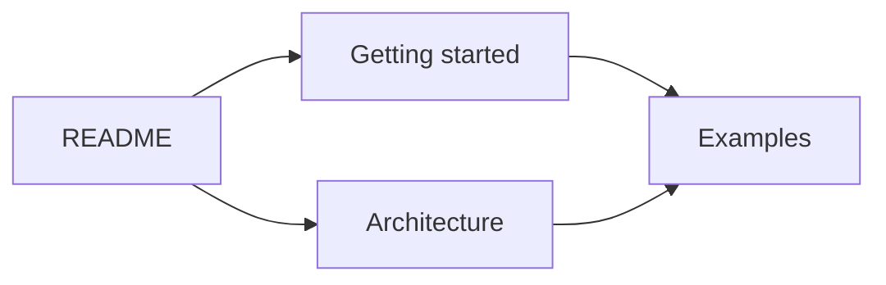
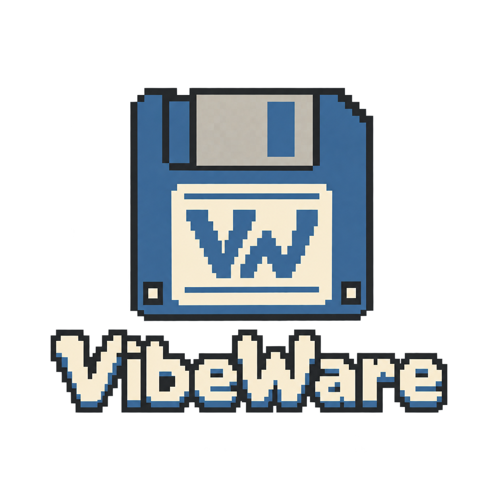

# MarkVibe

[](https://github.com/umbertotechnopreneur/VibeKit/actions/workflows/monorepo.yml)

[](LICENSE)

**A local Markdown reader with a document map, optional AI editing and HTML/PDF export.**

[Get started](#build-it) ·
[MIT license](LICENSE) · [Build and installation](docs/windows-packaging.md)

## Why I built it

MarkVibe started as a quick weekend project. I was frustrated with the tools I
tried for reading Markdown: I did not want to launch Visual Studio Code, or even
a browser, just to read an MD file.

I also wanted something I could customize completely. As usual, I started writing
code. Having a small codebase of my own means I can make it behave exactly how I
want, without finding my way through a huge application first.

## Built with care

I want a reader that respects your computer as well as your documents. I review third-party dependencies and their sources, pay attention to memory and performance, and keep potentially consequential actions under your control. The project's checks and limitations are documented separately.

## What it does

- Opens local Markdown files and folders with relative links, images and Mermaid
  diagrams.
- Offers Read, read-only Source, Split and Map views, with themes and saved layout.
- Exports the current page as HTML or PDF with its images and diagrams.
- Optionally revises Markdown through OpenAI API or the installed Codex CLI,
  using an explicit prompt and selected reference documents. Edited Markdown can
  be saved as a separate copy.

Reading and navigation happen locally. Sending an AI request shares the prompt,
current document or selection, and collected references with the selected provider.
On Windows, the assistant checks available models when opened or refreshed. Choose
the connection in Settings and use **Test connection** to verify it. Codex CLI
requires the Windows desktop app and an existing CLI login. The Windows assistant
lets you preview and apply proposed revisions. See [AI editing and data handling](docs/ai-editing.md).

## Follow the map

The map turns linked documents into cards. Search by title or path, explore nearby
pages or folders, inspect incoming and outgoing links, follow a route, and save a
viewpoint. Double-clicking a document card opens its page.

For example, a small documentation set might connect like this:



The current source also includes a relation lens, document comparison, navigation
trails and short directional link animations. See [map behavior and saved layouts](docs/map-layout.md).
Binary downloads are not yet published in VibeKit. Use the source instructions below.

## Run it

The desktop app targets **Windows 11, x64 and ARM64**. Windows packaging supports
MSIX, an MSI installer and a portable ZIP; see the [packaging guide](docs/windows-packaging.md) to create a local package.
Install the shared Microsoft .NET Runtime 10 for the package architecture and
Microsoft Edge WebView2 Runtime. Windows App SDK libraries are included.
[Microsoft .NET 10 downloads](https://dotnet.microsoft.com/en-us/download/dotnet/10.0/runtime)
Development-signed MSIX packages include their own installation instructions.

The desktop window, toolbars and dialogs use WinUI 3. Win2D draws the document
map. WebView2 renders Markdown, Mermaid and the Monaco source view, and generates
PDF output. The supported application frontend is Windows WinUI 3.

> [!NOTE]
> **A Mac reader needs a Mac maintainer**
>
> The desktop app is built for Windows; other platforms require a contributor willing to maintain them. This is not a promise of macOS support. I have no Mac to develop and test a native edition.
>
> Interested in owning that work? [Open an issue](https://github.com/umbertotechnopreneur/VibeKit/issues/new?title=%5BMarkVibe%5D%20) about native file access, document navigation or PDF export. Those are useful places to start.

## Build it

In a VibeKit checkout, run the commands below from `Apps/MarkVibe`.

I use **.NET 10 / C# / WinUI 3** for Windows, **Win2D** for the desktop map,
**Markdig** for Markdown, **Monaco** for source and **Mermaid** for diagrams.

With .NET SDK **10.0.402** and Node **22.12 or later**:

Open `MarkVibe.sln` in Visual Studio and choose the Desktop launch
profile to debug. The [Visual Studio guide](docs/visual-studio.md) explains setup,
the equivalent `.slnx` solution and the shared build/debug paths.

For the command line:

```powershell
npm ci --ignore-scripts --no-audit --no-fund
dotnet restore src/MarkVibe.Windows --locked-mode
dotnet build src/MarkVibe.Windows --no-restore -c Release
dotnet run --project src/MarkVibe.Windows --no-build -c Release
```

The desktop build bundles its renderer modules automatically. The standalone browser edition has been retired.

See [architecture](docs/architecture.md), [packaging](docs/windows-packaging.md)
and [contributing](CONTRIBUTING.md) for development and delivery rules.
Packaging writes each distribution under its own directory in `artifacts/`.
Local delivery defaults to Release x64.

## License and development

I release my MarkVibe code under the [MIT license](LICENSE).
Dependencies and brand assets keep their own notices; the included ELK layout
module remains EPL-2.0. See [third-party notices](THIRD-PARTY-NOTICES.txt) and
[dependency licensing](docs/dependencies.md).

I develop MarkVibe with AI assistance under my direction. See the
[development disclosure](AI-DEVELOPMENT-DISCLOSURE.md) for tools and responsibilities.

## A note on security

I care about what goes into this project. Before I add a third-party library or prebuilt binary, including files supplied without source code, I scan the downloaded package, its extracted files and any dependencies with Microsoft Windows Defender. I keep new imports aside until the scan finishes without detections.

I keep a record of where each new import came from and the scan result. If a scan cannot finish or flags something, I leave it out.

---

### This is VibeWare · [Manifesto](https://umbertogiacobbi.biz/vibeware/manifesto)

I created MarkVibe with AI assistance. I define its purpose, guide the implementation, and take responsibility for checking functionality, performance, and security. VibeWare is my initiative for building useful software openly with AI; I ask you to judge the result and the evidence behind it.

To learn what VibeWare means and why I created it, read the [VibeWare manifesto](https://umbertogiacobbi.biz/vibeware/manifesto).

[MarkVibe on GitHub](https://github.com/umbertotechnopreneur/VibeKit/tree/main/Apps/MarkVibe) · [VibeWare on GitHub](https://github.com/umbertotechnopreneur/VibeWare) · [umbertogiacobbi.biz](https://umbertogiacobbi.biz)

*You are welcome to explore, adapt and reuse the open-source VibeWare materials under the project license — my contribution to the developer community.*

[Terms](https://umbertogiacobbi.biz/terms/) · [Privacy](https://umbertogiacobbi.biz/privacy/)

<p align="right">
  <a href="https://umbertogiacobbi.biz/vibeware/manifesto">
    
  </a><br>
  <em>Human intent, AI execution, and plenty of tokens</em>
</p>
