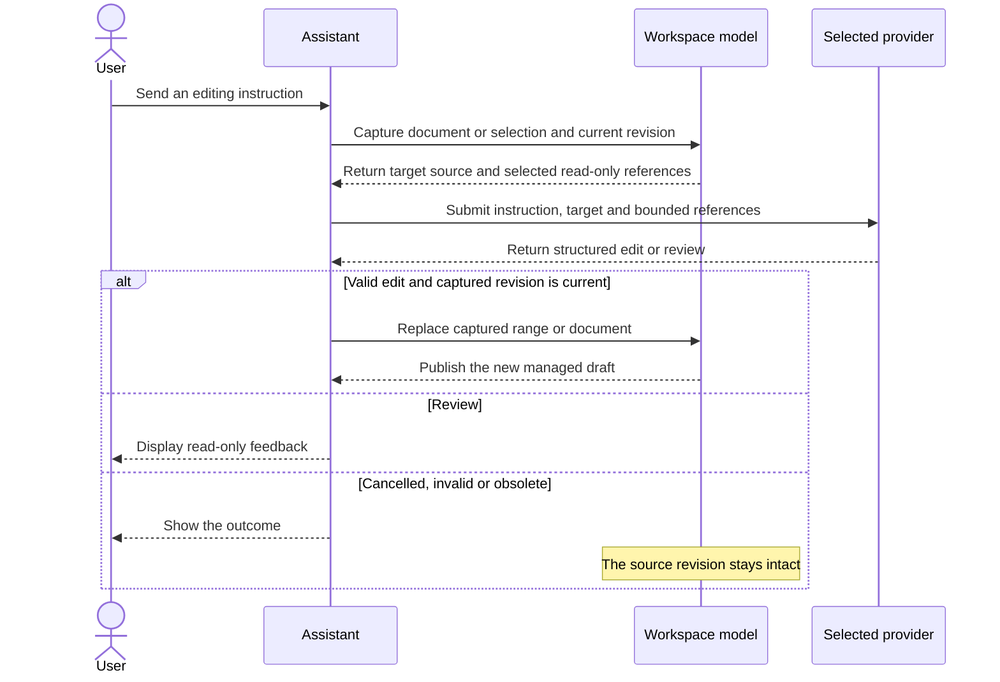

<!-- VBWR B

  Project: MarkVibe
  Repository: https://github.com/umbertotechnopreneur/MarkVibe
  Creator: Umberto Giacobbi | https://umbertogiacobbi.biz

  VibeWare: Human intent, AI execution, and plenty of tokens
  Manifesto: https://umbertogiacobbi.biz/vibeware/manifesto

  Created with AI: OpenAI Codex; Markdown AI contract and validation scope; 2026-10-11
  Human guidance: Umberto Giacobbi; stateless scoped edits, semantic costs and a one-minute deadline
  AI disclosure: AI-DEVELOPMENT-DISCLOSURE.md

  Copyright (c) 2026 Umberto Giacobbi
  License: MIT (see LICENSE)

VBWR E -->

# Markdown AI editing

The assistant can explain its own capabilities and workflow when asked, for
example, "What can I do?". These answers are displayed as reviews in the user's
language and never replace the document. Guidance covers opening a document,
optional selection, example editing requests, explicitly selected read-only
references with token estimates, automatic edit application, Undo and saving copies.

Use **AI** beside the view controls. Choose **OpenAI API key** or **Codex CLI** in
Settings; the choice is saved. Without a configured selected connection, the
component shows an activation banner linked to Settings. A configured connection exposes
the plain-text XAML prompt composer, supported models in a native Popup, and five
reasoning levels: Low, Medium, High, Very high and Maximum. There are no speed tiers
or Ultra reasoning option. Enter submits; Shift+Enter inserts a line break.

## Choose and test a connection

**OpenAI API key** is the default and works in the Windows desktop.
Its Test button sends one short diagnostic prompt to the Responses API using
`gpt-4.1-mini`. The dialog shows the assistant's reply or a connection error.
The request sends no document content, sets `store: false`, and can consume a
small amount of API usage. A completed, nonempty reply validates generation for
the test model. Entering a new key saves it after a successful reply. Leaving the
field empty tests the saved key. A failed or cancelled test keeps the previous key.

**Codex CLI** uses the installed Windows `codex` executable and its existing login.
MarkVibe does not install it, sign in for you or copy its credentials. The CLI
Test button makes a short synthetic request and checks its reply; it does not
send the open document or references. It can consume the CLI account's usage.
The resulting modal explicitly reports **Test passed** or **Test failed**.
Closing Settings cancels the test and suppresses delayed result dialogs.

Selecting the CLI connection
never falls back to the API connection. CLI authentication, model availability and
usage follow that CLI account; API billing categories do not establish ChatGPT
allowance or CLI access. The retained model catalog describes supported choices,
and actual CLI access is established when a request succeeds. Preflight uses local
estimates where CLI token counting is unavailable.

The integration follows OpenAI's [non-interactive CLI documentation](https://learn.chatgpt.com/docs/non-interactive-mode)
and [authentication guidance](https://learn.chatgpt.com/docs/auth). A locally
present login is status information, not a passed remote connection test.

Select document text before moving focus to the prompt to edit that selection.
The managed request captures the selection and document fingerprint before sending.
Reader text is mapped only where an exact literal source span exists. Unsupported or partially overlapping selections disable submission
and direct the user to Source; they never silently become whole-document edits.
Monaco and the plain-source fallback map raw UTF-16 offsets, including CRLF and
mixed line endings. Generated diagram/image text is not a Markdown source range.

## One request, one replacement



Each send contains two fixed system messages, explicitly selected read-only
references, the current document/selection, and the current editing instruction.
The application message identifies MarkVibe,
its creator, purpose, views and exports, explains why the user supplied the prompt,
and states that edit text will replace the supplied source. The policy message
limits work to Markdown editing/review and rejects image/media generation, new
books, fifty-page files and unrelated bulk output. Existing long documents can be
revised or shortened. Document instructions are content, not application authority.

The **AI collection** belongs to the current workspace and retains up to 16
canonical Markdown paths. Add/remove documents from the map or AI panel, or clear
the collection. The panel shows a local estimate before sending; incomplete
metadata is shown as pending rather than as a zero-cost reference. These estimates
make no API calls. On send, source comes from the current managed revision, with
at most 1 MiB UTF-8 per reference and 4 MiB combined. The open editing target is
excluded from the reference payload and reference-token total. References provide
context only: an edit can replace the captured open document or selection, never
another collected document.

Responses use a strict JSON schema with `kind`, `markdown` and `summary`. A complete
`edit` is parsed and automatically replaces the captured document or selection;
a `review` is displayed. The API request grants no tools, sets `tool_choice: none`
and `store: false`, explicitly selects Standard service, sends no conversation/history or previous response ID, and
never executes returned code. Reviews appear in a read-only XAML text control. Edited documents use the existing
managed Markdown parser and renderer sanitizer. Refused, truncated, malformed, obsolete or cancelled
responses cannot replace source. See [OpenAI structured outputs](https://developers.openai.com/api/docs/guides/structured-outputs).

Codex CLI receives the same captured target, explicit references and editing
instructions through standard input. Its structured final reply is adapted to the
same managed result contract. Requests use a temporary working directory and an
ephemeral read-only session, without loading the user's tool/plugin configuration.
Cancellation or the request deadline terminates its process tree. The CLI is a
separate local program, not an OS-isolated text API; do not interpret read-only
sandbox mode as a blanket restriction on filesystem reads.

### Native assistant controls

`WindowsAiPanel` renders the managed `WindowsAiSession` snapshot with WinUI
controls. The right-hand pane owns prompt, model/effort selection, references,
request progress, cancellation and review actions. The desktop model persists
pane geometry. Markdown selection reaches the session as source coordinates;
request state and revision validation never move into the renderer.

### Deadline and cancellation

The entire network operation has a **60-second deadline**, not a fresh minute
for each HTTP call. Cancellation propagates into native HTTPS. A late reply
is discarded before the source commit. No automatic retry repeats billed generation.

## Catalog, cost and context

The embedded [model snapshot](../src/MarkVibe.Core/AI/openai-models.json) retains
the retrieval timestamp, sources, Standard text prices, long-context multipliers,
supported reasoning levels, full context, maximum input and maximum output.
Account availability comes separately from `GET /v1/models`; that endpoint does
not supply this pricing and context catalog. Refresh its public facts explicitly with:

```powershell
node scripts/update-openai-models.mjs
```

The downloader uses only official public Markdown documentation, no credential
or private files. It replaces JSON only after all downloads and required fields
succeed. Pricing is a dated snapshot and may change, including promotional rates.
The app does not silently download catalog changes during a request.

Model badges show **Cheap** in green, **Affordable** in amber, and **Prohibitive**
in red. These are application-defined relative Standard output-price categories:
up to 5 USD per million output tokens, up to 20, and above 20 respectively.
Only the categories appear in the UI. The documented long-input multiplier can
change the badge. Actual usage depends on input, output, reasoning and caching;
the badges are not account-specific invoices. [Official OpenAI pricing](https://developers.openai.com/api/docs/pricing).

The seven retained models currently document 1,050,000 context tokens, at most
922,000 input tokens and 128,000 output tokens. MarkVibe reserves the documented
maximum output for response plus reasoning and uses the remaining full input
capacity. It does not shrink context to a small conversational budget. The app's
existing **1 MiB document**, block/headings and **16,000-character prompt** limits
still apply independently. [GPT-6.1 Sol limits](https://developers.openai.com/api/docs/models/gpt-6.1-sol).

Before generation, three cumulative input counts measure system/schema, then
references plus document/selection, then prompt. The counting and generation
payloads contain the same ordered reference messages. Exact full-input counts enforce the model limit;
oversized requests receive a clear message recommending a smaller selection or
shorter prompt. If counting is unavailable, a conservative UTF-8 byte bound permits
only requests that fit; a large unverified request is blocked. Partial counts may
still establish the total while leaving the individual shares estimated.

The context bar uses the model's full capacity as its scale and displays input
shares, response reservation, free space and occupied percentage. The token bar
separately shows System, Prompt, Document (target plus references), Response and Reasoning, with exact API
usage totals after completion and explicit approximation markers otherwise.
Reasoning is a subset of output and cached input a subset of input; neither is
added twice. Prefix attribution is exact only when the full preflight count agrees
with actual input usage. Session counters retain numbers, not conversational text.
[OpenAI token counting](https://developers.openai.com/api/docs/guides/token-counting).

## Local drafts and original files

Edits replace the in-memory document and update its reader, source, headings,
title/path search and map metadata. Local Undo/Redo requires no API call and is never added
to the next request. Revision/session checks prevent an old response from modifying
another page. Active graph-card gestures prevent a commit; document renderer input
freezes briefly during the managed replacement. Ink and sticky notes are retired.

**Save Markdown copy** opens a native destination. The picker prevents
replacement of the current original file. **Restore original**
discards local Markdown edits after confirmation. Closing or replacing a workspace
protects unsaved drafts and requests. Draft sessions are limited to sixteen pages;
restored or explicitly saved sessions can expire without discarding unsaved source.
Original files and annotation sidecars are not silently rewritten by an AI reply.
