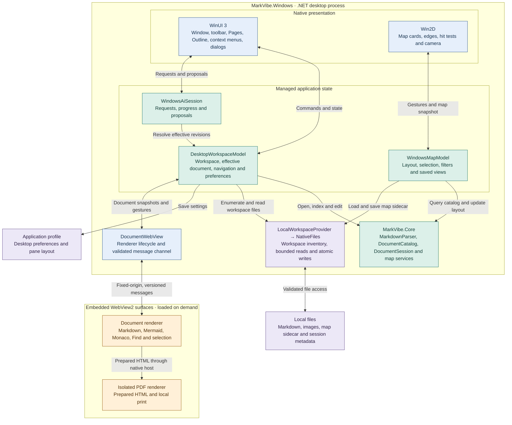
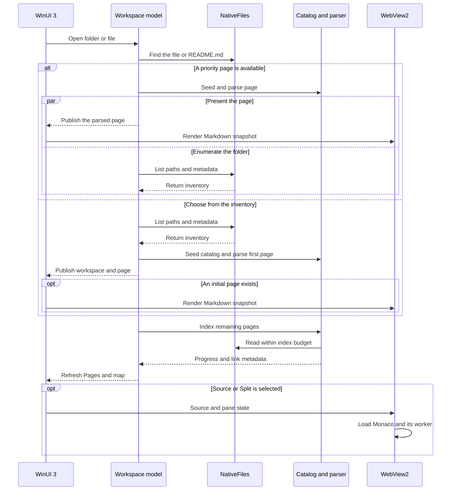
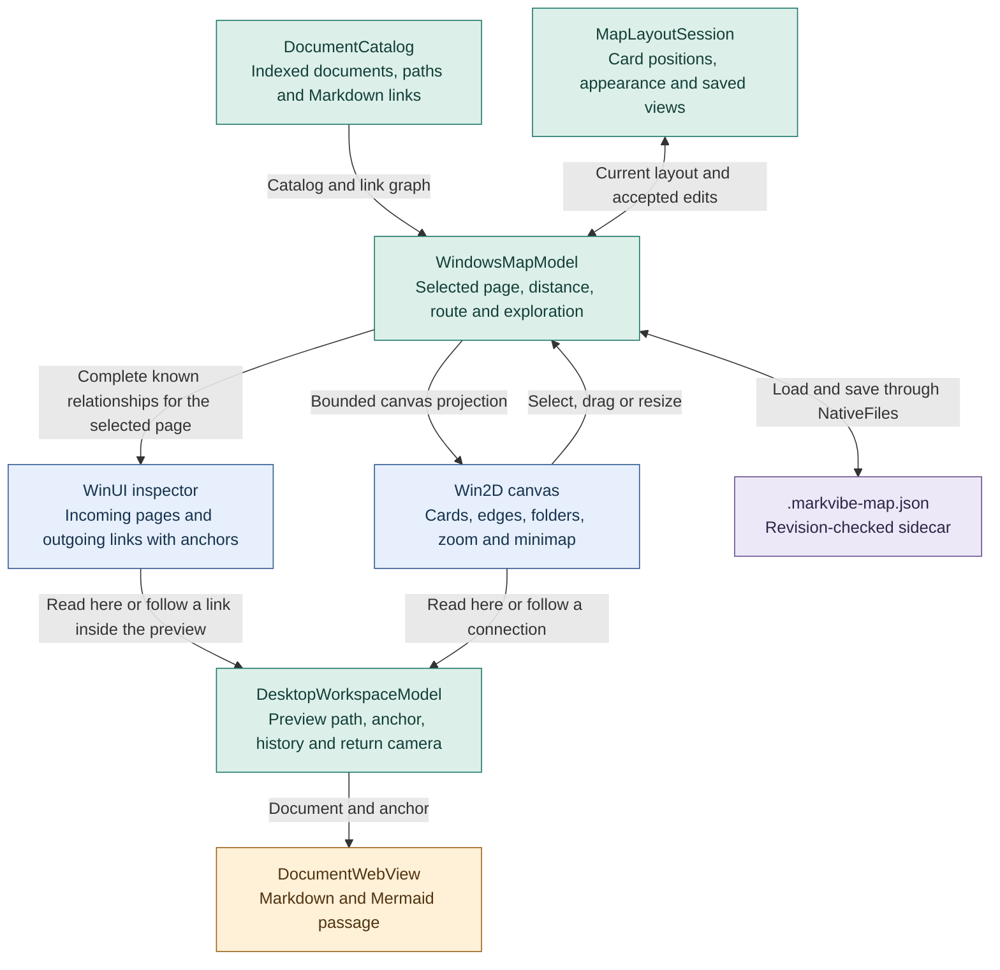
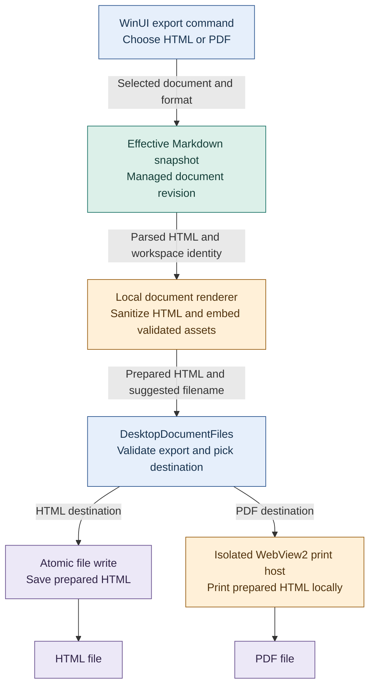

> **File name** `architecture.md` 
> **Full path** `E:\vibekit\Apps\MarkVibe\docs\architecture.md` 
> **Path relative to the MarkVibe application root** `docs/architecture.md`

# MarkVibe architecture

[Map layout](map-layout.md) · [Export](desktop-and-export.md) · [AI editing](ai-editing.md) · [Windows packaging](windows-packaging.md)

## Desktop modules and boundaries

WinUI 3 provides the desktop shell. Win2D draws the document map. The embedded
WebView2 surfaces render Markdown, Mermaid and Monaco, and print the prepared
document to PDF. C# owns file access and the application state that feeds each
surface.

Blue marks native presentation and hosting. Green marks managed models and
services. Amber marks embedded renderers. Purple marks file access and storage.

| Module | Authoritative state or operation | What the view receives |
| --- | --- | --- |
| `DesktopWorkspaceModel` and `DesktopWorkspace` | Active provider and catalog, effective document, reading and preview history, Find and preferences | Selected document, navigation commands, and the state for Pages and Outline |
| `DocumentCatalog` and `DocumentSession` | Paths, titles, headings, block ranges, resolved links, statistics and unsaved revisions | Parsed document and catalog snapshots used by the reader, editor and map |
| `WindowsMapModel` and Core layout services | Selection, distance, route, exploration, card geometry and named views | The canvas projection and the inspector's document relationships |
| `WindowsAiSession` | Request lifecycle and proposals for a captured editing target | Request progress, reference information and revision actions |
| `NativeFiles` | Workspace path resolution, bounded reads, session metadata and revision-checked writes | Results of file commands and persistence |
| `DocumentWebView` and client renderer | Rendered DOM, image leases, scroll offsets, text selection and local editor surface | Rendered document content and source-backed interaction events |

The WinUI controls hold focus, geometry and other presentation state. Preferences,
layout and folder reading choices persist in `desktop-settings.json`. Each
`DesktopWorkspace` has its own provider, catalog and AI reference collection.

## Open a folder and render a document

Markdig parses bounded Markdown and restricts embedded HTML. The same syntax tree
provides heading IDs, block IDs, source ranges and resolved links. Outline uses
those coordinates. Find searches the active pane. Split synchronizes the reader
and editor through source lines and block ranges with a short feedback guard.

The index retains metadata, statistics and links within an 8 MiB source budget.
Pages outside a partial index can still be opened by path. A workspace opened
from a specific file can show that page while the full folder inventory finishes.

The local client bundle lives under the executable's `app/` directory. WebView2
loads it through a fixed virtual HTTPS origin. The message channel checks the
sender and validates a per-instance capability on native requests. The host
permits a fixed set of operations and resolves supported images inside the
active workspace. DOMPurify sanitizes HTML before display and export. Mermaid
runs in a sandboxed frame with an opaque origin and network access disabled.

### Document revisions

`DocumentCatalog` keeps edited `DocumentSession` objects independently of its
three-document parsed cache. A session tracks original, current and last-exported
source with a monotonically increasing revision. Its states are `Original`,
`Unsaved` and `Exported`. Undo and redo each retain at most 16 entries and
4,194,304 UTF-16 code units. Each catalog retains at most 16 edited sessions.
Saving a Markdown copy preserves the original file. Refresh retains unsaved
revisions for documents that disappear from disk.

## Document map and linked pages

Tree, Star, Circle, Grid and Folders arrange the catalog. Search matches titles
and paths. The inspector reads all indexed incoming pages and distinct outgoing
targets for the selection. It exposes additional rows in batches and preserves
anchors and unavailable targets. Win2D renders the bounded projection and
handles camera and pointer interactions. The managed preview history stores a
reading position and a map camera for returning to a passage. The sidecar saves
layout edits atomically after checking its revision. [Map layout](map-layout.md)

## Assistant

The user starts connection checks and editing requests. Each workspace can retain
up to 16 Markdown paths in its AI reference collection. The session resolves
their effective source revisions at request time, excludes the editing target
and reads at most 4 MiB of reference content in total. Reference statistics and
token estimates are computed locally. A complete edit updates the captured
local document revision. Restore Original recovers the original source. [AI editing and data handling](ai-editing.md)

## Export flow

Export validates and embeds supported images, including images below the fold.
It preserves same-page anchors and marks links to neighboring Markdown documents
as unavailable. Native file dialogs select the output destination. The isolated
PDF host has page scripts and web messaging disabled. [Export and native hosts](desktop-and-export.md)

## Build boundary

WinUI 3 is the only application frontend. The document renderer's maintained
assets live under `src/MarkVibe.Windows/Rendering/web`; JavaScript source lives
under `client`. There is no standalone browser application or WebAssembly host.
The native build bundles only renderer entrypoints into `obj/desktop-js` and
stages them under `app/`. Core and Native remain UI-independent libraries.

Use the stable .NET 10 SDK configured in `global.json` and supported Node version.
Distribution shares the separately installed .NET Runtime 10.0 while retaining
required Windows App SDK application libraries. See [builds](visual-studio.md).

> **File name** `architecture.md` 
> **Full path** `E:\vibekit\Apps\MarkVibe\docs\architecture.md` 
> **Path relative to the MarkVibe application root** `docs/architecture.md`
