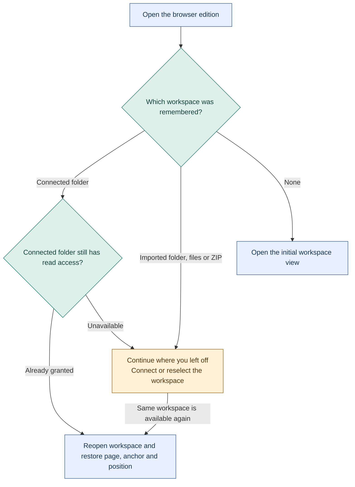

> **File name** `browser-capabilities.md` 
> **Full path** `E:\vibekit\Apps\MarkVibe\docs\browser-capabilities.md` 
> **Path relative to the MarkVibe application root** `docs/browser-capabilities.md`

# Browser capabilities

MarkVibe detects capabilities at runtime. A browser name alone does not guarantee
that a device's file picker exposes the required files and paths.

| Workspace mode | Required capability | Behavior |
| --- | --- | --- |
| Connected folder | Secure context and `showDirectoryPicker` | Reads through a retained directory handle |
| Imported folder | Directory input with usable `webkitRelativePath` values | Opens a snapshot; reselect after restart |
| Selected files / ZIP | File input | Opens a snapshot; reselect after restart |
| Windows desktop | Native provider | OS pickers, session persistence and direct PDF saving |

If a picker does not expose relative paths, select related files or a ZIP.

## Permission and persistence

Connected folders open in read mode. Enumeration and reads query permission.
Startup resumes only with an existing read grant; the explicit reopen action can
request read permission. A stored IndexedDB handle does not guarantee a retained grant.

Imported folders, files and ZIPs require reselection after restart, then restore
the remembered page and position. Settings can disable and clear that state.
The map's explicit **Save layout** action can request read/write access to
`.markvibe-map.json`, after which layout edits autosave. Imported layouts download
as separate files. Ink and sticky-note editing are unsupported.

## Source view and mobile behavior

Monaco is a progressive desktop enhancement. A coarse pointer, narrow source pane,
limited reported memory or editor failure selects the lightweight source view.
The fallback retains select/copy, find, line numbers and source-position navigation.

Mobile reading uses single panes, full-width sidebar switching and touch-sized
buttons. Split requires a wide viewport. File providers, permissions, safe areas,
virtual keyboards and orientation changes depend on the device.

## API references

- [Directory picker](https://developer.mozilla.org/en-US/docs/Web/API/Window/showDirectoryPicker)
- [Directory input and relative paths](https://developer.mozilla.org/en-US/docs/Web/API/HTMLInputElement/webkitdirectory)
- [Read permission querying](https://developer.mozilla.org/en-US/docs/Web/API/FileSystemHandle/queryPermission)

> **File name** `browser-capabilities.md` 
> **Full path** `E:\vibekit\Apps\MarkVibe\docs\browser-capabilities.md` 
> **Path relative to the MarkVibe application root** `docs/browser-capabilities.md`
