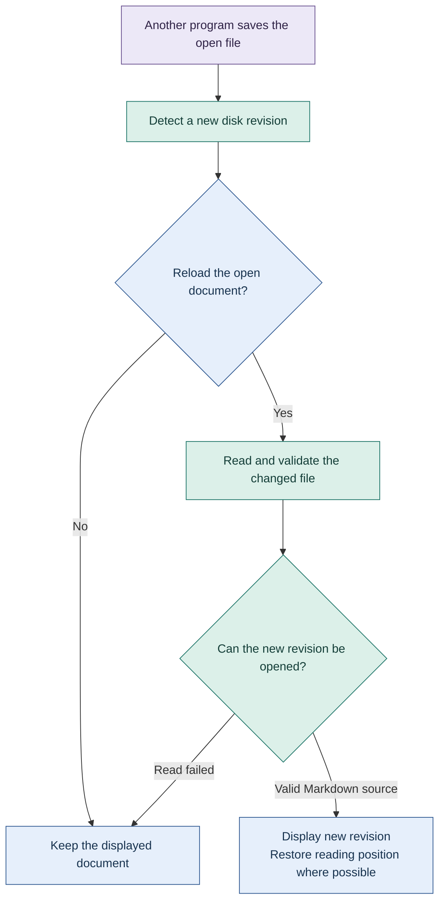

> **File name** `desktop-and-export.md`<br>
> **Full path** `E:\vibekit\Apps\MarkVibe\docs\desktop-and-export.md`<br>
> **Path relative to the MarkVibe application root** `docs/desktop-and-export.md`

# Document export and native hosts

The WinUI 3 desktop app exports the current document as HTML or PDF.

## Changes to the current file



The Windows host watches the opened Markdown file, including editor saves that
replace it atomically.

If the content changes, MarkVibe asks whether to reload it. **No** keeps the
displayed content; another notification needs a new disk revision. **Yes** reads
and validates the latest file before replacing its cached copy. Local AI edits
and undo history are discarded only after that confirmation, with a warning;
other documents keep their drafts. Reading position is restored where possible.
Missing, locked, oversized or invalid files leave the displayed copy intact.

Notifications wait for active operations and confirmations, follow only the
current document and stop on navigation or shutdown. This feature does not write
the source file.

## Export the current page

Choose **Export** in the native document toolbar.
Both formats include the title/path, reading styles, highlighted code, supported
local images and sanitized Mermaid on a light background.
Only the current document is included. Same-document anchors and safe external links
remain usable; links to neighboring Markdown pages are marked unavailable.

Windows uses an OS save dialog for either format. PDF is generated directly with
`PrintToPdfStreamAsync` in a separate WebView2 with page scripts/web messaging
disabled. The host waits for local assets/fonts and commits via temporary-file
replacement. It reports the saved filename or cancellation; no browser print dialog
is involved. A4 styling supplies margins and page numbers. Cancellation before commit
preserves the prior destination; a completed commit cannot be undone by cancellation.

Missing/blocked images and failed diagrams become notices. Remote images are not
fetched. Limits: 96 images, 8 MiB per input, 20 MiB embedded image bytes, 32 megapixels
aggregate and 32 MiB final UTF-8 HTML. No document upload is used.

## Run Windows

Build the desktop project with the dependencies prepared as described in the
[build guide](visual-studio.md). It stages its local reader, Mermaid and Monaco
assets under the executable's `app/` directory. The WinUI 3 desktop app is built
from the maintained native source.

```powershell
dotnet run --project src/MarkVibe.Windows --no-build -c Release
dotnet run --project src/MarkVibe.Windows --no-build -c Release -- --open 'C:\Docs\README.md'
```

Use Open file/Open folder to grant a local documentation root. Adjacent Markdown and
images are available through relative paths. Refresh rereads the bounded catalog.
Native access excludes UNC roots, reparse points, junctions, alternate streams and
reserved Windows filenames. The host exposes specific typed operations rather than
unrestricted filesystem or shell access.

Windows preferences and reader layout live in `desktop-settings.json` under
`%LOCALAPPDATA%\MarkVibe\Windows`. The native session in the same profile records
the last root, document, anchor and position. **Remember last workspace** allows
the app to restore it on restart. `--open` selects a different starting file.
Document map positions, colors, icons and atlas settings live in the workspace's
`.markvibe-map.json`. See [map layout](map-layout.md).

Source builds use .NET 10 and the Windows App SDK. Desktop packages require the separately installed .NET Runtime 10.0 and include
Windows App SDK application libraries and use the installed Microsoft Edge WebView2 Runtime. Portable profiles
live in a sibling `data/` directory. See [distribution and installation](windows-packaging.md).

## Other platforms

| Platform | Current route |
| --- | --- |
| Windows 11 | Native WinUI 3 application, Win2D map and WebView2 document rendering |
| Other platforms | No maintained frontend; contributions require a platform maintainer |

The native workspace provider handles filesystem access. The renderer bridge
checks sender URL, version and per-launch capability, blocks external page resources
and opens user-initiated external links in the system browser. Follow Microsoft's
[WebView2 security guidance](https://learn.microsoft.com/en-us/microsoft-edge/webview2/concepts/security)
and [printing documentation](https://learn.microsoft.com/en-us/microsoft-edge/webview2/how-to/print).

> **File name** `desktop-and-export.md`<br>
> **Full path** `E:\vibekit\Apps\MarkVibe\docs\desktop-and-export.md`<br>
> **Path relative to the MarkVibe application root** `docs/desktop-and-export.md`
