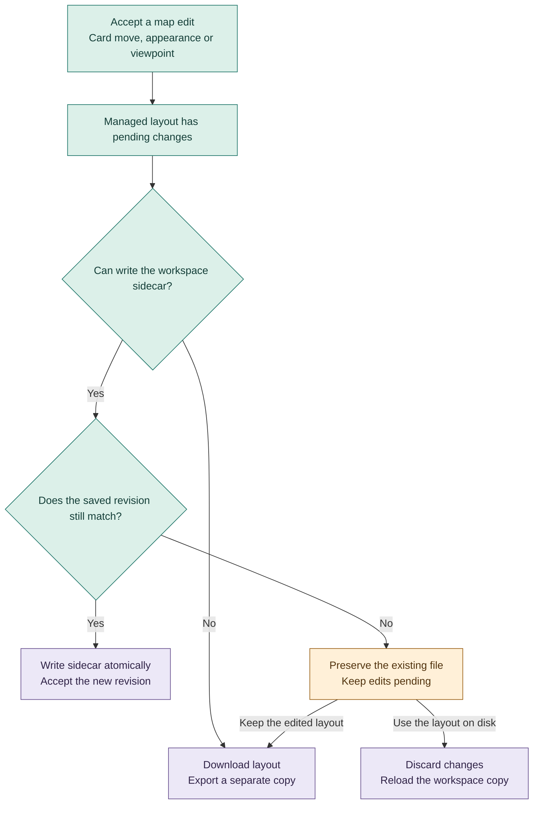

# Document map layout

Each opened workspace keeps one `.markvibe-map.json` in its top-level folder.
The JSON stores logical card coordinates, color and icon under the document's
normalized relative path, with optional `atlas` presentation settings and saved
viewpoints. Markdown and its links remain read-only. The format is
versioned and described in `schemas/map-layout.schema.json`; C# also enforces path,
size, palette and coordinate bounds. Version **4** is the only supported format:
the root contains `schemaVersion`, `nodes` and optionally `atlas`, with no annotation collection.
Versions 1–3 and unknown fields are rejected without rewriting their original
files. There is no migration layer for these unreleased formats.

The native canvas, cards and controls follow the application's light or dark
appearance. Settings offers ten paired color presets and a separate graph font.
The active preset supplies the canvas, directional links and selection accent.
Document and folder colors are retained when changing presets. The
map toolbar shows search, fit and the inspector toggle beside the **Map arrangement**
and **Map options** flyouts. Layout presets are grouped in the first flyout.
Filters, saved views, recent pages and editing actions are in the second.
Enable **Acrylic map surfaces** in Settings to tint and blur the background where
Windows supports transparency. Theme-matched solid surfaces provide the fallback.

Drag a card to arrange the graph. Connections follow the card while dragging;
releasing it commits the position. Hover gently enlarges a card; one click selects
and enlarges it further without opening the document. Double-click opens it.
Keyboard users select with Space and open with Enter. Drag the background
to pan, scroll the mouse wheel to zoom in or out around the pointer, and choose
**Fit** to frame the graph. Ctrl is not required. Zoom is held steady during an
active drag so its logical coordinates remain consistent.
With Windows animations enabled, a wheel detent starts moving the map immediately
and reaches its requested zoom over 60 ms. Successive detents adjust the same
destination. Fine wheel deltas and reduced-motion settings apply zoom directly.
Negative positions are supported. **Alt+arrow** moves a focused card by 20 logical
pixels; add Shift for 100 pixels. Escape cancels an unfinished drag.

On Windows, Tab moves between native controls, including the graph and the
selected card's **Read here** button at detail zoom. With the graph focused, **Page Up/Down**
cycles through cards. Add Shift to move through the focused card's links or Ctrl
to move through folder islands. **R** focuses the resize grip and **M** focuses
the minimap. **Home** fits the graph.

Hover a connection to illuminate its curve and both endpoint cards. Its invisible
hit area stays 14 screen pixels wide while zooming. Connection endpoints follow
card magnification, movement and resizing.

New desktop cards use portrait A4 proportions (210 × 297 logical pixels).
The header shows the filename, title and a short extract from the document.
An unresized document appears as a portrait A4 sheet, 210 by 297 logical pixels.
Its running header identifies the file. The title and first text paragraph are
followed by section headings or linked filenames when the sheet has room.
Selection magnifies the sheet uniformly. Saved custom dimensions take precedence.

Use the bottom-right grip to resize a desktop card. A focused grip accepts arrow
keys in 10-pixel steps, or Shift for 40 pixels; Escape cancels the preview. Width
is bounded to 180–780 and height to 120–600 logical pixels. The complete size
change commits on release. Every layout uses schema version 4; dimensions are
optional but must appear together when a card has been resized.
Compact views retain full-width cards with normal scrolling.

Right-click a card to open the frosted XAML card menu. It contains a live preview,
named color swatches with selection rings and a visible icon gallery. The active
color and icon are labeled; changes follow accepted managed map state. Its local
file actions match navigation, reader/source and AI collection menus: reveal in
Explorer, open a terminal in the containing folder, open a standalone browser
preview and delete the file after confirmation. Virtual workspaces omit local
shell/deletion actions. **Shift+F10** or the Context Menu key
also opens the picker. Escape, Close or
a click outside dismisses it. Color tints the card border/background and its icon.
On narrow or coarse-pointer devices the map remains a scrollable card list; the
saved graph positions are retained for the desktop canvas.

Deletion uses the shared frosted confirmation with the exact workspace-relative
path and a warning when a local draft will be discarded. Cancellation performs no
mutation. Approval is tied to the current UI session and the file's bytes/metadata;
Windows then receives a single-file Recycle Bin request. Folders are never deleted
from this menu. Catalog entries, retained drafts, map membership and AI collection
membership are refreshed after a completed operation. These new actions have been
compiled but their functional acceptance is reserved for the owner's manual tests.

The map toolbar wraps within the themed canvas. Search stays visible in the
compact document list. **Fit** is available on the canvas. The native shell
keeps Read, Source, Split and Map in a single selector that moves below the file
commands when the window is narrow.

Opening a document loads its own text first. Other document titles and link
metadata are indexed on demand for the visible Pages list or map. The graph
updates incrementally as those results arrive.

The first map opens in **Tree** when no saved layout exists. A valid saved layout
always keeps its card positions, sizes, colors and icons. Reset returns to the
initial Tree arrangement; no existing layout is silently rearranged.

Incoming and outgoing links appear in separate themed sections with direction
arrows, unique-target counts, document icons, readable titles and secondary paths.
Rows retain document navigation and the local file context menu.

The toolbar offers **Star**, **Circle**, **Grid**, **Tree** and **Folders**. Each uses the complete catalog,
independently of search, focus and the 120-card projection. The central document
has the most distinct connected documents, counting incoming and outgoing links
together. Repeated links, self-links, external URLs and missing targets do not
inflate its score. Ties prefer README/INDEX entry points, then shorter folder depth
and stable path order. Star groups cards along radial spokes; Circle surrounds
the center with a ring (multiple rings for large catalogs); Grid fills nearby rows
and columns. Star adds spokes when needed to stay within coordinate bounds.
Tree uses breadth-first levels beneath the strongest document in each connected
component. Cycles never duplicate cards; broad levels wrap into rows. Extremely
deep chains that exceed the coordinate contract fall back to a bounded grid in
breadth-first order. All arrangements leave room
between cards and preserve their colors and icons.

**Depth** is enabled initially and can be toggled independently of any arrangement.
Core calculates shortest connection distances from the selected document across
the complete catalog, before limiting visible cards. The renderer combines those
distances with logical distance from the selected card to distribute documents
across up to twelve recessed levels. Logarithmic spacing distinguishes cards with
equal graph distance and bounds far-card shrinking and opacity. Disconnected pages
start in the background and retain spatial variation. The selection uses 1.28×
magnification and stronger accent lighting. Every connection fades according to
its more distant endpoint, including connections from the selected card; hovering
a line restores full emphasis. Selection, hover and keyboard focus bring a card
forward; connections follow its rendered bounds throughout the 420 ms transition.
Clicking a card makes it the new depth reference. Completed arrangements and card
moves recompute spatial depth; pointer gestures retain stable magnification.
Depth changes neither saved positions nor the current document.
Compact list views stay full-size, and reduced-motion settings remove transitions.

**Reset all** opens a native confirmation before restoring card positions,
sizes, colors and icons. It rebuilds the active catalog in Tree layout, discards
orphaned card entries and leaves documents intact. It follows the same persistence
rules as any other layout change.

**Advanced view** shows a compact monospace strip below each card's content:
UTF-8 source size, estimated tokens, Unicode scalar characters, words, lines and
distinct linked document targets. Counts use the complete decoded Markdown,
including markup; unindexed metadata is explicitly unavailable. Words count
letter/digit groups, not language-specific linguistic segmentation. Tokens use
the app's UTF-8 byte/4 approximation, not a tokenizer or provider usage report.
Size and tokens occupy the primary row; secondary icon counters retain full
tooltips and accessible labels without clipping long captions. The appearance
selector shows each local icon beside its name, including the current selection.
No source text is sent to AI by showing these statistics.

New maps start in Tree arrangement. Existing saved coordinates remain unchanged
until an arrangement button is chosen. New pages in an established layout use
free grid slots without moving existing cards. Filtering and focusing retain
the same coordinates. Reconciliation uses the complete enumerated catalog,
including documents whose content has not been indexed, and removes entries for
absent paths. Existing cards retain their positions, colors, icons and sizes;
removed entries mark a loaded layout as changed so cleanup can be saved.
Filtered graph projections must never be used for this reconciliation. An
explicit arrangement is one managed edit and uses the existing save/download
workflow.

Cards fade in progressively from the layout center when opening or arranging the
map. The stagger is capped at one second for the last card, followed by its short
fade. The Windows canvas also interpolates existing cards, connections, folder
frames and the minimap between arrangements. Reduced-motion preferences disable
these transitions and entry effects. Narrow or coarse-pointer
devices retain a scrollable card list and normal scrolling instead of wheel zoom.

## Persistence

### Document atlas

The full-width toolbar sits above the canvas. Its directional legend appears
on the canvas below the commands when the relation lens is active. The default MarkVibe
palette uses warm paper and sage in light mode and charcoal and olive in dark mode.
The camera reserves space beneath the toolbar when fitting the graph. Narrow
devices retain a normal card list and can show the inspector as an overlay.
The reading panel opens below its row in the compact Windows list when the row
is available.

Below 40% zoom, documents appear as points. In a dense graph only selected,
focused, picked or route documents can display a label. At reading zoom each
document shows its icon, title and excerpt. The selected document can also show
its path, up to three section headings at 105% or more, or advanced statistics.
While the wheel moves through a dense graph, card outlines and titles identify
the visible documents. Titles use a fixed screen size wherever a card has room
for the label. During wheel zoom, or while dragging the camera at reading zoom,
background links follow their Béziers using short straight segments with a
tolerance of 0.75 logical pixels. Highlighted links keep their full curves.
The full card contents and curves return when the camera comes to rest.
Changing zoom preserves the saved positions and sizes.

**Folders** retains the existing full-catalog arrangement and adds deterministic
island colors without replacing custom card colors. Each island has a count and
a keyboard-accessible expand/collapse button. Collapsing retains all document
coordinates and redirects existing external connections to the island boundary;
internal connections disappear until expansion. Island counts and frames use the
complete catalog/layout, even when not all cards fit the 120-card projection.

Each document has a slim outline, a subtle internal gradient and slightly rounded corners. A one- or two-line
title sets the starting position of the excerpt. Hovering or selecting a document
reveals additional detail. Advanced statistics appear on the active document.

Selecting a document sends one short impulse along up to 24 adjacent links, from
source to target. Curves attach to the side facing the other document. Reciprocal
links follow separate paths, each with its own destination arrow. With the relation
lens on, incoming links use a dashed stroke and outgoing links use a solid stroke
in the current preset's colors. The lens follows hover or keyboard focus and
rests on the selection.
The link button toggles emphasis. Effects finish after about one second, respect
reduced motion, and cancel when the session is suspended or the page is hidden.
They introduce no blur, SVG filters or continuous animation loop.

Ctrl/Cmd-click cards to toggle a selection of at most 12 documents. Shift-drag
empty canvas to select a rectangle; Ctrl/Cmd additionally retains the previous
selection. The checkmark tool enables selection without modifiers. Escape cancels
an unfinished rectangle. The shelf locates selected documents, compares plain
catalog previews side by side and adds the whole set to AI context. Batch reads
and the existing 16-document/4 MiB limits are validated before membership changes;
adding references sends no inference request.

Recent pages contains the last ten successful document visits. Chips center a
page without extending the trail; a subdued dotted line joins consecutive visits
only when both cards are visible. Preview selection and hover never add visits.

Attention highlights use the complete catalog before the 120-card projection:
missing Markdown targets, isolated documents and content changes observed during
this workspace session. Unindexed/failed documents suppress isolation claims until
the graph is complete. Changed means a fingerprint changed after observation or
a retained local revision is modified; it does not imply filesystem timestamps.
The counter states when indexing is incomplete. Facts are cached by metadata
revision; hover effects do not rebuild the catalog. Selection, comparison, lenses
and the visit trail are temporary workspace state and do not alter map sidecars.

**Distance** chooses all documents or one, two or three undirected links from
the selected page. Surrounding visible documents dim in place. Distances and
projection priority are calculated in C# over the complete catalog. Changing a
lens can change which documents fit the existing display limit; it never moves
their saved coordinates. Search expands a collapsed target folder before centering.

Open **Document preview** to see the introduction, reading actions and link counts
for the selected card. Expand **Outline** for up to twelve headings, **Route**
for path finding, or **More actions** for document commands. Both link sections
start collapsed and retain their expansion during inspector refreshes in the
current session. In Windows, they use the entire indexed catalog and expose
more rows in batches, independent of the canvas limit. Unavailable local
targets remain visible, and separate links to the same page retain their anchors.
The distance selector has room for its localized captions and
shares its font size with the view-name input.

A single card click selects its preview. A second nearby click on the same
document opens it even if selection changed the underlying DOM target. Native
click counts retain the OS double-click interval; a 500 ms document/path fallback
handles changed targets. Completed drags, resizing, context menus and suspended
or replacement sessions clear the pending click. Enter remains an explicit open
action; Space selects. Compact document labels share this activation path.

Choose **Read here** on the selected card or in its inspector to read Markdown
inside the map. Following a document link replaces the open preview and scrolls
to the linked section. **Back** returns to the previous passage and map position.
From the first preview, **Back** returns to the original map. **Close** or Escape
returns directly to that map. **Open document** continues in the full reader.
Alt+Left uses the preview history while focus is inside the reading panel.
Images and diagrams in the preview load when you choose to show them.

Choose **Set route start**, then
select another document and choose **Find route to this document**. C# finds the
shortest route using incoming and outgoing connections and opens collapsed folders
on that route. Gold paths retain each original link's arrow direction. Unconnected
documents and routes exceeding the display limit have explicit messages; no
connection is inferred from text similarity. The inspector also lists route steps.
When indexing is incomplete, route results describe the known links in the indexed documents.

Hovering or focusing a connection displays its directed endpoints, source line
and a bounded source excerpt. Excerpts are plain text from the parsed source,
retained for up to 64 distinct link lines per document. Enter on a focused
connection opens its target section in the map preview. Clicking the connection
does the same.

The minimap represents the visible map projection and islands, with a camera
rectangle updated during pan/zoom. Click or drag to navigate; arrow keys pan and
Home fits. It is omitted from compact list views. Camera-only movement updates
existing minimap nodes rather than rebuilding the diagram.

Enter a **View name** and choose **Save view** to retain a logical camera center,
zoom, selected document, neighborhood depth and folder presentation. Up to eight
named views fit the optional `atlas.views` collection. Reusing a name replaces
that view, ignoring case; restore and delete apply to the selected saved view.
View names are bounded to 64 characters. Atlas fields receive strict validation
and use the same dirty/save/download/revision-conflict flow as card edits.
**Reset all** restores card defaults and clears the current lens/collapse state,
while preserving named viewpoints. Reduced motion disables entry, geometry and
camera transitions.

- **Windows local folders:** card moves and appearance changes autosave through
  contained, revision-checked atomic writes in `MarkVibe.Native`.
- **Sample workspace:** changes stay in memory until the native save action
  exports a separate layout copy. Source documents remain unchanged.

The managed state serializes edits and the pointer adapter keeps unacknowledged
previews until C# accepts them. Navigation waits for pending edits. Unsaved changes
must be saved, downloaded or explicitly discarded before replacing a workspace.
Closing warns if edits or writes remain pending.

Opening a workspace suspends map interaction before draining the edit queue.
Provider replacement and layout loading share the managed map gate; navigation
starts after releasing it. State updates carry a layout-session identity and
generation so replies from an earlier opening cannot replace current previews.

Unsupported, oversized or malformed layouts are preserved. Externally changed
files fail the revision check rather than being overwritten. Download a separate
copy of your changes, then use **Discard changes** to reload the folder's layout.
Downloads for writable folders are backups and do not mark a failed autosave as
successful.

Revision checks detect external changes optimistically; native writes do not
implement cross-process compare-and-swap. A completed native save is reported
only after the destination commit.

## Inspector sizing

The document inspector uses a splitter whenever the canvas and preview fit side
by side. Its preferred width (220–600 px, initially 290 px) is saved in
the desktop layout model and restored on
restart. Window resizing constrains the visible
width without overwriting that preference. Narrow windows use the preview overlay.
