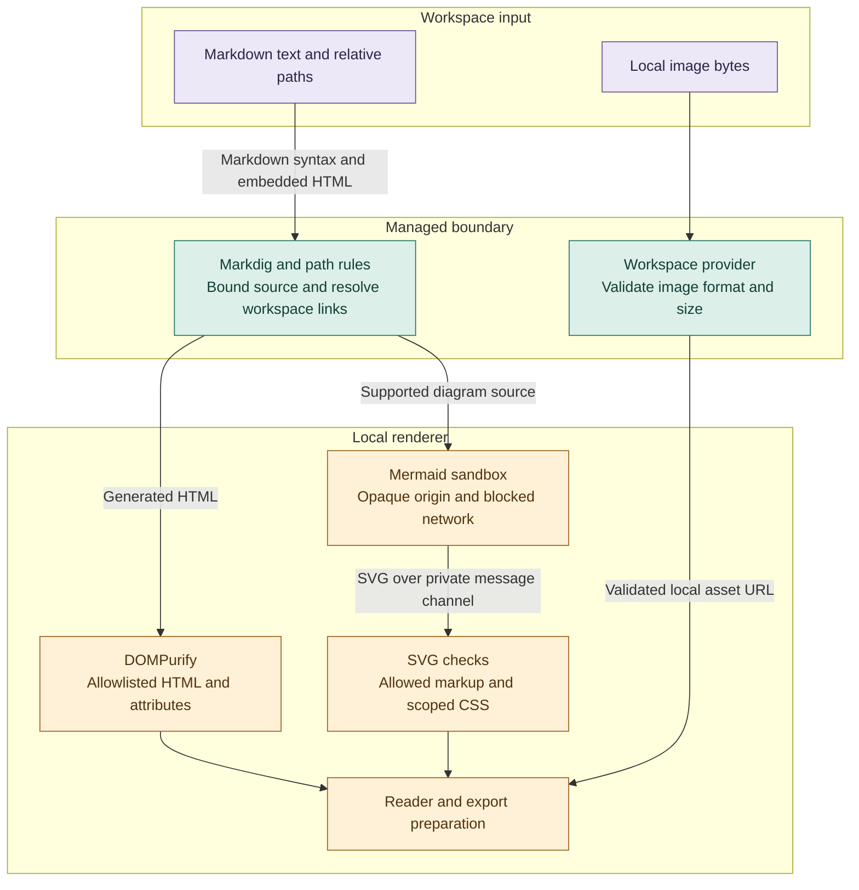

# Security and resource boundaries

These boundaries describe how MarkVibe handles documents, local files and network access.

## Untrusted document content

Markdig recognizes embedded HTML. The managed renderer hides comments and accepts only inert formatting tags, including `details` and `summary`, without any source attributes. Unsupported tags are displayed as text. The DOM adapter performs an independent DOMPurify allowlist pass, removes existing image sources and installs local asset URLs only after provider validation. Checkbox controls are disabled. Scripts, event attributes, embedded frames, objects and forms are not permitted.

External navigation allows explicit http, https and mailto URLs without credentials. External links open with noopener and noreferrer. Remote document images are not loaded. Document links, heading fragments and image references are decoded once in C#, then resolved inside the current workspace. File, data, JavaScript, scheme-relative and drive paths are blocked.

The reader and exporter render Mermaid in a sandboxed frame with an opaque origin. Its content security policy permits the bundled script by hash and blocks image requests, connections, fonts and other subresources while Mermaid measures and draws. The frame sends back sanitized SVG through a private channel. The receiver checks the SVG again before displaying or exporting it. Mermaid runs in strict mode with HTML labels disabled. An unsupported diagram leaves its source available.

Generated Mermaid styles retain bounded static CSS rules scoped to that diagram's id. Animation/import/other at-rules are discarded; style properties are allowlisted and external URLs, escaped CSS and executable values are rejected. This preserves node fills and readable labels without admitting document-supplied theme configuration.

Current-page HTML/PDF preparation reuses the same HTML, image and Mermaid validation, with separate aggregate export bounds. Supported images become data URLs and diagrams become sanitized inline SVG. The standalone document embeds no script and adds a restrictive CSP. Blocked/missing resources become visible notices. Only safe external and same-document anchor links retain navigation; neighboring Markdown pages are not included. PDF uses a separate WebView2 print host with scripts and messaging disabled. Neither exporter uploads content or writes the original workspace.

Local SVG assets retain allowlisted drawing and typography CSS, including inline
declarations and light/dark color-scheme rules. Styles remain inside the standalone
SVG image document. CSS imports, fonts loaded from URLs, other at-rules, scripts,
links, image references, filters, foreignObject and animation remain blocked.
Only local fragment URLs can reference gradients, clipping and markers. CSS is
limited to 64 KiB and 512 rules per image, in addition to the existing SVG size,
element and pixel limits. Accepted raster files must have supported signatures
and bounded header dimensions. Corrupt or unsupported images receive a useful error.

The shared SVG checks are `node tests/client/svg.mjs`. They use synthetic
fixtures in headless Edge without opening the application or reading user files.

## Native authority and local storage

C# owns workspace roots, files, navigation, revisions, AI requests and map state.
WebView2 loads only staged renderer assets at `https://markvibe-documents.invalid`.
Navigation and frame destinations are restricted. The top-level sender, protocol
version and per-instance capability are checked before native requests run.
Only `workspace.read`, `export.save`, `file.browser` and request cancellation are
accepted by this renderer boundary. No COM host object or general shell proxy is
exposed. The Win2D graph does not execute in WebView2.

Native path checks reject rooted and escaping paths, alternate streams, reserved
Windows names, UNC roots, junctions and reparse points. Links are decoded once;
provider filenames are not repeatedly decoded. Enumeration, parsing and indexing
are bounded and cancellable. Ambiguous normalized names are omitted with a notice.

Preferences, recent paths and the remembered root/document live in the application
profile. The renderer profile does not own these application records. Retired
browser site storage is neither migrated nor deleted. Original Markdown and
annotation files are not removed during frontend retirement or package upgrades.

## AI requests and credentials

The API-key and Codex CLI providers are explicit choices, with no silent fallback.
Settings validates a candidate key only through an explicit model-list check.
The accepted key is stored in the user environment, readable by processes running
as that user; it is not returned to the renderer. Provider status omits credentials.
The assistant can query account model availability when opened. Reading, map
navigation, local statistics and export do not send document contents.

An explicit AI action sends the captured document or selection, prompt and chosen
reference text, including token-count preflight. Collections retain at most 16
canonical Markdown paths, excluding the current editing target; each reference
is at most 1 MiB and combined reference source at most 4 MiB. References are
untrusted read-only content and do not authorize changing those files.

Requests have bounded input/output, cancellation and deadlines. Late replies must
match the captured workspace, document and revision before being accepted.
The CLI receives text through structured process arguments and standard input,
uses ephemeral temporary working data and terminates its child tree on cancellation.
Its read-only sandbox is a write restriction, not complete filesystem-read isolation.
No live credential or inference check is part of the local migration smoke test.

## Resource limits

| Resource | Bound |
| --- | --- |
| Workspace entries / Markdown pages | 4,096 / 1,024 |
| Markdown file / aggregate index input | 1 MiB / 8 MiB |
| Parsed blocks / inline nodes / headings / links | 2,048 / 32,768 / 512 / 4,096 |
| Rendered HTML | 3 Mi UTF-16 code units |
| Renderer inbound message / concurrent native calls | 45 Mi UTF-16 code units / 64 |
| Parsed page cache / edited sessions | 3 / 16 |
| Each undo/redo stack | 16 entries / 4,194,304 UTF-16 code units |
| Visible map projection | 120 nodes / 600 edges |
| Map sidecar | 1 MiB, current schema only |
| Source editor models | 3 |
| Image bytes / live blob budget | 8 MiB each / 32 MiB total |
| Image dimensions / pixels | 10,000 each dimension / 16,777,216 pixels |
| Aggregate leased image pixels / leases | 33,554,432 pixels / 96 |
| SVG source / elements | 256 KiB / 2,048 |
| SVG CSS / rules | 64 KiB / 512 |

Image reads reserve aggregate budget before allocation. Renderer owners release
leases and object URLs on replacement, navigation and disposal. These limits
reduce resource exposure; they are not exact heap measurements or hard GPU/CPU
timeouts for hostile content. Native animation work is bounded by the visible map.

## Saving and export

Map writes compare the loaded sidecar revision and commit by atomic replacement.
This detects external changes optimistically, without cross-process compare-and-swap.
Conflicts preserve the original and keep local edits available for reconciliation.
Current schema validation rejects unknown fields and invalid geometry atomically.

Edited Markdown lives in bounded managed sessions. Saving a copy is explicit and
does not overwrite the active original. Cache eviction cannot discard drafts.
HTML export embeds validated assets without executable page content. PDF rendering
uses an isolated script-disabled WebView2, local assets and restrictive CSP.
Cancellation before destination commit preserves the previous file; it cannot undo
an already completed atomic commit. Source files are never an export staging area.

Debug diagnostic options remain rejected in Release. Native UI smoke checks use
an isolated local profile and synthetic files, invoke only non-AI commands and
remove their fixture afterward. GUI acceptance and live AI provider acceptance
remain separate from those automated checks.
