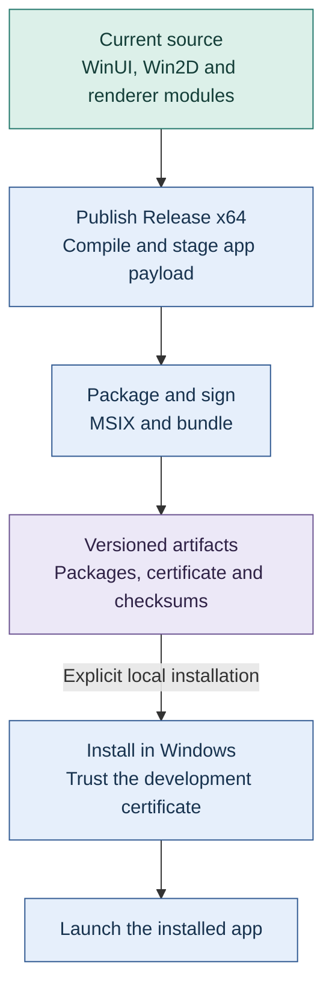

> **File name** `windows-packaging.md`<br>
> **Full path** `E:\vibekit\Apps\MarkVibe\docs\windows-packaging.md`<br>
> **Path relative to the MarkVibe application root** `docs/windows-packaging.md`

# Windows distribution

`scripts/package-windows.ps1` defaults to framework-dependent Windows 11 **x64 Release**
packages. Debug and ARM64 require an explicit selection. The desktop package
requires a separately installed .NET Runtime 10.0 and includes Windows App SDK application libraries. WebView2 uses the installed Evergreen Runtime.

## Requested Release or Debug build



Use PowerShell 7, existing Node >=22.12, a stable .NET 10 SDK >=10.0.402 and Windows SDK tools
`makeappx.exe`/`signtool.exe`. The script discovers tools already installed on the machine.

```powershell
./scripts/package-windows.ps1
# MSIX and bundle only:
./scripts/package-windows.ps1 -MsixOnly
# Explicit wider distribution:
./scripts/package-windows.ps1 -Configuration Release -Architectures x64,arm64
```

Each invocation writes the distribution under `artifacts/<build-id>/` and keeps
staging under `artifacts/.work/<build-id>/`. The build ID includes configuration,
version and a unique suffix. Private signing files live under the application's
ignored `obj/packaging-signing/` directory. Existing build outputs are available
for manual cleanup.

`packaging/windows/version.json` stores the last successful four-part version.
Default packaging increments its final component, across both configurations.
`-Version 0.1.1.0` selects a greater explicit version. Version metadata advances only
after packaging succeeds. Build settings include version, configuration and UTC
timestamp. The About dialog displays the running package or executable version.

Packaged applications contain `app/build-info.json` with the configuration,
architecture and build-host timestamp metadata. The local date and time text
uses the build host's culture and timezone.

By default, the script includes portable ZIPs and MSI installers for the selected
architectures. Both modes produce MSIX files, one MSIX bundle, a public development
certificate and installation helper for signed builds, README,
`BUILD-INFO.json` and `SHA256SUMS.txt`. No tests, installation, branch/worktree creation,
commit or publication are performed by this script. For local Release x64 delivery,
the owner has authorized closing MarkVibe, discarding unsaved in-app work,
trusting the generated MarkVibe certificate in LocalMachine/TrustedPeople and
installing/replacing the Release package without another confirmation. Remove an
old Debug installation when replacing it. Launch the
installed app afterward. This does not authorize deleting source documents or
unrelated data/certificates. Publication remains separate.
Run tests only when the owner explicitly requests them for the current task.

## Install the development bundle

Keep the bundle, `MarkVibe-Development.cer` and installation helper together.
Open PowerShell **as administrator** in that directory and run:

```powershell
./Install-MarkVibe.ps1 -TrustDevelopmentCertificate
```

This explicitly trusts the supplied certificate in LocalMachine/TrustedPeople and
installs the bundle for the current Windows user. Open MarkVibe from Start.
The bundle chooses x64 or ARM64. Once the certificate is trusted, double-clicking
the bundle is another installation route. Each build gets a fresh development
certificate; trust the CER supplied with that build. The private key is not distributed.
See Microsoft's [MSIX signing and certificate trust guidance](https://learn.microsoft.com/en-us/windows/msix/package/sign-msix-package-guide).

## Markdown file association

The MSIX helper and a full/reduced-UI MSI installation offer to use MarkVibe for
`.md` and `.markdown`. Choosing **Yes** opens Windows Default apps, where the
user selects MarkVibe for each extension. **No** keeps the existing defaults.
The response is remembered per Windows user and distribution, including updates.
The same choice remains available in Settings, alongside the effective default
status for each extension, even after answering No during installation.

Double-clicked MSIX installations and quiet MSI installations offer the same
choice at the first normal app launch. For an unattended MSIX helper run, use
`-SkipFileAssociationPrompt`. Portable and source builds do not register file
types or display this request. Repair and uninstall do not display it.

Windows controls the final default selection; the installer only registers an
available handler. See Microsoft's [Default Apps setup](https://learn.microsoft.com/en-us/windows/apps/develop/launch/launch-default-apps-settings).

## Portable

Extract the matching ZIP completely into a writable folder; run `MarkVibe.Windows.exe`.
`portable.flag` selects a sibling `data/` directory for the WebView2 profile, settings
and native session. `--data-dir` overrides it. Existing annotation sidecars are left
untouched; the application no longer edits ink or sticky notes.
The portable directory can be moved together with `data/`; remembered document paths
still refer to their original absolute locations.

## MSI installer

The same packaging command creates a real Windows Installer `.msi` for each
selected architecture, in addition to MSIX and portable. It uses Windows Installer
COM and the existing Windows `makecab.exe`; no additional packaging tool or EULA
acceptance is required. The MSI includes the framework-dependent app and licenses,
installs for the current user under LocalAppData, and creates a Start menu shortcut.
WebView2 Runtime remains a prerequisite. It is not installed by the MSI.

Debug/Release and x64/ARM64 have separate stable upgrade identities. The MSI
compares three version fields, so application version `major.minor.build.revision`
maps to `major.minor.(build * 1000 + revision)`; for example, `0.1.0.23` becomes
`0.1.23`. Packaging rejects revisions above 999 or values beyond MSI's numeric
limits before packaging. The four-part app version remains in build
metadata and the application's About window.

Open the MSI normally or use Windows Installer's standard command line:

```powershell
msiexec.exe /i "MarkVibe-<version>-release-win-x64.msi"
```

MSI upgrades replace the same channel/architecture; uninstall removes installed
payload files and shortcuts, retaining the separate user profile and source
documents. MSI and MSIX are separate products and can coexist. Local Release x64
delivery on this workstation continues to replace the existing MSIX; generating
an MSI does not establish its installation, upgrade or uninstall acceptance.
Do not install a second distribution implicitly.

The native authoring script and table definitions live under `packaging/windows/`.
Keep component identities stable across upgrades and never add wildcard deletion
of user data to the uninstall tables.

The separately installed **Microsoft .NET Runtime 10.0**, matching the package
architecture, is required. Obtain it from the [official .NET runtime download](https://dotnet.microsoft.com/en-us/download/dotnet/10.0/runtime).
Windows App SDK application libraries remain bundled; .NET itself is not bundled.
The installation helper reports missing runtime prerequisites before installation.

The payload contains the WinUI 3 executable and its compiled XAML resource index,
the Win2D map, and the local WebView2 document renderer with Monaco's worker and
the Mermaid frame. Packaging also places the app PRI at the MSIX resource index
path. The desktop project targets `net10.0-windows10.0.19041.0` and pins Windows SDK
reference pack `10.0.19041.57`. Keep the explicit desktop target and the Windows 11
minimum in the MSIX manifest.

## GitHub and Microsoft Store

The manual `windows-packages.yml` workflow accepts configuration and four-part
version, builds both architectures on one Windows runner, and uploads `artifacts/*`.
It contains no test or automatic-release step. Branch/worktree creation and publishing
remain separate, explicitly authorized operations.

For a future Store submission, use Partner Center's reserved package identity and
publisher. The local development identity is configurable through `-IdentityName`
and `-Publisher`; `-Unsigned` prepares files for later signing. Store distribution is
signed by Microsoft. See [manual desktop MSIX components](https://learn.microsoft.com/en-us/windows/msix/desktop/desktop-to-uwp-manual-conversion).

Installer acceptance means explicitly installing the generated package and trying
the app. Packaging success is not an installation result. Automated test execution
requires a separate current request.

> **File name** `windows-packaging.md`<br>
> **Full path** `E:\vibekit\Apps\MarkVibe\docs\windows-packaging.md`<br>
> **Path relative to the MarkVibe application root** `docs/windows-packaging.md`
