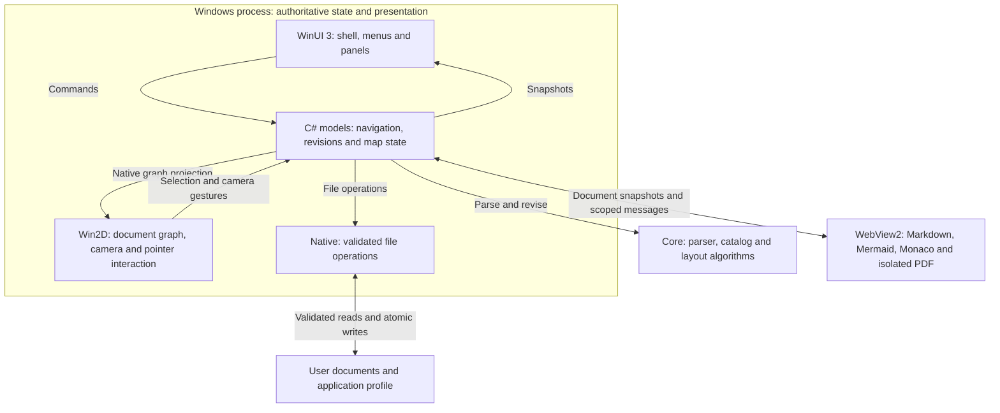

> **File name** `winui-migration-plan.md` 
> **Full path** `E:\vibekit\Apps\MarkVibe\docs\winui-migration-plan.md` 
> **Path relative to the MarkVibe application root** `docs/winui-migration-plan.md`

# Approved WinUI-only action plan

Approved by Umberto Giacobbi on 2026-11-22: retire the standalone browser edition
and OpenSilver; retain WinUI 3; create the implementation branch; run necessary
tests; build, install and launch a Release x64 MSIX. The owner also confirmed that
the document graph must remain native Windows for responsive interaction.

## Target boundaries

## Implementation sequence

```mermaid
flowchart LR
    Baseline[Build current source] -->|Known native baseline| Separate[Extract renderer assets]
    Separate -->|Independent desktop inputs| Remove[Retire browser projects and dedicated paths]
    Remove -->|WinUI-only source| Runtime[Use shared .NET Runtime 10.0]
    Runtime -->|Release payload| Verify[Run focused checks]
    Verify -->|Verified package| Install[Install and launch MSIX]
    Install -->|Running application| Owner[Owner GUI acceptance]
```

1. Establish native build readiness with existing stable .NET 10 and supported Node.
2. Preserve native commands, Core, Native, document renderers, licenses and user data.
3. Move renderer assets out of the retired browser tree and align all consumers.
4. Remove the two browser projects, WebAssembly bootstrap, web graph, browser-only
   workspace providers, tests, scripts and startup entries. Keep both solutions aligned.
5. Publish framework-dependent for .NET, retaining WinUI/Win2D application libraries.
6. Run Core, Native, renderer resource/SVG and native shell smoke checks with synthetic
   fixtures; then build, install and launch the final Release x64 MSIX.

## Completion and remaining authority

The result must have no OpenSilver runtime or standalone browser frontend and no
native dependency on their removed directories. Graph rendering stays in Win2D.
WebView2 remains restricted to document surfaces and PDF. Fresh package output must
come from current source and require the shared .NET Runtime 10.0.

Existing artifacts and application data are preserved. GUI acceptance remains with
the owner. Git merge, publication and Store submission are outside this approval.
The current work list and latest-delivery summary describe outstanding acceptance;
check results are reported in the conversation instead of retained validation journals.

> **File name** `winui-migration-plan.md` 
> **Full path** `E:\vibekit\Apps\MarkVibe\docs\winui-migration-plan.md` 
> **Path relative to the MarkVibe application root** `docs/winui-migration-plan.md`
