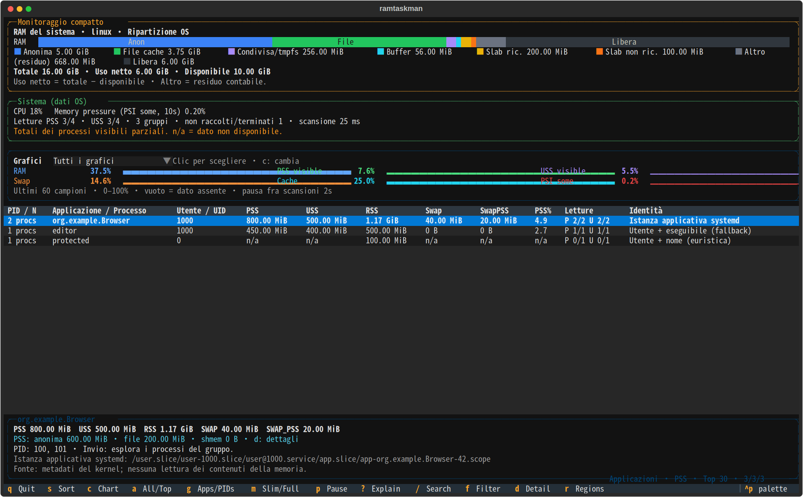
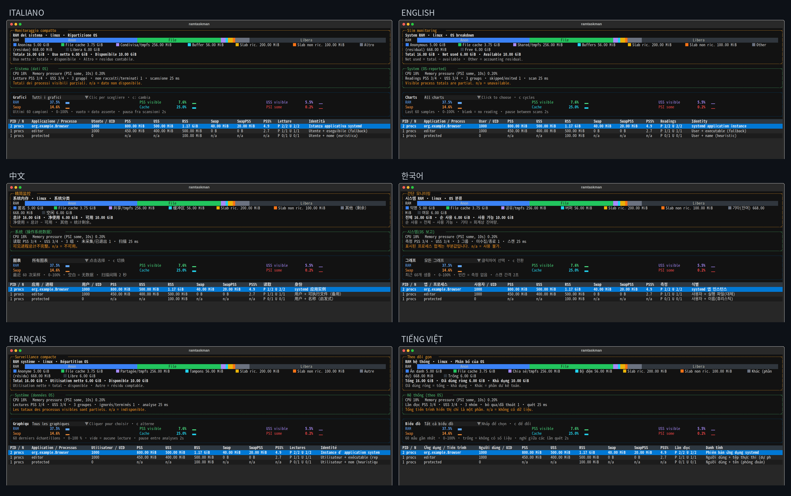

# Ram Taskman

### Your RAM has a job. Find out who hired it.

Ram Taskman puts system memory, applications, individual processes and memory history
in one terminal. Start with a compact overview, follow the biggest users, then open
the details that explain what a number actually means.

An experimental **VibeWare** tool for **Linux and Windows**, built with Python and Textual.



[Italiano](docs/i18n/README.it.md) · [中文](docs/i18n/README.zh.md) · [한국어](docs/i18n/README.ko.md) · [Français](docs/i18n/README.fr.md) · [Tiếng Việt](docs/i18n/README.vi.md) · [Español](docs/i18n/README.es.md) · [Português](docs/i18n/README.pt.md) · [Deutsch](docs/i18n/README.de.md) · [日本語](docs/i18n/README.ja.md)

## From “where did my memory go?” to a useful answer

- **See the whole machine.** System RAM, available memory, cache and history,
  with compact and full diagnostic views.
- **Follow an application.** Group related processes, inspect individual PIDs,
  search by name, executable or PID, and filter the available readings.
- **Understand shared memory.** Inspect RSS and private resident memory (USS),
  plus proportional shared-memory accounting (PSS) and process swap on Linux.
- **Look closer without reading memory contents.** Explore Linux memory mappings;
  Windows offers an experimental view of virtual address ranges.
- **Keep a before and after.** Compare two captures, save them locally and reopen
  them offline. Missing values stay `n/a`, never a reassuring but invented zero.

## Your apps called. They want more RAM. 🧾

Put a price next to the memory an app occupies. Enter the price of your machine's
RAM and Ram Taskman calculates the hardware value represented by each measurable
application or process, using the current reading:

```bash
./run.sh --ram-price 320 --ram-currency EUR
./run.sh --ram-price 320 --ram-currency EUR --ram-months 36
./run.sh --json --ram-price 320 --ram-currency EUR --ram-months 36
```

The default denominator is **RAM visible to the operating system**, which may be
smaller than the capacity printed on the box. If your price covers a nominal
32 GiB kit, add `--ram-capacity-gib 32`.

`hardware value = RAM price × attributable bytes / RAM capacity`

`--ram-months` divides that value over your chosen number of months. It is a way
to think about a hardware purchase, not a bill, an electricity estimate or a
promised saving. A current snapshot is not a monthly average. Prices are entered
by you: there is no automatic price feed or network request.

**Shared pages are not charged twice.** Linux uses PSS to apportion shared memory;
Windows uses USS and therefore values only private resident memory. There is no
fallback to RSS. Incomplete groups and unavailable readings remain `n/a` (`null`
in JSON). App groups and their constituent processes are alternative views: do
not add them together. Kernel, cache and inaccessible processes are not arbitrarily
charged to an app or to the operating system. Sampling is sequential, not atomic.

## Ten languages, one familiar interface

English, Italian, Simplified Chinese, Korean, French, Vietnamese, Spanish,
Portuguese, German and Japanese are available with `--language`:

```bash
./run.sh --language en
./run.sh --language it --ram-price 320 --ram-currency EUR
```

The dashboard, detail and region views, filters, capture dialogs, metric help,
footer shortcuts and core CLI messages are localized. New RAM-price option help
and some About text still use English. Technical identifiers and operating-system
messages remain as supplied by their source.



## Run it

You need **Python 3.11+** and [uv](https://docs.astral.sh/uv/). Linux also needs
`/proc` and `smaps_rollup`. The first run downloads locked dependencies; launchers
keep the environment and cache inside this project folder.

```bash
git clone https://github.com/umbertotechnopreneur/VibeKit.git
cd VibeKit/Apps/RamTaskman
./run.sh
```

On Windows, open the project folder in **Windows Terminal** and run:

```powershell
.\run.cmd
```

Use `--once` for a single terminal report or `--json` for structured output. The
package is not published on PyPI. Recreate `.venv` locally when moving the project
between operating systems.

**Useful keys:** `m` changes view, `g` toggles apps/processes, `/` searches, `f`
filters, `d` opens details, `r` opens regions, `?` explains metrics and `q` quits.
**F1** opens About, including VibeWare, the project website and acknowledgements.
Esc returns to the running monitor.

## Know what the numbers can tell you

| Capability | Linux | Windows |
|---|---|---|
| System RAM, RSS and USS | Available where readable | Available where readable |
| PSS and per-process swap | Available where readable | `n/a` |
| Memory regions | On-demand `smaps` mappings | Experimental virtual ranges |
| Native validation | Local Linux checks | Requires Windows validation for this integration |

Permissions can limit visibility and app grouping is heuristic. RSS may count
shared pages more than once. Summed process PSS is not total system RAM; cache and
available memory overlap. Per-process swap is not inferred from commit. Bars show
shares of usage, not physical memory addresses. Process identities use native
name/executable reads without command-line fallback.

**macOS is not supported.** We do not have a Mac for development and validation;
contributors willing to own that work are welcome. Live collection is intentionally
disabled on macOS and the CI matrix contains Linux and Windows only.

The [technical guide](docs/guida.md), [counter audit](docs/audit-contatori-piattaforma.md)
and [architecture](docs/architecture.md) give more detail; these documents are
currently in Italian. Images in this repository show the actual Textual interface
with synthetic process data, so no private machine details are published.

## Develop and check

From this folder:

```bash
uv sync --locked
uv run --locked python -m unittest discover -s tests -v
uv build
uv run --locked python tools/verify_distribution.py
```

In VibeKit, the root dispatcher invokes `.github/workflows/ci-ramtaskman.yml` when
this app changes. It checks Python 3.11, 3.13 and 3.14 on Linux and Windows,
including an isolated wheel installation and offline replay.

## Thank you, Scott Hanselman

[Scott Hanselman](https://github.com/shanselman)'s
[GPU Taskman](https://github.com/shanselman/gputaskman) inspired this project.
Ram Taskman reuses parts of its terminal interface and adapts them to RAM
monitoring. It is an independent project. The original MIT copyright and
[reuse notes](docs/upstream.md) are preserved.

Created by [Umberto Giacobbi](https://umbertogiacobbi.biz/), as part of
[VibeWare](https://umbertogiacobbi.biz/vibeware/). [MIT license](LICENSE).
Translations were prepared with AI assistance; corrections from native speakers
are welcome.
