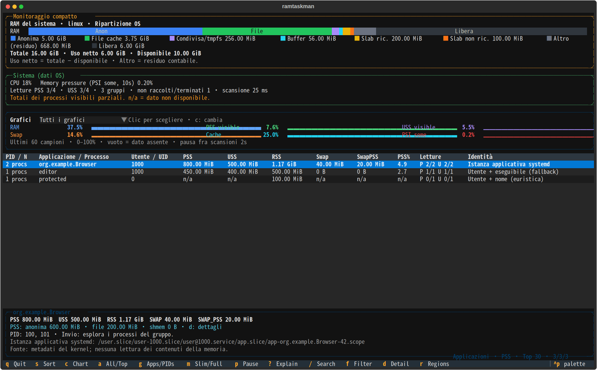
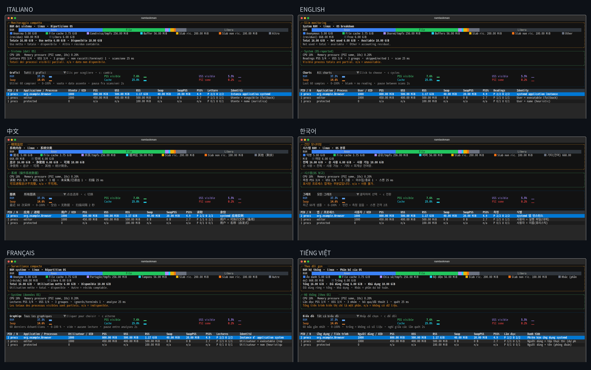
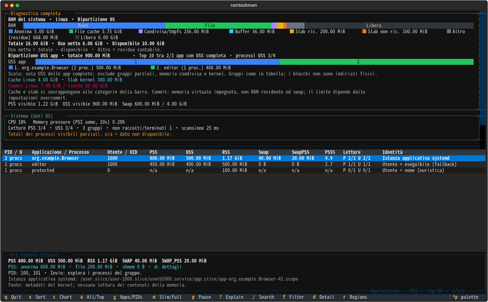
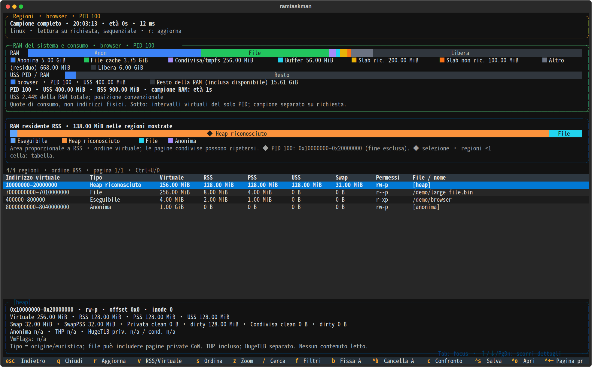

# ramtaskman

[Italiano](README.it.md) · [English](../i18n/README.en.md) · [中文（简体）](../i18n/README.zh.md) · [한국어](../i18n/README.ko.md) · [Français](../i18n/README.fr.md) · [Tiếng Việt](../i18n/README.vi.md) · [Español](../i18n/README.es.md) · [Português](../i18n/README.pt.md) · [Deutsch](../i18n/README.de.md) · [日本語](../i18n/README.ja.md)

### Capire dove va la RAM, direttamente dal terminale.

**ramtaskman** è un monitor sperimentale della memoria per Linux e Windows.
macOS non è supportato: non dispongo di un Mac per sviluppare e verificare il supporto. I contributi di chi desidera occuparsene sono benvenuti.

Nasce dalla voglia di capire meglio cosa succede alla RAM passando da un sistema
all’altro, senza dover aprire strumenti complicati. È un progetto **Vibeware**:
un’idea personale nata per curiosità e ricerca, diventata uno strumento utile
nel lavoro di tutti i giorni.



*Schermata dell’interfaccia reale catturata su Linux con dati dimostrativi sintetici.*

## Cosa puoi fare

1. **Vedere la RAM a colpo d’occhio.** Barra del sistema, memoria disponibile,
   cache e grafici storici in una UI da terminale, con modalità Slim e Full diagnostics.
2. **Esplorare app e processi.** Passa dai gruppi ai singoli PID e ordina le righe
   per le metriche disponibili, con indicazione della copertura delle letture.
3. **Capire le metriche.** Consulta RSS e USS; su Linux anche PSS, swap e SwapPSS,
   con dettaglio delle componenti e spiegazione dei valori mancanti.
4. **Trovare ciò che cerchi.** Ricerca per nome, eseguibile o PID e filtra per
   utente, swap e dati parziali.
5. **Navigare le regioni di memoria.** Su Linux esplora le mappature di un processo,
   i loro indirizzi virtuali e la residenza; su Windows la vista virtuale è sperimentale.
6. **Confrontare e salvare acquisizioni.** Fissa un campione A, raccogli B e confronta
   le variazioni; salva e riapri acquisizioni locali anche offline.

## Una dashboard, più lingue



*Schermate catturate su Linux con dati sintetici. La localizzazione dell’app è in corso:
dashboard, dettagli, regioni, guida, controlli e CLI sono tradotti in dieci lingue.
Le nuove opzioni per il valore della RAM e alcuni messaggi About restano in inglese.*

## Uno sguardo dentro

**Full diagnostics** aggiunge la ripartizione della RAM, la barra USS delle app con
letture complete e i contatori disponibili per il sistema operativo.



**Mappa delle regioni**: scegli un processo per esplorarne le mappature e i relativi
contatori, senza leggere il contenuto della sua memoria.



Le immagini sono catturate su Linux dall’applicazione Textual con processi, percorsi e
numeri sintetici: sono esempi illustrativi, non misure del computer di sviluppo.

## Provalo

Servono **Python 3.11 o superiore** e [uv](https://docs.astral.sh/uv/). Su Linux
servono `/proc` e `smaps_rollup`. I launcher creano ambiente e cache nella cartella
del progetto; al primo avvio l’installazione delle dipendenze richiede rete.

```bash
git clone https://github.com/umbertotechnopreneur/VibeKit.git
cd VibeKit/Apps/RamTaskman
./run.sh
```

Su Windows, dalla cartella del progetto, usa **Windows Terminal** e avvia:

```powershell
.\run.cmd
```

Per un singolo campione o per l’output JSON: `./run.sh --once` e `./run.sh --json`
su Linux, oppure `.\run.cmd --once` e `.\run.cmd --json` su Windows.
Il progetto non è pubblicato su PyPI. Non condividere la stessa `.venv` tra sistemi:
ricreala localmente dopo aver copiato il progetto.

La lingua dell’interfaccia e della CLI è selezionabile con `--language`, per
esempio `./run.sh --language zh`. Codici disponibili: `it`, `en`, `zh` (cinese
semplificato), `ko`, `fr`, `vi`, `es`, `pt`, `de`, `ja`. Su Windows usa ad esempio
`.\run.cmd --language ko`. Le nuove opzioni per il valore della RAM e alcuni messaggi About sono ancora in inglese.

**Scorciatoie utili:** `m` cambia modalità, `g` alterna app e processi, `/` cerca,
`f` filtra, `d` mostra i dettagli, `r` apre le regioni, `?` spiega le metriche e
`q` chiude il programma. La [guida completa](../guida.md) descrive tutti i controlli.

## Sperimentale, con i numeri in chiaro

Questo progetto è nato per ricerca e curiosità: usalo con spirito critico. Le misure
sono raccolte in momenti diversi, i permessi possono limitare la visibilità e il
raggruppamento delle applicazioni non è infallibile. Un valore non disponibile è
mostrato come **n/a**, non come zero.

| | Linux | Windows |
|---|---|---|
| RAM globale, RSS e USS | Disponibili | Disponibili |
| PSS e swap per processo | Disponibili se leggibili | n/a |
| Mappa regioni | `smaps`, su richiesta | Intervalli virtuali, sperimentale |
| Verifica su hardware | Eseguita localmente | Da verificare |

PSS non equivale alla RAM totale usata; RSS può contare più volte pagine condivise.
Cache e memoria disponibile si sovrappongono. La swap per processo non viene dedotta
dal commit. Le barre descrivono quote di consumo, non indirizzi fisici. I dettagli e
le altre limitazioni sono nella [guida](../guida.md) e nell’[audit dei contatori](../audit-contatori-piattaforma.md).

## Ispirazione e ringraziamenti

**Grazie a [Scott Hanselman](https://github.com/shanselman) e a [GPU Taskman](https://github.com/shanselman/gputaskman)**:
la sua interfaccia terminale e il suo progetto sono stati un’ispirazione concreta.
ramtaskman ne riutilizza parti e ne adatta l’impostazione alla memoria RAM; è un
progetto indipendente, non una release ufficiale di GPU Taskman. Provenienza e dettagli
del riutilizzo sono documentati in [docs/upstream.md](../upstream.md).

Distribuito sotto [licenza MIT](../../LICENSE), con il copyright originale conservato.

Traduzioni preparate con assistenza AI: sono gradite correzioni da traduttori e madrelingua.

## Valore della RAM e quota mensile

```bash
./run.sh --ram-price 320 --ram-currency EUR
./run.sh --ram-price 320 --ram-currency EUR --ram-months 36
./run.sh --json --ram-price 320 --ram-months 36
```

Il prezzo è quello dell’intera RAM della macchina, inserito da te: nessun listino
automatico né richiesta di rete. La capacità predefinita è quella visibile al sistema
operativo, che può essere inferiore alla capacità fisica nominale. Se il prezzo riguarda
un kit da 32 GiB, puoi specificare `--ram-capacity-gib 32`.

Valore = prezzo × byte attribuibili / capacità. `--ram-months` divide questo valore
per il numero di mesi scelto: è una quota del costo hardware, non una bolletta, un
consumo energetico o un risparmio garantito. La quota corrente non è una media mensile.

Linux usa PSS, che ripartisce le pagine condivise; Windows usa USS, quindi valuta
solo la memoria privata residente ed esclude quella condivisa. Nessun fallback a RSS.
I gruppi incompleti o non misurabili rimangono n/a (null nel JSON). Non sommare i
valori delle app con quelli dei processi che le compongono, né con la memoria del
sistema. Cache, kernel e processi inaccessibili non vengono attribuiti arbitrariamente
a Windows o ad altre app. I campioni sono sequenziali, non atomici.

La colonna del valore segue le misure reali durante il monitoraggio; l’inspector
indica la metrica usata. JSON aggiunge `ram_valuation` solo quando richiesto.

Premi **F1** per l’About: VibeWare, Umberto Giacobbi, sito, ringraziamenti a Scott
Hanselman e riferimenti alla provenienza MIT. Esc chiude senza fermare il monitor.
