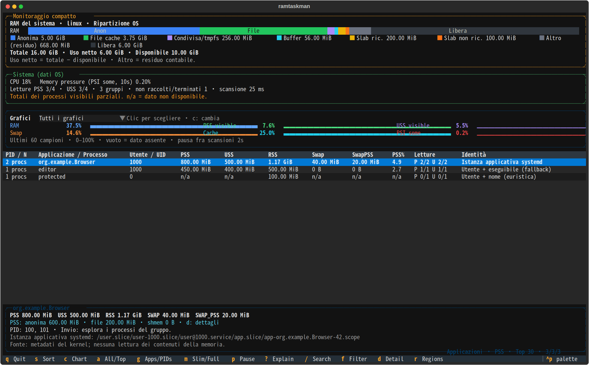
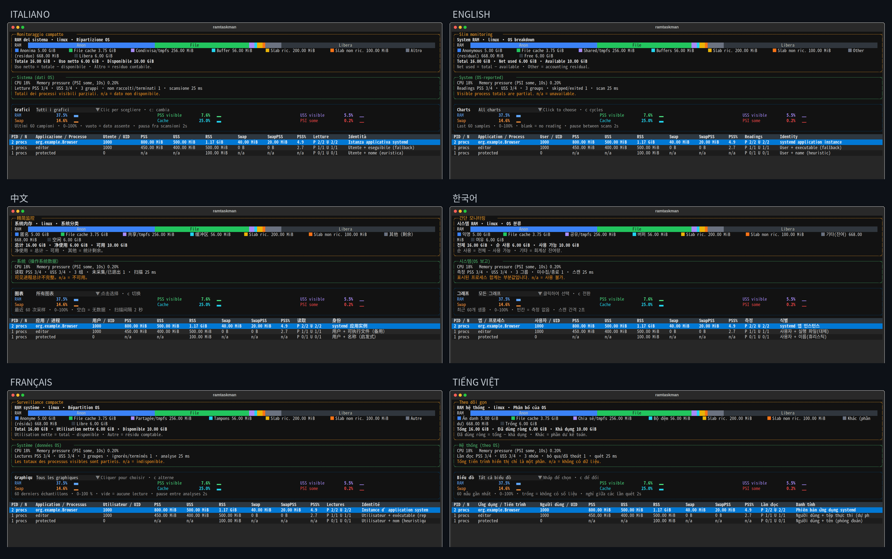
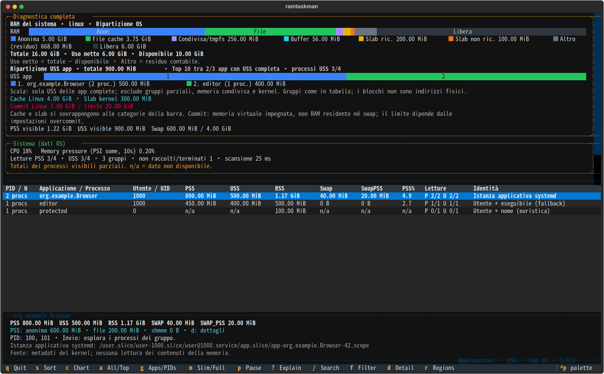
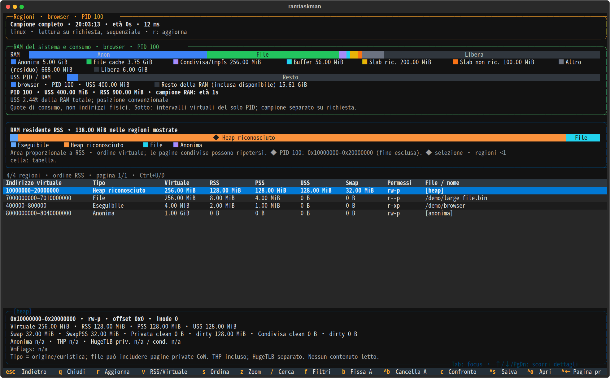

# ramtaskman

[Italiano](README.it.md) · [English](README.en.md) · [中文（简体）](README.zh.md) · [한국어](README.ko.md) · [Français](README.fr.md) · [Tiếng Việt](README.vi.md) · [Español](README.es.md) · [Português](README.pt.md) · [Deutsch](README.de.md) · [日本語](README.ja.md)

### Entenda para onde vai a RAM, direto no terminal.

ramtaskman é um monitor experimental de memória para Linux e Windows. Nasceu da curiosidade e da pesquisa para entender a memória em diferentes sistemas sem recorrer a ferramentas complicadas. É um projeto Vibeware.



*Interface Textual real capturada no Linux com dados sintéticos de demonstração. As imagens mostram a interface italiana atual.*




*As capturas mostram uma etapa anterior da tradução. A aplicação agora oferece dez idiomas.*

## O que você pode fazer

1. Veja RAM, memória disponível, cache e histórico; escolha o modo Slim ou diagnóstico completo.
2. Explore aplicativos e processos, ordene métricas disponíveis e confira a cobertura das leituras.
3. Consulte RSS e USS; no Linux, também PSS, swap e SwapPSS, com detalhes e dados ausentes indicados.
4. Pesquise por nome, executável ou PID exato e filtre por usuário, swap ou dados parciais.
5. Explore regiões de memória no Linux; a visualização virtual do Windows é experimental.
6. Compare duas amostras e salve ou abra capturas locais, inclusive offline.

## Por dentro





## Como começar

São necessários Python 3.11+ e uv. No Linux, são exigidos /proc e smaps_rollup. A primeira execução precisa de rede para instalar as dependências fixadas. Ambiente e cache ficam no projeto.

```bash
git clone https://github.com/umbertotechnopreneur/VibeKit.git
cd VibeKit/Apps/RamTaskman
./run.sh
```

No Windows, na pasta do projeto e usando o Windows Terminal:

```powershell
.\run.cmd
```

Use --once ou --json para uma leitura única ou saída JSON. Não compartilhe .venv entre sistemas: recrie-o localmente. O projeto não está publicado no PyPI.

Atalhos: m troca o modo, g alterna aplicativos/processos, / pesquisa, f filtra, d mostra detalhes, r abre regiões, ? explica as métricas e q sai. O guia técnico completo está atualmente em italiano.

`./run.sh --language pt` · Windows: `.\run.cmd --language pt`

A interface, o rodapé, a ajuda, as mensagens principais da CLI e os diagnósticos da aplicação estão disponíveis em dez idiomas. As novas opções de valor da RAM e alguns textos de Sobre continuam em inglês.

[RAM valuation and current validation status (English)](../../README.md)

## Experimental: interprete os números com cuidado

As leituras são sequenciais, permissões podem limitar a visibilidade e o agrupamento de aplicativos é heurístico. Dados ausentes são n/a, não zero. RSS pode contar páginas compartilhadas mais de uma vez; PSS dos processos não é toda a RAM. Cache se sobrepõe à memória disponível. Swap por processo não é deduzida do commit.

Linux fornece PSS e swap por processo quando legíveis; aqui o Windows não os expõe. Linux usa smaps e Windows mostra intervalos virtuais experimentais. A verificação local foi feita no Linux; Windows precisa de validação. macOS não é suportado porque não tenho um Mac para desenvolver e testar. Contribuições para manter esse suporte são bem-vindas.

## Inspiração e agradecimentos

Obrigado a Scott Hanselman e ao GPU Taskman pela inspiração. ramtaskman reutiliza partes do projeto e adapta sua interface de terminal à RAM; é independente e não é uma versão oficial. [Scott Hanselman](https://github.com/shanselman) · [GPU Taskman](https://github.com/shanselman/gputaskman) · [Provenance](../upstream.md)

Traduções preparadas com ajuda de IA. Correções de tradutores e falantes nativos são bem-vindas.

[Guia técnico completo (italiano)](../guida.md) · [Licença MIT; copyright original preservado.](../../LICENSE)
