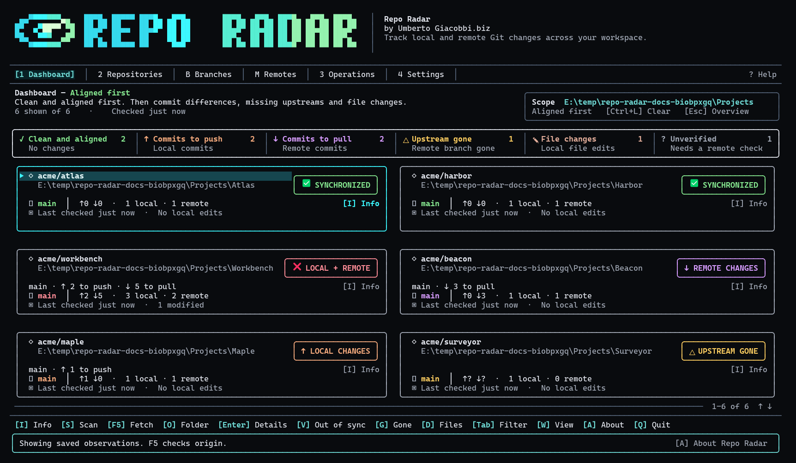
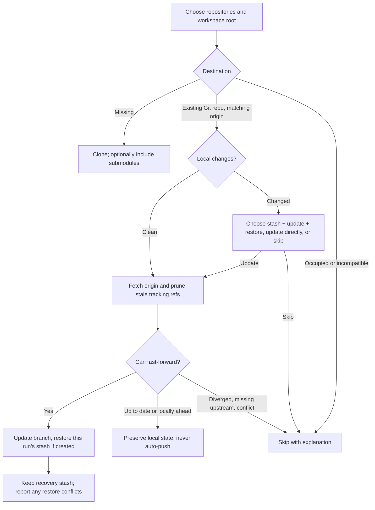

> **File name:** `README.md`<br>
> **Full path:** `E:\vibekit\Apps\RepoRadar\README.md`<br>
> **Path relative to the VibeKit repository:** `Apps/RepoRadar/README.md`

# Repo Radar

Repo Radar is a full-screen Git dashboard **by Umberto Giacobbi.biz**. Choose a disk or a folder to see which working trees need attention, including repositories nested inside other projects. Built in C# with Spectre.Console and SQLite. [Umberto Giacobbi](https://umbertogiacobbi.biz) · [MIT license](LICENSE).



See the [repository table](docs/screenshots/repositories.png), [plain-English repository summary](docs/screenshots/repository-info.png) and [About dialog](docs/screenshots/about.png).

## Open Repo Radar 0.3.0

| Distribution | Start |
| --- | --- |
| Windows x64 MSI | Open `RepoRadar-0.3.0-win-x64.msi` and install for the current user. Open **Repo Radar** from Start. |
| Windows x64 portable ZIP | Extract `RepoRadar-0.3.0-win-x64-portable.zip` into a writable folder and open `repo-radar.exe` or `repo-radar.cmd`. The portable folder holds its own data. |
| Debian amd64 | With the Microsoft .NET package source configured, run `sudo apt install ./repo-radar_0.3.0-1_amd64.deb`, then `repo-radar`. The package declares Git, libsqlite3 and the .NET 10 runtime as dependencies. |

Users who already have a compatible shared Microsoft .NET 10 Runtime can use the framework-dependent installer or ZIP immediately. Install the Microsoft .NET 10 Runtime for x64 separately if it is missing. [Microsoft .NET 10 downloads](https://dotnet.microsoft.com/en-us/download/dotnet/10.0) · [Git for your platform](https://git-scm.com/downloads).

The Windows MSI upgrades the previous per-user installation. The Debian package replaces the previous package identity. The first run can bring existing installed workspace data forward. See [Index and catalog](#index-and-catalog).

## Read the disk at a glance

Press **O** to choose a drive, folder or a file whose containing folder you want to scan. At the scan prompt, press **Enter** to discover repositories and check the remote, or **L** to inspect local data only. The scan dialog shows animated dots, the current location and live counts over the repository table. Newly discovered working trees appear as rows while Git inspection is pending. Each nested working tree with its own `.git` gets its own row and tile. The scan skips generated folders, system folders and directory links.

`WorkspaceViewModel` projects repository status, table rows and counts. `WorkspaceScanSession` assembles discovery and inspection events into a snapshot for the terminal to render.

The dashboard opens in **Aligned first**. Clean repositories with a verified matching branch come first in green. The following cards show verified commit differences, missing upstreams, local file changes and repositories that need a remote check. **V** shows just the repositories with commits to push or pull. **W** cycles through framed tiles, the repository table and compact tiles. A repository can contribute to more than one counter.

On large terminals, Standard and Wide tiles give paths and branch names room to wrap. The status counters show explanations when there is room, then reduce to short labels or status symbols and counts as the terminal narrows.

| Color | What the repository needs |
| --- | --- |
| Green | Clean files and an aligned tracked branch, with no detected drift on secondary branches. |
| Violet | Commits to pull from a verified upstream. |
| Orange | Commits to push to a verified upstream. |
| Red | Commits in both directions. Open the repository for the affected branch or branches. |
| Amber | A previously tracked remote branch is confirmed missing. The branch inventory lists other branches under **B**. |
| Muted rose | Local files are modified or untracked. |
| Gray | The remote comparison is unavailable, failed or has yet to be verified. |

Each tile starts with the remote repository name and checkout path. The **Commits** line names the affected branch and shows its push and pull counts. The **Files** line reports working-tree changes. Open the details for all named branch differences and the time of the remote check. **F5** fetches fresh remote references. A local-only scan keeps cached branch observations and marks the remote comparison unverified. Saved snapshots from before exact-ref verification also need a fresh check before they can show green.

The file and folder picker shows an expandable drive tree next to the directory contents. **Tab** switches panes, **Enter** opens a folder or selects a file, **Space** chooses the highlighted entry, and **G** accepts a path. **Import catalog** uses the same picker to open the selected JSON file for validation.

| Key | Action |
| --- | --- |
| Arrows, PgUp, PgDn, Home, End | Navigate the grid. Its columns reflow when the terminal changes size. |
| Enter | Open the selected repository. |
| I | Explain the selected repository in plain English. Read per-branch commit differences, missing upstreams, and local changes. Use the arrow keys or Page Up and Page Down to scroll, and Esc to close. |
| V | Switch between the overview and repositories with verified commit differences. |
| W | Switch between framed tiles, the table and compact tiles. |
| G | Show only repositories with an upstream verified as gone. |
| D / B / M | Filter to local file changes / open the Branches tab / open the Remotes tab. |
| 1 / 2 / 3 / 4 | Open the dashboard / repository table / Operations popup / tile settings. |
| Space or X / Y | Mark or unmark the focused checkout / show only marked checkouts. |
| Ctrl+A / Ctrl+X | Mark every checkout in the current filtered view / clear the marks. |
| Shift + navigation | Mark the range between the old and new focus. |
| N | Jump to the next visible repository with local changes, incoming commits or a branch to review. |
| F / Tab | Find by name, path, remote or branch observation / cycle through conditions. A repository can appear in more than one filter. |
| P / H | Pin or unpin the selected repository / hide or restore it. |
| L | Preview tile density, sort order, favorites and visible fields. Arrow keys navigate, Space edits, Enter saves, Escape cancels, and R loads the defaults into the preview. |
| T | Open the existing clone, update, catalog and branch tools. |
| F1 or ? | Open Help. Use Left and Right or 0–4 to choose a topic, Up and Down to scroll, and Esc to return. |
| A | Open About. G opens GitHub, M opens the VibeWare manifesto, and U opens Umberto Giacobbi's site. |
| Esc / Ctrl+L / Q | Close a dialog or return to the overview / clear the search and return to the overview / quit. |

## Reuse the terminal controls

The [file and folder picker](src/TerminalPathPicker.cs) returns an absolute path or `null` on cancel. The [console widgets](src/ConsoleWidgets.cs) accept styles and content from their host, including an optional logo renderer for About. Both use the same [terminal grid](src/DashboardTerminal.cs) and its Unicode cell layout.

## Index and catalog

`workspace.sqlite3` holds one committed snapshot per scan root. Cancelling a scan preserves the previous complete snapshot. Repo Radar records the Git object ID at HEAD in the repository's native object format. It also calculates **CRC32 and SHA-256** for the Git metadata it reads, including HEAD, index, config and relevant refs. The index retains digests and paths for Git metadata.

`dashboard.json` stores layout and root preferences. The workspace tools use `repos.json` for portable remote URLs and relative paths and `settings.json` for machine preferences. Opening workspace tools adds eligible discovered repositories to the catalog and preserves existing entries. Export the catalog, then import it on another computer and choose its destination root. The distributions ship without a personal catalog.

Installed builds keep data in `%LOCALAPPDATA%\RepoRadar` on Windows and in `$XDG_DATA_HOME/repo-radar` on Linux, defaulting to `~/.local/share/repo-radar`. The portable Windows executable uses its own folder. Set `REPO_RADAR_DATA` to an absolute writable directory to reuse a saved workspace or open a separate test workspace. Select an existing catalog with `--catalog`.

When the new installed data folder is first created, Repo Radar copies eligible data from the previous default installed location. To reopen state saved in a custom or portable directory, point `REPO_RADAR_DATA` to it.


## Synchronization



- Updates use `fetch --prune` followed by a fast-forward-only merge of the fetched upstream commit. They never rebase, reset or auto-push. Ignored-file collisions stop the update rather than overwriting those files. Pruning removes stale **local remote-tracking references**; it does not delete local branches or branches on GitHub. See the [Git merge options](https://git-scm.com/docs/git-merge).
- With local changes, choose **Stash, pull, restore**, **Pull without stashing**, or **Skip**. The stash includes untracked files and is restored with its index. Git may refuse direct updates when files overlap. Ignored files are not included in a stash. Git's normal line-ending and filter rules still apply.
- Recovery stashes are retained even after successful restoration. Inspect with `git stash list`; after verifying your work, remove the specific backup yourself. On conflicts or cancellation, inspect `git status` before attempting another restore.
- Detached HEAD, absent or non-origin upstream, origin mismatch, active merge/rebase/cherry-pick/bisect, unresolved conflicts and changed submodules require manual attention. Shallow histories may require deepening before fast-forward checks can succeed.
- Existing submodules are not automatically updated or stashed. New clones can initialize them recursively. Private remotes use existing Git Credential Manager or SSH-agent credentials. Authenticate and accept SSH host keys before running Repo Radar. Git runs without interactive credential prompts.
- Repositories are processed sequentially, with parent paths first. Nested entries already created by a parent clone are re-inspected. Duplicate destinations and paths escaping the root are rejected. Workspace paths through symbolic links or junctions are unsupported.

## Operations on marked repositories

`[X]` marks a checkout for operations and `▶` shows keyboard focus. Marks follow the local checkout path across Dashboard, Repositories, Branches and Remotes. The footer counts marks outside the current view.

Press **3**, select an action, and press **Enter** to build a read-only preview. The preview shows exact checkout paths and applicable branches and remotes, with reasons for skipped entries. Press **Enter** on the review to confirm the plan, then **R** on the final prompt to run it. Use **Esc** to go back or stop a running plan after the active checkout. For a mixed plan, use **A** to queue an action for the current marks. Each checkout has one queued action. **R** opens a review of the queue from the action picker.

- **Prune tracking refs** removes the verified stale local references listed in the review. Branch deletion is available through the separate branch cleanup tools.
- **Pull** updates the checked-out branch by fast-forward. The plan flags local changes, unknown tracking and any divergence it can verify.
- **Commit only** and **Commit → Push** use the staged files listed in the plan and the message you enter. In the combined action the push follows a successful commit. **Push only** uses the existing checked-out commit. Pushes use the exact tracked remote branch and skip duplicate destinations.
- **Stash only** saves local changes. **Stash → Pull** saves them and, when needed, fast-forwards the branch. Use **U** to include untracked files. Created stashes remain available for manual application by the reference shown in the results.

## Branch cleanup

The separate **Branch cleanup** menu offers tracking-reference prune, merged local-branch deletion and merged origin-branch deletion. It fetches first and lists only branches integrated into the verified remote default branch. The default branch, common protected names (`main`, `master`, `develop`, `development`, `dev`, `trunk`, `production`, `release`, `release/*`) and names checked out in any local worktree are excluded.

Deletion requires checkbox selection and typing `DELETE N`. Local deletion uses `git branch -d`, never `-D`. Remote deletion verifies matching fetch/push destinations and uses a lease on the selected branch SHA so an updated server branch is not silently deleted. Server-side protection rules still apply. Unmerged branches are deliberately left for manual review.

## Engineering documentation

[Technical guide](docs/technical-guide.md) · [Code review and verification](docs/code-review.md)

## Build from source

The project targets .NET 10. From this folder, `dotnet run --project src/RepoRadar.csproj` starts the dashboard. Set `--root` after `--` to choose the starting location. Use `--tools` for the workspace tools or `--self-test` to exercise Git and SQLite using local test repositories.

On Windows with the .NET 10 SDK, Python 3 and PowerShell:

```powershell
./build.ps1 -Channel Portable
./build.ps1 -Channel Debian
pwsh -File ./packaging/windows/Build-Msi.ps1
```

The MSI builder uses WiX 3.14 and PowerShell 7.2 or newer. `./build.ps1 -Channel All` runs all three builders. Packages are written to `artifacts/dist` and `artifacts/msi`. See the [terminal design guide](docs/design/console/README.md) for the layout and brand.

> **File name:** `README.md`<br>
> **Full path:** `E:\vibekit\Apps\RepoRadar\README.md`<br>
> **Path relative to the VibeKit repository:** `Apps/RepoRadar/README.md`
