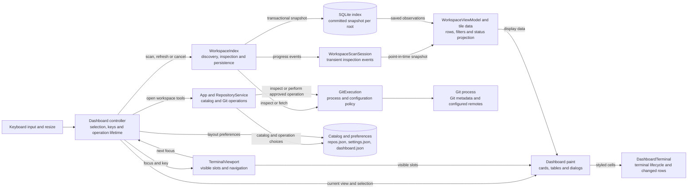
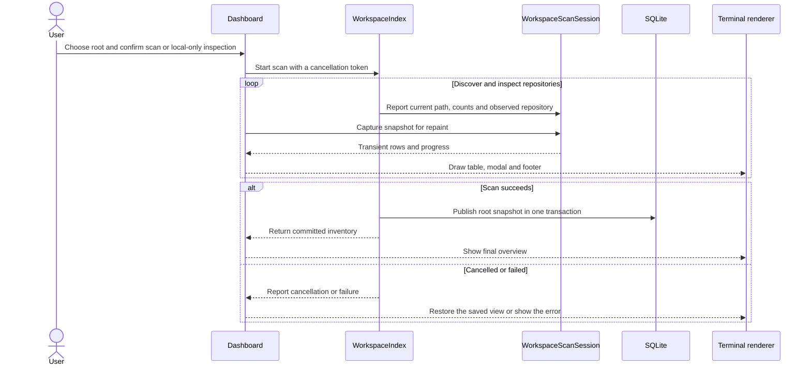

> **File name** `technical-guide.md` 
> **Full path** `E:\vibekit\Apps\RepoRadar\docs\technical-guide.md` 
> **Path relative to the VibeKit repository** `Apps/RepoRadar/docs/technical-guide.md`

# Repo Radar technical guide

This guide describes the Repo Radar terminal application. The [historical code review](code-review.md) records findings and test evidence from before the Git and viewport changes.

## Current architecture

Repo Radar draws the screen as a grid of styled cells. `Dashboard` owns input, selection and dialog state. A workspace view model supplies the filtered repositories, list rows and counts. A scan session turns asynchronous observations into a frame snapshot. The active viewport supplies visible positions to the painter and keyboard navigation, and the tile view model supplies display data to cards and their preview.

| Area | Owner and boundary | Source |
| --- | --- | --- |
| Terminal session and controls | Alternate screen, cursor visibility, changed rows, Unicode cell width, status, shortcuts, badges and progress | [Terminal](../src/DashboardTerminal.cs) · [Cell text](../src/TerminalText.cs) · [Widgets](../src/ConsoleWidgets.cs) |
| Shell | Keyboard routing, active tab, selection, dialog transitions and cancellation | [Dashboard](../src/Dashboard.cs) · [Viewport](../src/TerminalViewport.cs) |
| View data | Workspace filters, ordering, table rows, counters, transient scan events and tile fields | [Workspace view model](../src/WorkspaceViewModel.cs) · [Tile model](../src/WorkspaceTileViewModel.cs) |
| Presentation | Responsive table and card geometry, frames, picker and progress | [Table and toolbar](../src/DashboardWorkspacePaint.cs) · [Cards](../src/DashboardPaint.cs) · [Dialogs](../src/DashboardDialogsPaint.cs) · [Scan popup](../src/DashboardProgressPaint.cs) |
| Filesystem picker | Current directory, navigation, selected path and directory enumeration | [Picker state](../src/TerminalPathPicker.cs) · [Picker drawing](../src/TerminalPathPicker.Paint.cs) |
| Inventory | Root walk, Git inspection, exact remote evidence and atomic index publication | [Index](../src/WorkspaceIndex.cs) · [Git status collection](../src/WorkspaceIndex.Git.cs) · [Remote comparison](../src/WorkspaceIndex.RemoteComparison.cs) · [Alignment rules](../src/RepositoryAlignment.cs) · [SQLite adapter](../src/WorkspaceIndex.Sqlite.cs) |
| Workspace tools | Catalog, plan selection, clone and update, branch review | [App and Spectre menus](../src/Program.cs) · [Repository service](../src/Core.cs) · [Shared Git policy](../src/GitExecution.cs) · [Sync plan and progress](../src/SyncRun.cs) |
| Delivery | Source publish, portable ZIP, Debian package and per-user MSI | [Build entry point](../build.ps1) · [ZIP and Debian builder](../scripts/package.py) · [MSI builder](../packaging/windows/Build-Msi.ps1) |

## Scan and repaint

- `Discovered` represents a path the scanner found before Git inspection produced a result. Progress rows are transient. Saved observations can remain visible during a refresh.
- Alignment requires the exact upstream reference, local commit ID and remote commit ID. Legacy observations, cached refs, failed checks and unsupported tracking mappings remain unverified. Local edits, outgoing commits, incoming commits and missing upstreams are independent signals. The same repository can appear in several counters. [Alignment rules](../src/RepositoryAlignment.cs)
- Cancelled work preserves the preceding committed index. A directory the scanner cannot read can retain a cached entry. The review documents where the UI needs a clearer distinction between cached and current observations. [Index publication](../src/WorkspaceIndex.cs#L87)
- Scan and catalog commands share an absolute Git executable, a controlled child environment and checks on repository-local helpers. Local inspection runs with network protocols disabled. Network operations use supported transports and honor user and system authentication settings. Recursive submodule setup excludes implicit local file remotes. [Git execution policy](../src/GitExecution.cs)

## UI patterns and reusable components

The immediate-mode grid suits a resizable terminal. Each paint pass renders the current screen and the terminal diff writes changed rows. Keep the scan snapshot and the shared card renderer used for the dashboard and the Tile Customization preview.

| Component | Contract | State |
| --- | --- | --- |
| Cell grid and text metrics | Measure, clip, wrap and edit text on grapheme boundaries. Accept trusted styles and treat repository text as plain text. | Shared |
| Viewport planning | Return an immutable plan of rows, columns, slots, selection and visible indices for drawing, arrows and paging. | Shared by grid and table |
| Widgets | Draw frames, badges, shortcuts, progress and status from values and styles supplied by the caller. Keep Git status semantics in Repo Radar. | Shared |
| Command descriptors | Define command, key, label and availability once for toolbar, footer and help. | Follow-up |
| Folder picker | Separate directory loading from selection state and drawing. Use a cancellable or supersedable request and show loading. | Follow-up |
| Terminal session | Pair entering and leaving terminal mode. Define capability fallbacks for color, Unicode and redirection before extracting the controls across apps. | Session boundary in place |

Keep the components inside Repo Radar while the contracts and tests settle. A separate library becomes useful when a second application needs the same primitives.

## Screen and resize rules

The dashboard answers two questions in order. Which repositories are known to be aligned, and what action is needed elsewhere? Keep the green group first, then put confirmed incoming and outgoing commits and unpublished edits ahead of branch inventory. Use amber for branch review and distinguish a gone upstream or a branch with drift from an extra branch that simply exists. Keep gray for an unavailable comparison, with its reason and the last trustworthy check in Details. Use a readable label and icon next to color.

| Surface | At every supported size | When space permits |
| --- | --- | --- |
| Dashboard | Keep alignment groups visible. Show repository identity, current branch, primary signal and ahead/behind when known. Reserve a row for status. | Widen cards before adding columns. Show the path, supporting signals, status explanations and freshness. |
| Repositories | Keep the selected row, repository, branch and alignment visible. | Add path, ahead/behind, last check and branch evidence as separate columns. |
| Scanning | Keep the current path, folders visited, repositories found and cancellation visible. Animate without implying a completion percentage during discovery. | Show the scan dialog over live results. Display determinate progress once the inspection total is known. |
| Folder picker and tile settings | Keep the active control, required keys and selected value visible. | Put the directory list beside the drive tree, and the tile settings beside their preview. |
| Toolbar and footer | Show valid commands and an operation line with the active repository or path. | Include labels and the latest Git progress detail. Derive the same bindings for help. |

Measure columns and rows together. Preserve selection by repository identity across resize and mode changes. Budget a minimum number of content rows before expanding the header or the legend. Use Details and Help as stable places to recover information hidden by size.

## Where comments add value

Write short XML summaries for the classes that own a boundary, including `DashboardTerminal`, `DashboardGrid`, `WorkspaceViewModel`, `WorkspaceScanSession`, `RepositoryAlignment` and the Git execution policy. The existing [picker summary](../src/TerminalPathPicker.cs#L7) and [snapshot contract](../src/WorkspaceIndex.cs#L42) are useful examples.

At method level, document preconditions, outcomes and invariants for cancellation, snapshot publication, branch comparison, terminal restoration and the mutation plan. Use `<param>`, `<returns>` and `<exception>` when the information changes how a caller uses the method. Inside methods, explain decisions such as why a comparison must use the exact fetched ref or why a wide glyph needs both cells cleared. [Cell-width rationale](../src/TerminalText.cs) · [Exact ref comparison](../src/WorkspaceIndex.RemoteComparison.cs)

## Validation workflow

Build from source and run `repo-radar --self-test` against a disposable `REPO_RADAR_DATA` directory. The suite creates local Git repositories and tests catalog operations, recovery, scan progress, SQLite snapshots and alignment. The [historical review](code-review.md#verification) documents the audit baseline. See the [application README](../README.md#build-from-source) for distribution commands.

> **File name** `technical-guide.md` 
> **Full path** `E:\vibekit\Apps\RepoRadar\docs\technical-guide.md` 
> **Path relative to the VibeKit repository** `Apps/RepoRadar/docs/technical-guide.md`
