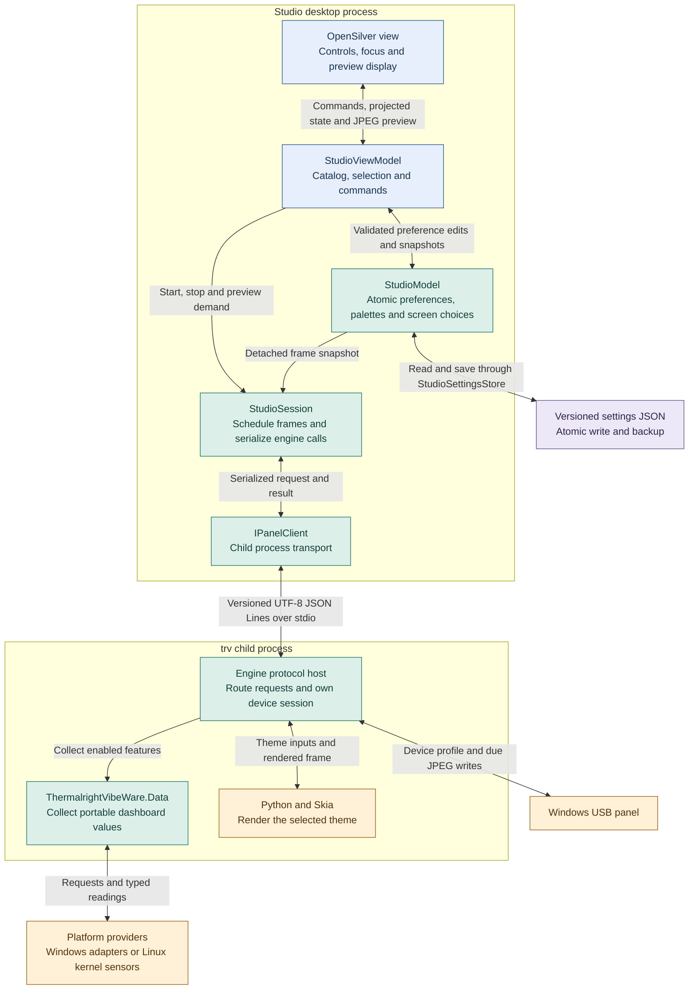
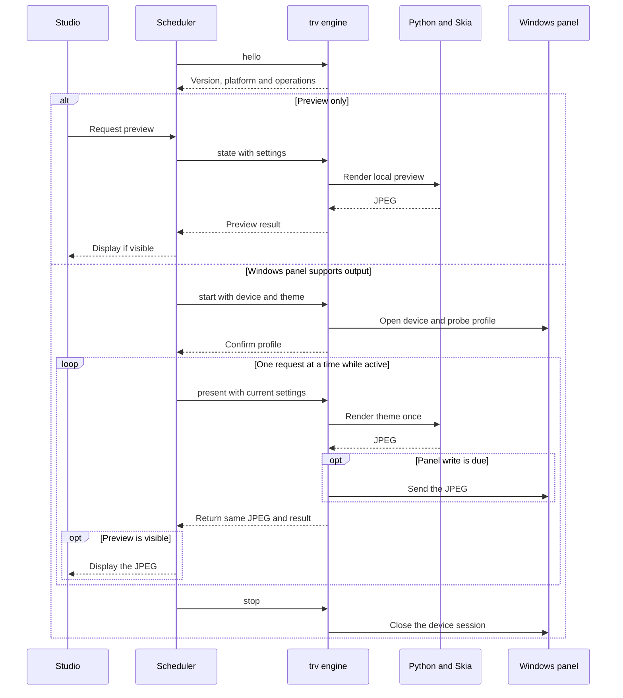

> **File name** `studio-architecture.md` 
> **Full path** `E:\vibekit\Apps\ThermalRight Panel\docs\studio-architecture.md` 
> **Path relative to the VibeKit repository** `Apps\ThermalRight Panel\docs\studio-architecture.md`

# Studio state and provider boundaries

The display loop belongs to `StudioSession`, not the window. Closing a preview, hiding the window or blocking its dispatcher must not stop an active output session.

## State and persistence

`StudioModel.Update` commits preferences, screen choices and palette overrides under one lock. Editors and readers receive detached copies. A failed edit commits nothing. Each frame takes one copy, including its palette and screen selections. Automatic rotation checks the observed revision before committing, so it cannot overwrite a newer user edit.

`StudioViewModel` owns catalog normalization, workspace selection and navigation. Its auxiliary snapshot holds the latest font, Codex and diagnostics results, pending operations and their errors. The view projects those values into controls and owns layout, focus and JPEG presentation.

`StudioSession` owns output scheduling and engine serialization. The saved startup request carries its own device, theme and profile. The running output records the device and profile confirmed by the engine. Host visibility and the selected workspace together determine local preview demand. USB output continues while the window or preview is hidden.

`StudioSettingsStore` reads at most 1 MiB and writes `schemaVersion: 1`. Unversioned settings are rejected and left untouched. A save flushes a temporary file, then atomically replaces the current file and preserves its previous contents as `.bak`. A corrupt file falls back to a valid backup. Recovery does not replace that good backup with corrupt data. Unsupported versions and unrecoverable files are left untouched, with a visible notice; saving remains disabled for that session. Runtime revisions and timestamps are not persisted.

`StudioPreferences.IsFirstRun` defaults to `true` and is stored as `isFirstRun` in the same versioned file. The first Windows launch shows the studio even when sign-in passes tray arguments. Once the main page has loaded, `StudioModel.CompleteFirstRun` saves a detached state with the flag set to `false`, then publishes it. A failed save leaves the flag true and reports a notice. Later Windows launches start in the tray; Open, About and ordinary activation still restore the existing window. Without a working tray, the host keeps its visible-window fallback.

See [Code maintenance](code-maintenance.md) for the source file map and documentation conventions.

## Preview and panel output

Hiding the Studio changes preview demand. While the host is running, output
continues until Stop or an output failure. A failed start or disconnected
session requires a new start. [Engine protocol](engine-protocol.md)

## Platform boundary

`ThermalrightVibeWare.Data` targets plain `net10.0`. It holds data records, provider interfaces and the shared collection service. It references Contracts, with no Windows APIs or hardware libraries. `ISensorProvider` adds raw diagnostics and access metadata to `IMetricsProvider`. The host selects adapters through `PlatformDashboardProviders`; constructing them does not open or sample hardware. Disabled features do not read their providers. A failed playback provider cannot discard available media or sensor results.

`ThermalrightVibeWare.Backends.Windows` owns the existing Windows sensor, media,
volume and loopback implementations. Only the Windows engine target references it
and the pinned LibreHardwareMonitor fork. `WindowsDashboardProviders` keeps the
Windows composition and optional artist provider.

`ThermalrightVibeWare.Backends.Linux` reads Linux sensors through procfs and sysfs.
It has no monitoring-library dependency. Core and CLI have separate `net10.0` and
Windows targets. The Linux studio starts the bundled `engine/trv` child. It negotiates
supported methods through `hello`, then loads manifests and Python/Skia previews.
Linux dashboards use the existing kernel sensor reader; media, audio and network
sources remain explicitly unavailable. USB requests fail before device access.
Windows raster conversion is excluded. See [Linux sensors](linux-sensors.md).

Linux sensor coverage depends on kernel drivers and access permissions. Windows
runtime regression behavior remains unverified for this separation. Tests and
runtime trials require owner approval.

> **File name** `studio-architecture.md` 
> **Full path** `E:\vibekit\Apps\ThermalRight Panel\docs\studio-architecture.md` 
> **Path relative to the VibeKit repository** `Apps\ThermalRight Panel\docs\studio-architecture.md`
