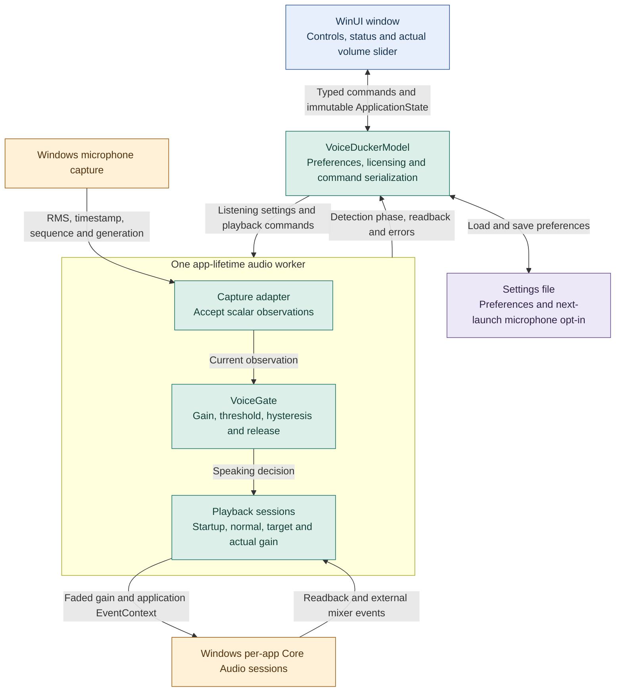
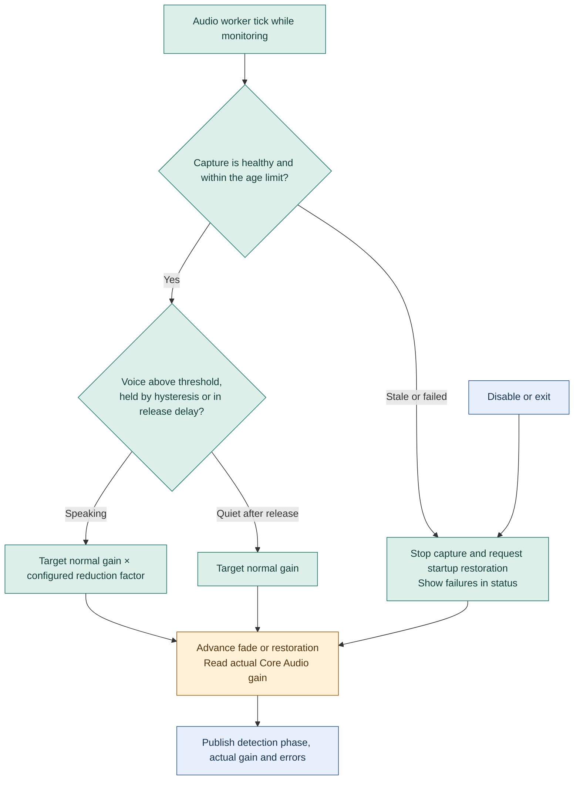

> **File name** `AUDIO-MODEL.md` 
> **Full path** `E:\vibekit\Apps\VoiceDucker\docs\AUDIO-MODEL.md` 
> **Path relative to the VibeKit repository** `Apps\VoiceDucker\docs\AUDIO-MODEL.md`

# Audio application model

`VoiceDuckerModel` is the application state owner. It loads and saves preferences,
serializes user operations, checks licensing, controls startup behavior and owns
the audio worker. `ApplicationState` is an immutable snapshot for presentation.
The window renders that snapshot and sends typed commands. Focus, editing buffers,
scroll, window geometry and animations remain view concerns.

## State and audio ownership

## Audio path

The audio path is linear:

1. Capture publishes raw RMS, monotonic observation time, sequence and generation.
2. The worker applies software sensitivity once, then evaluates threshold,
   hysteresis and the release delay against that same settings snapshot.
3. The detector returns a phase and a speaking decision. Repeated polling never
   renews a sample or its release deadline. Stale capture fails safely.
4. Playback computes a target from a stable normal volume and advances its fade.
5. Native readback, actual attenuation and errors become a new application snapshot.

Each playback session has four different values:

| Value | Meaning | Changes when |
| --- | --- | --- |
| Startup | Safety restoration level | First observation only |
| Normal | User's ordinary listening volume | An explicit slider or current external mixer command |
| Target | Current fade destination | Detection, normal volume or settings change |
| Actual | Windows session gain | Fresh readback |

For normal volume 36% and reduction 50%, voice targets 18% and silence targets
36%. The slider renders Actual and sends an explicit playback-volume command.
The worker consumes that intent with the gate and settings used for the same
playback update. During lowering it derives Normal from requested Actual divided
by the configured gain, clamped to 100%; otherwise the request becomes Normal.
It never divides by an intermediate fade level. At 100% reduction, editing is
unavailable and a queued command is rejected without replacing Normal.
An unfinished fade never becomes a new normal volume. Disable and exit
restore Startup for sessions changed by the application, while keeping Normal
available for another Enable in the same application lifetime.

All Core Audio objects, session discovery, callback subscriptions and mixer
writes belong to one app-lifetime worker. Native callbacks publish only scalar
state and exclude this process's EventContext. The controller validates external
events against current native state before adopting a normal-volume change.
No monitoring tick writes a volume that is already applied. Muted restoration
waits; unavailable or failed restoration is reported rather than certified.

**Enable microphone on startup** is a saved opt-in independent of Windows
autostart. It applies to every new launch after playback initialization and license
checks. Changing the checkbox saves the next-launch preference; it does not start
capture immediately. The existing JSON key is preserved so current choices survive
an in-place update.

The isolated microphone, playback and application-model harnesses use generated
buffers, clocks, adapters and in-memory mixer state. They do not prove acoustic
behavior, device compatibility or visual acceptance.

> **File name** `AUDIO-MODEL.md` 
> **Full path** `E:\vibekit\Apps\VoiceDucker\docs\AUDIO-MODEL.md` 
> **Path relative to the VibeKit repository** `Apps\VoiceDucker\docs\AUDIO-MODEL.md`
