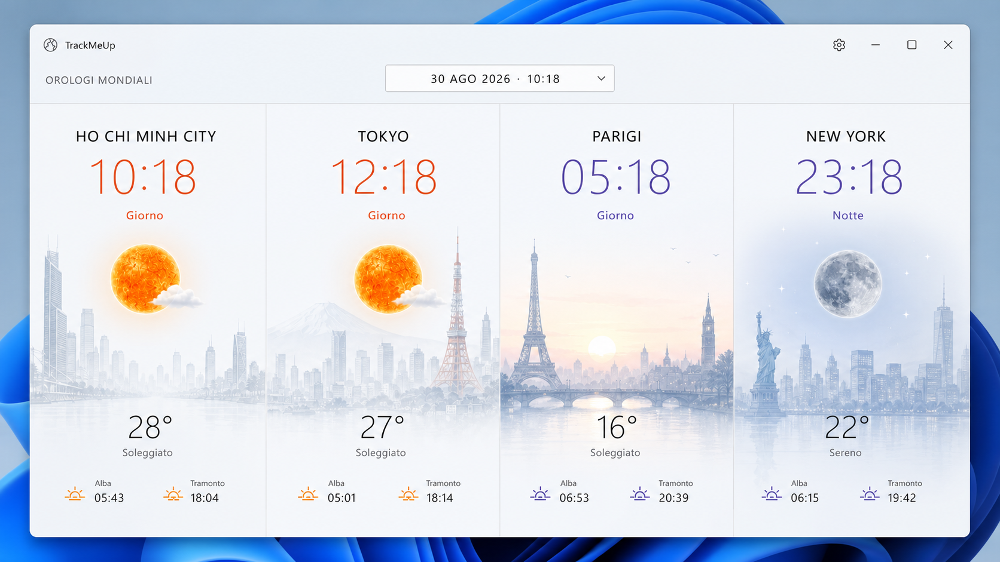

# WorkTrail — See time zones and availability at a glance

[](https://github.com/umbertotechnopreneur/VibeKit/actions/workflows/monorepo.yml)


[](LICENSE)

I work with people in different time zones. Converting one hour at a time does not tell me when our working days overlap, or whether an appointment falls on someone else's rest day. I built WorkTrail around a visual availability grid so I can compare the same moment across cities and choose a meeting time at a glance.

Choose your home city, open **World availability**, and scroll across five days around the date you select. Compare local times, working hours, reserve margins, holidays and personal exceptions in one grid. Use it to plan meetings and appointments across time zones, then export the selected 16 or 24 hours to a PDF with selectable text and vector timetable cells.

WorkTrail uses native **WinUI 3** windows. Keep the planner, world clocks, calendars, Moon and sky views open as independent desktop widgets. Windows remember their placement and can snap to screen edges or other WorkTrail windows. Hide the launcher in the notification area while your widgets stay open. I keep memory use, performance and resource cleanup in view as I develop; the source is open for inspection.

**[Get started](#get-worktrail)** · [Desktop tools](docs/CELESTIAL_DESKTOP.md) · [Privacy](docs/PRIVACY.md) · [Build guide](docs/DEVELOPMENT.md)

<p align="center">
  
</p>

*Actual world-clock window from an earlier build, shown in Italian. The new launcher is not pictured. See the [screenshot provenance](docs/images/readme/celestial-screenshots-PROVENANCE.md).*

## Built with care

I review third-party dependencies and their sources and pay attention to memory, CPU and performance as I develop. When a feature needs a safeguard, I want its behavior and your controls to be clear. The project's documented checks and limits are not a blanket security guarantee.

## Get WorkTrail

WorkTrail targets **Windows 11 x64 and ARM64**. The Microsoft Store channel is separate from source builds and portable distribution. Choose a package for your processor in [VibeKit releases](https://github.com/umbertotechnopreneur/VibeKit/releases). Install the matching Microsoft .NET 10 Runtime. Run the **MSI** to install WorkTrail for the current user, or extract the whole **portable ZIP** and run `WorkTrail.exe`. Linux is source-only, without binaries or compatibility promises.

To work on the source, install PowerShell 7, the .NET 10 SDK and the Windows build tools described in the [development guide](docs/DEVELOPMENT.md). Start with:

```powershell
git clone https://github.com/umbertotechnopreneur/VibeKit.git
Set-Location .\VibeKit\Apps\WorkTrail
```

On the first import of an external dependency, scan its archive and extracted files with Microsoft Defender before use. Reuse the evidence for the same unchanged import; see [AGENTS.md](AGENTS.md).

## Desktop tools

- Compare availability across cities on a shared timeline, with 15-, 30- or 60-minute intervals and 16- or 24-hour views.
- Convert a local date and time across up to 12 saved cities. See the local date and UTC offset for each city.
- Save working hours, weekly rest days, reserve margins and personal day exceptions. Missing holiday coverage is shown explicitly.
- Export the planner to A4 landscape PDF with repeated city headers, selectable text, vector cells and embedded skyline artwork.
- Open the astronomical agenda with local solar and lunar events, national holidays and saints.
- Inspect the local sky, lunar phase, day/night map and globe in separate windows.
- Keep window placement, snapping, theme, language and Windows startup preferences.
- Configure and verify an optional OpenWeather API key from launcher Settings, world-clock options or the planner. Current weather remains separate from the selected planning date.

Weather, satellite data and space-weather information use external sources when requested by their views; details are in the [privacy notes](docs/PRIVACY.md). The planner helps you choose meeting and appointment times; it does not create or synchronize events in an external calendar.

## ExcelPlanner

[`ExcelPlanner/`](ExcelPlanner/README.md) remains a separate availability-planning prototype. It includes the workbook, calendar CSVs, support scripts and source credits. It is not part of the app build or launcher.

## Build and contribute

> [!NOTE]
> **Time zones travel farther than this Windows app**
>
> WorkTrail currently targets Windows 11. **macOS is unsupported**: I do not have a Mac to develop and check a native version. Linux remains source-only, with no compatibility promise.
>
> If you can maintain a Mac port, [let me know](https://github.com/umbertotechnopreneur/VibeKit/issues/new?title=%5BWorkTrail%5D%20). Native desktop windows, calendar behavior and daylight-saving changes would all need attention.

The Windows views call `IWorkTrailApplication`. `WorkTrail.Core` owns settings, astronomy and Windows integration; `WorkTrail.Presentation` contains passive projection and window-state helpers. See [architecture](docs/ARCHITECTURE.md), [development](docs/DEVELOPMENT.md), [contributing](CONTRIBUTING.md) and [licenses](THIRD_PARTY_NOTICES.md).

Project-authored code and documentation use the [MIT License](LICENSE). The WorkTrail name and brand assets follow [TRADEMARKS.md](TRADEMARKS.md).

## More from MeUp

- [AgentInbox](https://github.com/umbertotechnopreneur/VibeKit/tree/main/Apps/AgentInbox): connect your inboxes to your AI assistant.
- [PromptMeUp](https://github.com/umbertotechnopreneur/VibeKit/tree/main/Apps/HelpMe): Can't remember that command? Git, Bash, or PowerShell: describe what you want to do. hm is here to help.
- [WorkTrail](https://github.com/umbertotechnopreneur/VibeKit/tree/main/Apps/WorkTrail): compare time zones and availability at a glance, with independent desktop widgets.

I’m Umberto Giacobbi. I built and maintain WorkTrail, with help from contributors. Find me on [LinkedIn](https://www.linkedin.com/in/umbertogiacobbi/) or at [umbertogiacobbi.biz](https://umbertogiacobbi.biz/).

---

### This is VibeWare · [Manifesto](https://umbertogiacobbi.biz/vibeware/manifesto)

I created WorkTrail with AI assistance. I define its purpose, guide the implementation, and take responsibility for checking functionality, performance, and security. VibeWare is my initiative for building useful software openly with AI; I ask you to judge the result and the evidence behind it.

To learn what VibeWare means and why I created it, read the [VibeWare manifesto](https://umbertogiacobbi.biz/vibeware/manifesto).

[WorkTrail on GitHub](https://github.com/umbertotechnopreneur/VibeKit/tree/main/Apps/WorkTrail) · [VibeWare on GitHub](https://github.com/umbertotechnopreneur/VibeWare) · [umbertogiacobbi.biz](https://umbertogiacobbi.biz)

*You are welcome to explore, adapt and reuse the open-source VibeWare materials under the project license — my contribution to the developer community.*

[Terms](https://umbertogiacobbi.biz/terms/) · [Privacy](https://umbertogiacobbi.biz/privacy/)

<p align="right">
  <a href="https://umbertogiacobbi.biz/vibeware/manifesto">
    
  </a><br>
  <em>Human intent, AI execution, and plenty of tokens</em>
</p>
