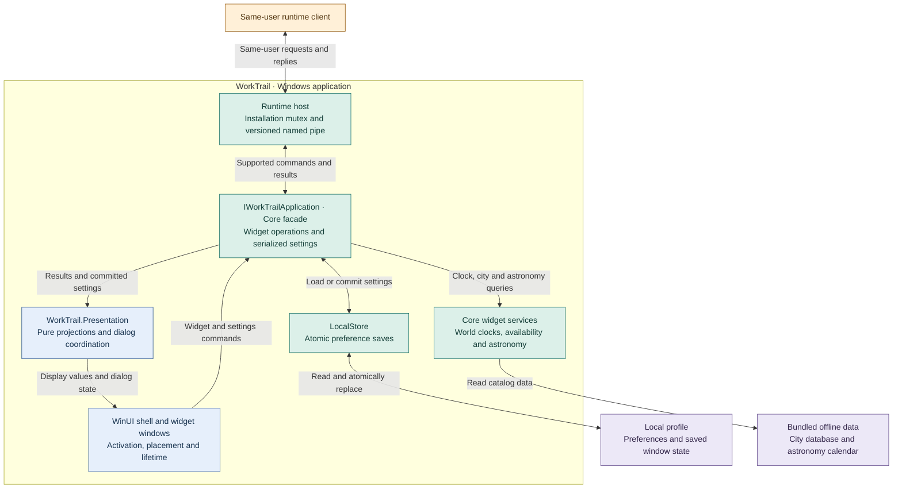
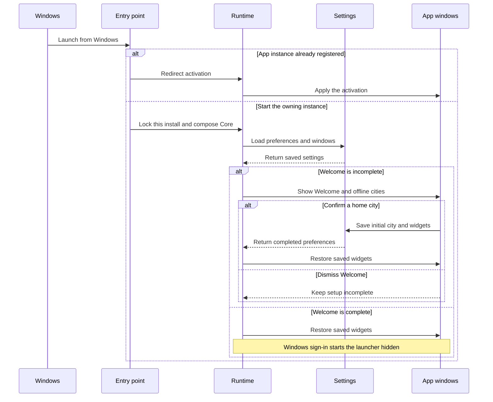
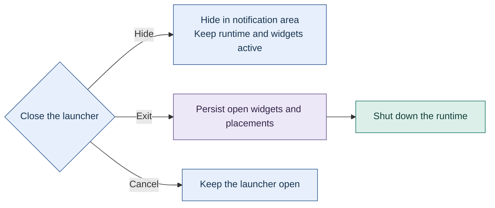

> **File name** `ARCHITECTURE.md` 
> **Full path** `E:\vibekit\Apps\WorkTrail\docs\ARCHITECTURE.md` 
> **Path relative to the VibeKit repository** `Apps\WorkTrail\docs\ARCHITECTURE.md`

# WorkTrail architecture

The app is a desktop launcher with independent world-clock and astronomy windows. It has one application facade, one installation-scoped mutex and one same-user versioned named pipe.

## Runtime and data ownership

## Projects

| Project | Responsibility |
| --- | --- |
| `WorkTrail` | Windows composition root, passive WinUI views and window lifecycle |
| `WorkTrail.Core` | Widget operations, astronomy, city catalog, settings and Windows integration |
| `WorkTrail.Presentation` | Pure projections, dialog queue and window presentation state |
| `WorkTrail.Core.Tests` | Widget services, persistence, runtime protocol and shared contracts |
| `WorkTrail.Presentation.Tests` | Pure presentation and retained window contracts |

`ExcelPlanner/` is a standalone prototype outside the solution.

## Startup and lifetime

`Program` redirects repeated Windows launches to the current application. `App` acquires the existing hashed-installation runtime mutex before constructing `WorkTrailApplication`. Other clients connect through the same-user named pipe. Protocol version 9 exposes only widget, settings, window, startup, product-link and diagnostic operations.

The factory does not construct capture services, input hooks, activity storage, search indexes, AI clients or timesheet workers. `LocalStore` reads and atomically saves preferences; it never opens existing activity databases. The astronomical agenda reads the bundled calendar catalog directly. The separate read-only world-city database remains in use.

Before restoring widgets on first launch, Welcome asks for a home city through the shared offline city selector. Core suggests a city from the Windows time zone. Confirmation atomically saves the home city, clock selection, agenda observer and completion flag; dismissing Welcome leaves setup incomplete. Existing saved clocks and window placement are retained.

Closing the launcher offers an Acrylic choice to hide it in the notification area, exit the app or cancel. Hiding leaves independent widgets open. Explicit app exit persists the open widget session and placements before shutting down the runtime. Once setup is complete, a Windows sign-in launch starts hidden and restores saved widgets. Shared title bars float above content without reserving layout space, including when auto-hide is disabled.

## Application boundary

Views bind DTOs, collect input and call `IWorkTrailApplication`. Keep file, environment, HTTP and OS work in Core services. Serialize settings mutations in the facade; publish a new immutable snapshot only after persistence succeeds. Preserve saved cities and window placement when unrelated settings change.

Report unexpected startup, persistence and interop failures through the durable local log and a visible error surface, including failures before Main exists. Keep credentials in environment variables and out of IPC diagnostics and logs.

Existing personal history and screenshots are not migrated or deleted by widget startup. Removed tracking commands and launch arguments fail explicitly.

> **File name** `ARCHITECTURE.md` 
> **Full path** `E:\vibekit\Apps\WorkTrail\docs\ARCHITECTURE.md` 
> **Path relative to the VibeKit repository** `Apps\WorkTrail\docs\ARCHITECTURE.md`
