# VibeKit by Umberto Giacobbi

**Small tools. Real problems. Your computer deserves a little breathing room.**

Music should make room for your voice. A memory monitor should tell you where your RAM went. A desk controller should put useful buttons under your fingers.

VibeKit is my workbench for turning those everyday annoyances into applications and desktop utilities. Built with AI, guided by human judgment, and open for you to explore, adapt and improve.

**[Take the visual tour →](https://umbertogiacobbi.biz/vibeware/manifesto#vibekit-gallery)** · [Choose a project](#find-your-next-tool) · [Contribute](#want-to-help)

## Meet the projects

A little hardware, a few desktop windows, and plenty of curiosity. **[Open the 20-image carousel](https://umbertogiacobbi.biz/vibeware/manifesto#vibekit-gallery)** for the large images and full-screen gallery.

| | | | |
| --- | --- | --- | --- |
| [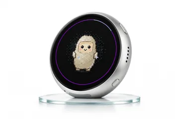](https://umbertogiacobbi.biz/vibeware/manifesto#vibekit-gallery) **Cody** |  **Cody · pairing** |  **VoiceDucker** |  **VoiceDucker · controls** |
| [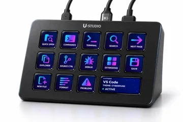](https://umbertogiacobbi.biz/vibeware/manifesto#vibekit-gallery) **UlanziDeck · code** | [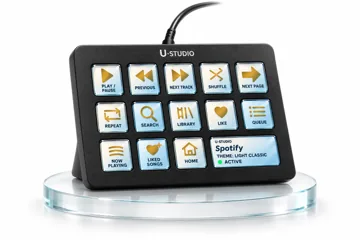](https://umbertogiacobbi.biz/vibeware/manifesto#vibekit-gallery) **UlanziDeck · music** | [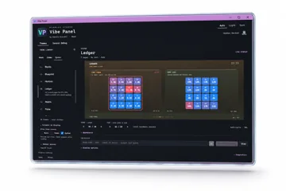](https://umbertogiacobbi.biz/vibeware/manifesto#vibekit-gallery) **ThermalRight · system** | [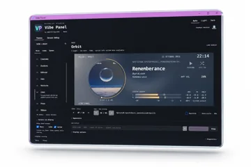](https://umbertogiacobbi.biz/vibeware/manifesto#vibekit-gallery) **ThermalRight · music** |
| [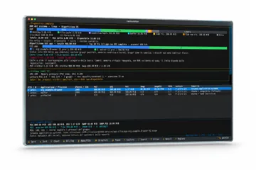](https://umbertogiacobbi.biz/vibeware/manifesto#vibekit-gallery) **Ram Taskman** | [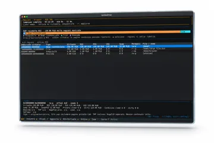](https://umbertogiacobbi.biz/vibeware/manifesto#vibekit-gallery) **Ram · memory regions** | [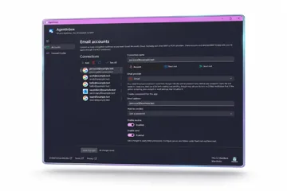](https://umbertogiacobbi.biz/vibeware/manifesto#vibekit-gallery) **AgentInbox · accounts** | [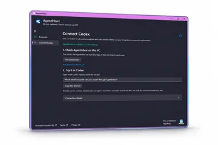](https://umbertogiacobbi.biz/vibeware/manifesto#vibekit-gallery) **AgentInbox · connection** |
| [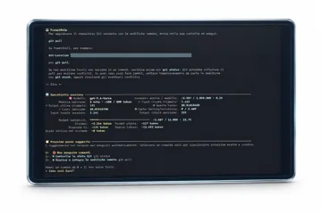](https://umbertogiacobbi.biz/vibeware/manifesto#vibekit-gallery) **HelpMe · commands** | [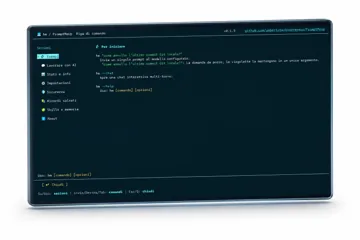](https://umbertogiacobbi.biz/vibeware/manifesto#vibekit-gallery) **HelpMe · guide** |  **WorkTrail · day & night** |  **WorkTrail · globe** |
| [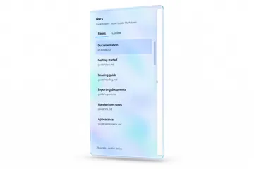](https://umbertogiacobbi.biz/vibeware/manifesto#vibekit-gallery) **MarkVibe** |  **Gauge** | [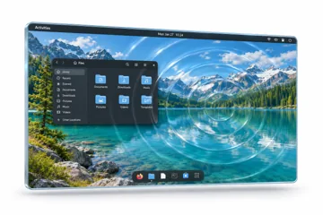](https://umbertogiacobbi.biz/vibeware/manifesto#vibekit-gallery) **Ripple · alpine** |  **Ripple · violet** |

**Cody is a companion project, not part of this monorepo.** Its round-screen device and AI integrations live in [their own repository](https://github.com/umbertotechnopreneur/esp32-luna-shell). The rest of this tour comes from the VibeKit projects below.

## Find your next tool

### Applications

| Project | The small problem it takes on |
| --- | --- |
| [Ram Taskman](Apps/RamTaskman/README.md) | “Where did my RAM go?” Inspect system memory, application groups and processes in a terminal, and put a hardware-cost estimate beside their memory use. |
| [VoiceDucker](Apps/VoiceDucker/README.md) | “Let me talk to my AI.” Lower selected playing apps when the microphone detects sound, then bring their volume back gradually. |
| [UlanziDeck](Apps/UlanziDeck/README.md) | “That action deserves a button.” Put apps, media controls and shortcuts on an Ulanzi D200H. |
| [ThermalRight Panel](Apps/ThermalRight%20Panel/README.md) | “That little display could do more.” Show music, artwork and system readings on supported Thermalright displays. |
| [AgentInbox](Apps/AgentInbox/README.md) | “My mailboxes are scattered everywhere.” Connect as many compatible mailboxes as you need—Gmail, Microsoft, iCloud, GoDaddy and other IMAP/POP3 providers—then let an AI agent work across their selected folders through one MCP connection. |
| [HelpMe](Apps/HelpMe/README.md) | “I know what I want; I forgot the command.” Describe a task in your terminal, read the explanation and review suggested commands. |
| [MarkVibe](Apps/MarkVibe/README.md) | “I just want to read this Markdown file.” Open local documents with a document map, optional AI editing and HTML/PDF export. |
| [WorkTrail](Apps/WorkTrail/README.md) | “Is this a good time over there?” Compare time zones and working hours, with world clocks, calendars and celestial desktop views. |
| [Ghostty Shaders](Apps/Ghostty%20Shaders/README.md) | “A little phosphor, please.” Add configurable CRT or subtle scanline effects to Ghostty through GLSL shaders. |

### Desktop utilities

| Project | The finishing touch |
| --- | --- |
| [Studio Controls](Widgets/StudioControls/README.md) | A native OBS control desk with scenes, screen zoom, vignettes and project cards; Windows ZIP and Linux Debian preview packages. |
| [Gauge / OpenAI Usage](Widgets/OpenAI/README.md) | Keep AI usage visible in a desktop widget. Other providers are a future goal. |
| [Desktop Ripple](Widgets/WaterRipple/README.md) | Give the desktop a water-like ripple effect; see also the [Linux edition](Widgets/WaterRipple/Linux/README.md). |
| [CRT Filter / Retro Terminal](Widgets/RetroTerminal/README.md) | Give the GNOME desktop green phosphor, amber or arcade color, with controls for the effect and an emergency stop. |

Each project has its own supported platforms, installation instructions, license and limitations. **Start with that project's README**: availability, packaging and maturity differ between tools.

## Small tools, serious care

I prefer software that earns its place on your computer. That means native platform experiences, attention to memory and CPU use, and meaningful checks rather than promises about performance. Automatic features should explain what they are doing, respect a manual stop and leave you in control.

AI helps me build. I choose the problems, guide the work and remain responsible for reviewing the result. I review dependencies and their sources, investigate bottlenecks and document remaining limits. Read the [VibeWare manifesto](https://umbertogiacobbi.biz/vibeware/manifesto) for the thinking behind the work.

## Inside the kit

- **[Apps/](Apps/)** — nine self-contained applications, each with its own documentation and scripts.
- **[Widgets/](Widgets/)** — small desktop utilities and platform-specific implementations.
- **[scripts/](scripts/)** — shared, project-independent shell utilities.
- **[docs/](docs/)** — repository documentation, [import notes](docs/project-imports.md) and [CI guidance](docs/ci.md).

A change to an app should run that app's checks. [VibeKit CI](.github/workflows/monorepo.yml) selects pipelines by changed directories; the [CI and release guide](docs/ci.md) covers selection rules, namespaced release tags and publishing requirements.

Imported projects retain their histories and attribution. Each application keeps its own license; this collection does not relicense third-party code or artwork.

## Want to help?

Try a tool, report a reproducible bug, improve the documentation or contribute support for hardware we cannot test. Include the project, platform and steps to reproduce in an issue. Leave private information and credentials out of reports.

Our studio develops these projects in spare time and through its **20% time rule**, giving team members and collaborators room for personal projects. We share the work freely; community help lets it go further than our available time.

**Have a Mac? We'd love a hand.** We develop and test on Windows and Linux as documented by each project. macOS is not supported because we do not have a Mac to maintain or validate it. Contributors willing to take ownership of that platform are welcome.

## A thank-you worth keeping

Ram Taskman adapts parts of [GPU Taskman](https://github.com/shanselman/gputaskman) for RAM monitoring. Thank you to **Scott Hanselman** for the inspiration and original code. The original MIT license and [reuse notes](Apps/RamTaskman/docs/upstream.md) are preserved.

Made by [Umberto Giacobbi](https://umbertogiacobbi.biz) and contributors, with curiosity and a healthy suspicion of apps that need half your RAM to show one button.
