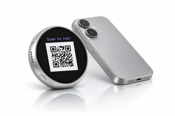
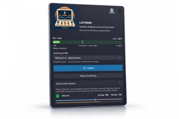
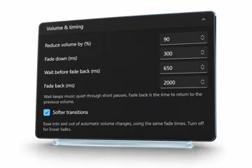
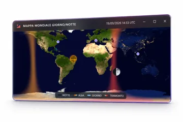
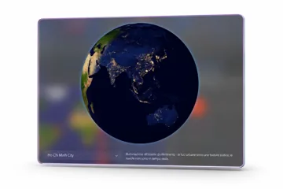
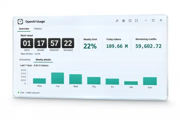
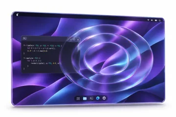

> **File name:** `README.md` 
> **Full path (workspace file):** `E:\vibekit\README.md` 
> **Full path (published document):** `https://github.com/umbertotechnopreneur/VibeKit/blob/main/README.md` 
> **Relative path (VibeKit repository root):** `README.md`

<h1 align="center">VibeKit</h1>

  <strong>Small tools. Real problems.</strong> 
  Your computer deserves a little breathing room.

  By <a href="https://umbertogiacobbi.biz">Umberto Giacobbi</a> and contributors 
  

Music should make room for your voice. A desk controller should put useful buttons under your fingers.

VibeKit is my workbench for turning those everyday annoyances into applications and desktop utilities. Built with AI, guided by human judgment, and open for you to explore, adapt and improve.

  <a href="#find-your-next-tool"><strong>Choose a project</strong></a> ·
  <a href="https://umbertogiacobbi.biz/vibeware/manifesto#vibekit-gallery">Take the visual tour</a> ·
  <a href="#want-to-help">Contribute</a> ·
  <a href="https://umbertogiacobbi.biz/vibeware/manifesto">VibeWare manifesto</a>

## Meet the projects

A little hardware, a few desktop windows, and plenty of curiosity. **[Open the 20-image carousel](https://umbertogiacobbi.biz/vibeware/manifesto#vibekit-gallery)** for the large images and full-screen gallery.

| | | | |
| --- | --- | --- | --- |
|  **Cody** |  **Cody · pairing** |  **VoiceDucker** |  **VoiceDucker · controls** |
|  **UlanziDeck · code** |  **UlanziDeck · music** |  **ThermalRight · system** |  **ThermalRight · music** |
|  **HelpMe · commands** |  **HelpMe · guide** |  **WorkTrail · day & night** |  **WorkTrail · globe** |
|  **MarkVibe** |  **Gauge** |  **Ripple · alpine** |  **Ripple · violet** |

**Cody is a companion project, not part of this monorepo.** Its round-screen device and AI integrations live in [their own repository](https://github.com/umbertotechnopreneur/esp32-luna-shell). The rest of this tour comes from the VibeKit projects below.

## Find your next tool

Each project has its own setup, maturity and limitations. Start with its README. CI badges show the shared VibeKit workflow, whose selected checks depend on the changed projects.

### Applications

#### [Repo Radar](Apps/RepoRadar/README.md)

Scan a drive for Git repositories and review local changes, remote commits and branch status in terminal cards or a detailed table. By Umberto Giacobbi.biz. [MIT license](Apps/RepoRadar/LICENSE).

#### [VoiceDucker](Apps/VoiceDucker/README.md)

**“Let me talk to my AI.”** Lower selected playing apps when the microphone detects sound, then bring their volume back gradually.

#### [UlanziDeck](Apps/UlanziDeck/README.md)

**“That action deserves a button.”** Put apps, media controls and shortcuts on an Ulanzi D200H.

#### [ThermalRight Panel](Apps/ThermalRight%20Panel/README.md)

**“That little display could do more.”** Show music, artwork and system readings on supported Thermalright displays.

#### [HelpMe](Apps/HelpMe/README.md)

**“I know what I want; I forgot the command.”** Describe a task in your terminal, read the explanation and review suggested commands.

#### [MarkVibe](Apps/MarkVibe/README.md)

**“I just want to read this Markdown file.”** Open local documents with a document map, optional AI editing and HTML/PDF export.

#### [WorkTrail](Apps/WorkTrail/README.md)

**“Is this a good time over there?”** Compare time zones and working hours, with world clocks, calendars and celestial desktop views.

#### [Ghostty Shaders](Apps/Ghostty%20Shaders/README.md)

**“A little phosphor, please.”** Add configurable CRT or subtle scanline effects to Ghostty through GLSL shaders.

### Desktop utilities

#### [Studio Controls](Widgets/StudioControls/README.md)

A native OBS control desk with twelve scenes, screen zoom, independent vignettes and editable project cards. Windows ZIP and Linux Debian preview packages include generic, device-unassigned scene templates.

#### [Gauge / OpenAI Usage](Widgets/OpenAI/README.md)

Keep AI usage visible in a desktop widget. Other providers are a future goal.

### [Nostalgia desktop effects](Widgets/Nostalgia/README.md)

Water Ripple, Vignette, Retro Terminal, CRT Degauss and Retro Sound install independently on Windows and Linux.

#### [Desktop Ripple](Widgets/Nostalgia/WaterRipple/README.md)

Give the desktop a water-like ripple effect; see also the [Linux edition](Widgets/Nostalgia/WaterRipple/Linux/README.md).

#### [CRT Filter / Retro Terminal](Widgets/Nostalgia/RetroTerminal/README.md)

Give the GNOME desktop green phosphor, amber or arcade color, with controls for the effect and an emergency stop.

## Small tools, serious care

I prefer software that earns its place on your computer. That means native platform experiences, attention to memory and CPU use, and meaningful checks rather than promises about performance. Automatic features should explain what they are doing, respect a manual stop and leave you in control.

AI helps me build. I choose the problems, guide the work and remain responsible for reviewing the result. I review dependencies and their sources, investigate bottlenecks and document remaining limits. Read the [VibeWare manifesto](https://umbertogiacobbi.biz/vibeware/manifesto) for the thinking behind the work.

## Inside the kit

- **[Apps/](Apps/)** — nine self-contained applications, each with its own documentation and scripts.
- **[Widgets/](Widgets/)** — small desktop utilities and platform-specific implementations.
- **[scripts/](scripts/)** — shared, project-independent shell utilities.
- **[docs/](docs/)** — repository documentation, [import notes](docs/project-imports.md) and [CI guidance](docs/ci.md).

A change to an app should run that app's checks. [VibeKit CI](.github/workflows/monorepo.yml) selects pipelines by changed directories; the [CI and release guide](docs/ci.md) covers selection rules, namespaced release tags and publishing requirements.

Imported projects retain their histories and attribution. Each application keeps its own license; this collection does not relicense third-party code or artwork.

## Want to help?

Try a tool, report a reproducible bug, improve the documentation or contribute support for hardware we cannot test. Include the project, platform and steps to reproduce in an issue. Leave private information and credentials out of reports.

Our studio develops these projects in spare time and through its **20% time rule**, giving team members and collaborators room for personal projects. We share the work freely; community help lets it go further than our available time.

> [!TIP]
> **Have a Mac and a little time to contribute?**
>
> These tools target Windows and Linux as documented by each project. **macOS is unsupported** because I do not have a Mac for development or testing.
>
> Pick a project you would like to maintain and [open an issue](https://github.com/umbertotechnopreneur/VibeKit/issues) with its name and your proposed contribution. Native integrations, packaging and checks on real hardware are all useful ways to help.

Made by [Umberto Giacobbi](https://umbertogiacobbi.biz) and contributors, with curiosity and a healthy suspicion of apps that need half your RAM to show one button.

---

### This is VibeWare · [Manifesto](https://umbertogiacobbi.biz/vibeware/manifesto)

I created VibeKit with AI assistance. I define its purpose, guide the implementation, and take responsibility for checking functionality, performance, and security. VibeWare is my initiative for building useful software openly with AI; I ask you to judge the result and the evidence behind it.

To learn what VibeWare means and why I created it, read the [VibeWare manifesto](https://umbertogiacobbi.biz/vibeware/manifesto).

[VibeKit on GitHub](https://github.com/umbertotechnopreneur/VibeKit) · [VibeWare on GitHub](https://github.com/umbertotechnopreneur/VibeWare) · [umbertogiacobbi.biz](https://umbertogiacobbi.biz)

*You are welcome to explore, adapt and reuse the open-source VibeWare materials under their respective licenses and notices — my contribution to the developer community.*

[Terms](https://umbertogiacobbi.biz/terms/) · [Privacy](https://umbertogiacobbi.biz/privacy/)

   
  <em>Human intent, AI execution, and plenty of tokens</em>

> **File name:** `README.md` 
> **Full path (workspace file):** `E:\vibekit\README.md` 
> **Full path (published document):** `https://github.com/umbertotechnopreneur/VibeKit/blob/main/README.md` 
> **Relative path (VibeKit repository root):** `README.md`
