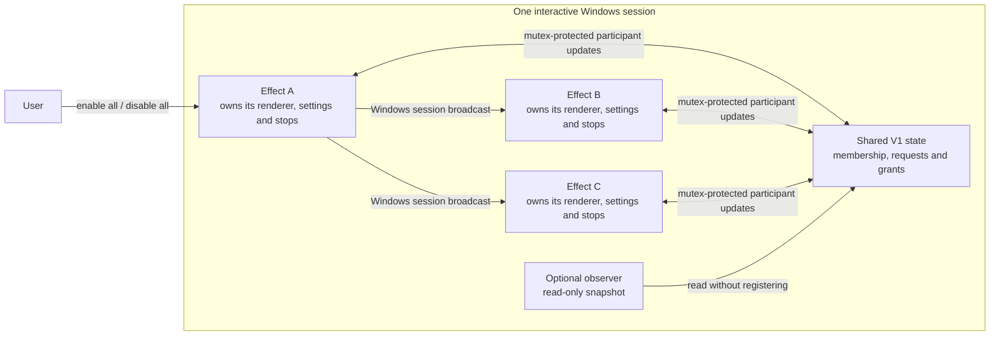
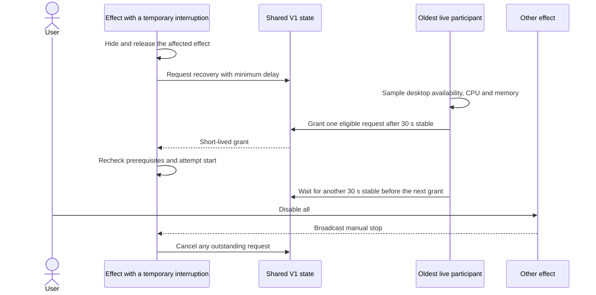

> **File name:** `desktop-effects-contract.md` 
> **Full path:** `E:\vibekit\Widgets\Shared\desktop-effects-contract.md` 
> **Path relative to the VibeKit repository root:** `Widgets/Shared/desktop-effects-contract.md`

# Desktop effects coordination: Windows V1

This public, versioned contract lets independently installed VibeWare effects
coordinate **within one interactive Windows session**. It applies to the open,
participating applications; it does not launch closed applications or persist a
global on/off preference. Linux has a separate implementation and is not covered
by this Windows contract.

## Ownership and boundaries

The oldest open participant owns the **recovery decision** while it is live.
All participants retain responsibility for detecting and safely stopping their
own effects, their settings, and validating their own start. If the authority
leaves or its heartbeat is stale for more than ten seconds, the next oldest
participant takes over and starts a fresh stability interval. A mutex serializes
membership changes and decisions. No standalone daemon is required.

## Manual commands

Use [`DesktopEffectStop.cs`](DesktopEffectStop.cs) by linking the source for
C#, or [`DesktopEffectCommands.h`](DesktopEffectCommands.h) for C++. These
commands use `RegisterWindowMessageW` and `PostMessageW(HWND_BROADCAST, …)`:

| Command | Registered message name | Required recipient behavior |
| --- | --- | --- |
| Enable all | `VibeWare.DesktopEffects.EnableAll.v1` | Treat as an explicit user request to enable this app's effect. Clear its old retry budget and check its own prerequisites. Report a failure locally if it cannot start. |
| Disable all | `VibeWare.DesktopEffects.DisableAll.v1` | Stop the effect and cancel its pending automatic recovery, including any queued start. Do not automatically undo this command. |

Both messages have zero `wParam` and `lParam`; a successful broadcast only means
the message was posted, not that every effect started or stopped. Register a
top-level window, including a hidden tray window, to receive the messages.
Messages are session-local cooperative commands, **not** an authentication or
security boundary. A recipient may refuse to start if a safety prerequisite,
permission, selected display or resource is unavailable. A user-facing switch
should indicate the reported state of participating open applications, and must
not claim that an unavailable or older non-participating app is running.

## Coordinated recovery

Link [`DesktopEffectRecovery.cs`](DesktopEffectRecovery.cs) in C# or include
[`DesktopEffectRecovery.h`](DesktopEffectRecovery.h) in C++. The native header
requires C++20, C++/WinRT, Windows SDK, `windowsapp.lib`, `ole32.lib` and
`wtsapi32.lib`. Initialize WinRT on its calling thread before using the header.
The application calls `Tick` on its owning thread at least once per second, even
when its effect is stopped. Pass whether it is safe to start at that moment and
whether its effect is currently running. In C#, a granted resume invokes the
supplied callback on that thread; in C++, `Tick` returns `true` exactly once for
each grant and the caller performs the start. A `true` running value is the
application's own report; it is not independent proof of visible output.

Only classify an interruption as recoverable when the app can safely retry it.
Call `Pause(enabled, delaySeconds)` **after** stopping and releasing the effect.
It returns false if recovery is disabled, the coordinator is unavailable, or
the retry budget is exhausted. The app must explain that a manual start is
needed. Unknown errors, missing permissions, emergency stops and user stops
must not be converted into automatic retries. Call `Cancel` for a manual stop,
`Reset` for a new manual enable, and dispose the participant at shutdown.
Each app retains control of its own automatic-recovery preference.

The authority grants at most one request after 30 continuous seconds with an
active, unlocked input desktop, more than 15% CPU idle, and available physical
memory of at least 10% of total or 512 MiB, whichever is greater. A sample gap
longer than two seconds resets the stability interval. Minimum delay is clamped
to 30–300 seconds, and the second attempt uses twice that delay. Grants expire
after two seconds, and a new grant requires another 30 seconds of stability.
There are at most two automatic attempts until a manual reset or five continuous
minutes reported running. An app must still check its own GPU, capture and
other prerequisites on start; the shared health check does not certify them.
If state, desktop status or sampling is unavailable, recovery fails closed.

The `AllEnabled` and `AnyEnabled` properties report the live participants' last
running states. A mixed state has `AnyEnabled` true and `AllEnabled` false. It
may lag by a tick and excludes closed, stale and non-participating apps. A
binary switch can enable all from a mixed state; the UI also needs an explicit
disable-all action in that state. `TryObserve` in C# and `Recovery::Observe` in C++ read the current
participant snapshot without joining the election or changing shared state.
Both can fail when no coordinator exists or the state is temporarily locked.
CRT Degauss and Retro Sound participate in the global commands and status;
their own error handling remains separate. In particular, an audio-device error
in Retro Sound is not automatically retried by the visual-effect recovery policy.

## V1 wire format and compatibility

The public source adapters above are the preferred integration point. The
interoperability format is also specified so another language can implement V1:

* Mutex: `Local\VibeWare.DesktopEffects.Recovery.v1.Mutex`.
* Named file mapping: `Local\VibeWare.DesktopEffects.Recovery.v1.State`, 32,768 bytes.
* Under the mutex, offset 0 is a little-endian signed 32-bit UTF-8 byte count;
  offset 4 contains that many bytes of JSON. Zero length is an empty state.
  Invalid data fails closed. Never change either object while observing.
* The JSON object contains `NextOrder`, `NextGrant`, `Leader`, and `Members`.
  Each member contains `Id`, `App`, `Order`, `Opened`, `Seen`, `Due`,
  `GrantUntil`, `CanResume`, `Running`, `Request`, and `Grant`. IDs and request
  tokens are unique opaque strings; `Opened` is process creation time in
  milliseconds since 1601 UTC, and other time values use `GetTickCount64`
  milliseconds. `Order` breaks ties. Empty `Request` means no pending request;
  `Grant` must equal it and remain unexpired before it can be consumed.
* Preserve unknown JSON properties. Do not reinterpret a changed schema as V1;
  an incompatible protocol must use a new object and message version.

The adapters report availability; the absence or corruption of shared state
must never be treated as permission to resume independently.

> **File name:** `desktop-effects-contract.md` 
> **Full path:** `E:\vibekit\Widgets\Shared\desktop-effects-contract.md` 
> **Path relative to the VibeKit repository root:** `Widgets/Shared/desktop-effects-contract.md`
