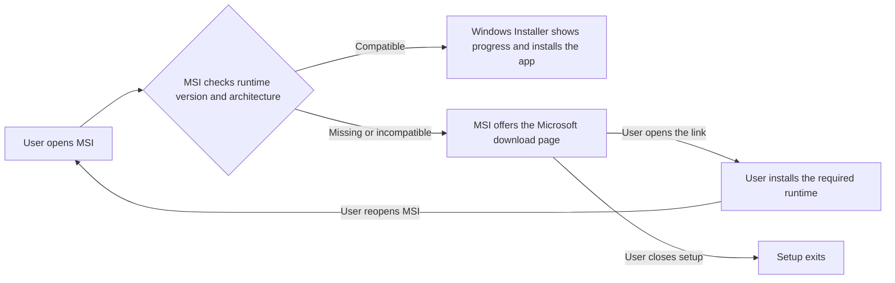

# VibeKit installer specifications

This directory is the shared reference for VibeKit installers. Put common requirements here and link to each application's packaging instructions for product-specific details.

## Windows MSI layout

Use a single centered native Windows Installer window, 370 × 270 installer units. Keep the same layout in the progress and missing-prerequisite states. Start installation as soon as the prerequisite checks pass.

| Area | Position in installer units | Content |
| --- | --- | --- |
| Upper left | X 20, Y 24 | Product icon in a 44 × 44 control, about 64 px at standard display scaling. Preserve its proportions and transparency. |
| Upper right | X 82, Y 24 | Product name in 16 pt bold Segoe UI. Below it, show the full product version, installation scope, and `Welcome to the [Product] installer.` in 9 pt Segoe UI. |
| Main body | X 82, Y 92 | State the required .NET runtime and architecture. Place `[Product] home • Member of VibeWare movement` at Y 124 and `Need help? Contact us` at Y 142. |
| Bottom | X 20, Y 201 | Installation status and a native progress bar at Y 220, fed by Windows Installer. Place `Cancel` below the bar. |
| Missing runtime | X 82, Y 170 | Explain what must be installed. Use `Open the Microsoft download page` at Y 204 and put `Close` in the same position as `Cancel`. |

Use Windows Installer controls for progress, hyperlinks, and buttons. Keep links and buttons reachable by keyboard and readable at Windows display scaling. Link the first label to the project's home and `Member of VibeWare movement` to the manifesto. Separate the two links with a spaced bullet (` • `). Use the shared contact page in every package. Verify URLs before using them. [Windows Installer progress bars](https://learn.microsoft.com/en-us/windows/win32/msi/authoring-a-progressbar-control) · [Hyperlink controls](https://learn.microsoft.com/en-us/windows/win32/msi/hyperlink-control) · [VibeWare manifesto](https://umbertogiacobbi.biz/vibeware/manifesto/) · [Contact page](https://umbertogiacobbi.biz/contacts/)

## Shared .NET runtime

- Publish .NET applications framework-dependent and keep the application-specific libraries they need. MarkVibe and VoiceDucker use the shared Microsoft .NET Runtime 10. Their Windows App SDK libraries are a separate dependency.
- Match the prerequisite to the published runtime configuration and the package architecture. Check the runtime the executable needs, including its minimum patch and compatible servicing updates. Where an app uses WPF or Windows Forms, check for the .NET Desktop Runtime. [Microsoft runtime guidance](https://learn.microsoft.com/en-us/dotnet/core/install/windows)
- Perform the prerequisite check before installing or upgrading app files, including in basic and silent mode. Keep uninstall available even if the runtime was removed. In silent mode, report a missing prerequisite and its download URL in the installer log.
- Open Microsoft’s download page in the default browser only when the user activates the link. The user installs the shared runtime and starts the MSI again. [Microsoft .NET 10 downloads](https://dotnet.microsoft.com/en-us/download/dotnet/10.0/runtime)
- Release notes identify the runtime and the package architectures built and verified for the release. Users with a compatible .NET 10 runtime can install or extract the app immediately. Other users install the appropriate Microsoft runtime separately. [Microsoft .NET 10 downloads](https://dotnet.microsoft.com/en-us/download/dotnet/10.0)

## Implementations

- [MarkVibe MSI authoring](../../Apps/MarkVibe/packaging/windows/New-MsiPackage.ps1) and [Windows packaging guide](../../Apps/MarkVibe/docs/windows-packaging.md)
- [Shared WiX dialog](../../scripts/packaging/VibeWareInstallerUI.wxs) and [packaging helper](../../scripts/packaging/vibeware_msi.py) for the app and widget MSI generators
- [HelpMe and VoiceDucker MSI generator](../../scripts/ci/create-app-msi.py) and [Water Ripple and Retro Terminal MSI generator](../../Widgets/Shared/create-widget-wix.py)
