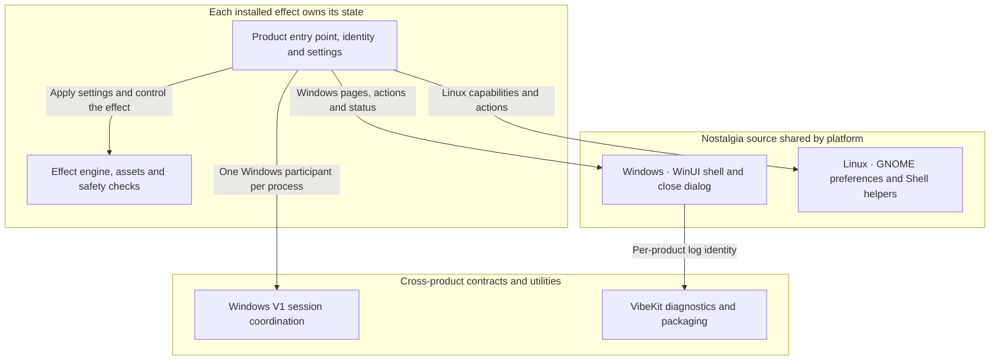
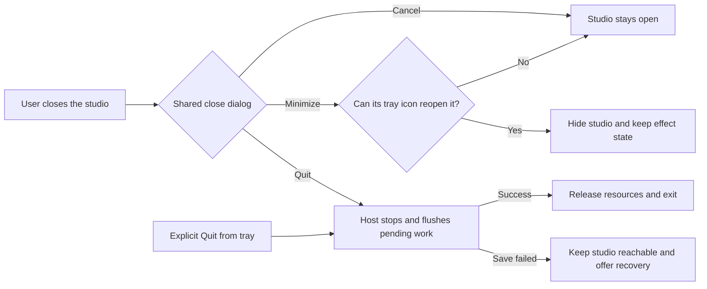

> **File name** `nostalgia-architecture-proposal.md`<br>
> **Full path** `E:\vibekit\docs\nostalgia-architecture-proposal.md`<br>
> **Path relative to the VibeKit repository root** `docs/nostalgia-architecture-proposal.md`

# Nostalgia · Proposed architecture for the five desktop effects

**Design decision, 26 November 2026.** Group Water Ripple, Vignette, Retro Terminal, CRT Degauss and Retro Sound under `Widgets/Nostalgia/`. Give the family one build-output directory and one Windows UI library. Each effect keeps its executable, installer, application identity, settings and release cycle. “Nostalgia” is the working name for the source family. The owner subsequently specified native UI per platform, explicit failure on invalid required inputs, and removal of compatibility-only code. Current commands and implementation paths are in the [family guide](../Widgets/Nostalgia/README.md).

## Source findings before the migration

| Product | Windows | Linux | What a migration needs to preserve |
| --- | --- | --- | --- |
| Water Ripple | WinUI studio, C++ ripple renderer and capture. The close sequence stops, flushes pending settings and handles save failure. | GNOME Shell extension and a separate GJS/Libadwaita panel. Its close dialog already checks that the panel icon can reopen the window. | JSON settings, capture consent, custom pipelines, manual stop and standalone presentation when Retro Terminal leaves. |
| Vignette | WinUI studio with the common About and tray. The main window can hide on close. | GNOME extension with Libadwaita preferences. Packaging currently obtains the preferences layout and branding from Retro Terminal. | Existing settings and presets, monitor choices and the lightweight overlay. |
| Retro Terminal | WinUI studio connected to a native engine. Native code owns its tray registration. The studio handles native save failures and Windows servicing. | GNOME extension with Libadwaita preferences and its own recovery policy. | Registry settings, phosphor history, the capture handoff with Ripple and the servicing shutdown path. |
| CRT Degauss | Shares a WinUI host and C++ bridge with Retro Sound. The close-confirmation flag is on. Its CMake target directly compiles Retro Terminal's renderer. | GNOME extension with an About page inside preferences. | Existing preference blob, sound and patch previews, recorded audio, shader and pulse timing. |
| Retro Sound | Uses the same host with close confirmation off. On-disk identity includes the historical HardDriveSound registry key. | Standalone Python/GTK3 app with an Ayatana indicator, GStreamer and a compiled C++ mixer. Closing the window hides it. | Legacy settings and autostart, recorded samples, mixer, disk-activity monitoring and user profiles. |

On Windows the five already use the same About window, tray menu, theme and much of the four-tab layout. Most share them through source links in each executable. One concrete dependency runs in the opposite direction to the intended design: the common About calls a scrollbar helper in the Retro Terminal namespace. Its MSI version fallback also reads the assembly containing the About window. Moving that class into a DLL without changing the version input would display the library version. [Windows About](../Widgets/Nostalgia/Shared/Windows/WidgetAboutWindow.cs) · [Water Ripple project](../Widgets/Nostalgia/WaterRipple/WaterRipple.csproj) · [Shared native-host project settings](../Widgets/Nostalgia/Shared/Native/Studio.props)

On Linux, the four extensions share GJS helpers. GNOME Shell hosts their effects, while preferences use a separate UI context. Retro Sound owns its own process. The existing stop registry lives on the Shell stage and reaches registered extensions. Ripple and Retro Terminal implement their own recovery policies. Vignette and CRT Degauss can require manual reactivation after resource pressure. These are different capabilities from Windows V1. [Shell stop registry](../Widgets/Nostalgia/Shared/Linux/effect-stop.js) · [Ripple close dialog](../Widgets/Nostalgia/WaterRipple/Linux/extension/ripple@vibeware.local/control.js) · [Retro Sound GTK application](../Widgets/Nostalgia/RetroSound/Linux/main.py)

## Source layout and ownership

```text
Widgets/
  Nostalgia/
    WaterRipple/       Vignette/        RetroTerminal/
    CrtDegauss/        RetroSound/
    Shared/
      Windows/         Nostalgia.WinUI.csproj, UI, theme and tray presentation
      Native/          native host bridge and effect-specific shared headers
      Linux/           Shell integration and separate preferences modules
      Assets/          family branding and its artwork notice
    build/             family packaging entry points and output conventions
    artifacts/         Windows and Linux generated files, ignored by Git
  Shared/              facilities used elsewhere in VibeKit
```

Keep each product's current internal layout for the first move. A single canonical copy of general-purpose facilities stays available to other consumers. OpenAI Usage links the About content builder. Studio Controls uses the tray icon, stop command and MSI helper. HelpMe, VoiceDucker, WorkTrail and other applications link shared diagnostics. The family library can reference or source-link these primitives internally. When migrating an app, remove direct links to types now supplied by its library to avoid competing definitions. Keep public protocol entry points available to independent consumers. [OpenAI Usage references](../Widgets/OpenAI/Windows/OpenAIUsage.Windows.csproj) · [Studio Controls references](../Widgets/StudioControls/Windows/StudioControls.Windows.csproj) · [VoiceDucker references](../Apps/VoiceDucker/VoiceDucker.csproj)



### First extraction on Windows

Build one WinUI 3 class library referenced using `ProjectReference`. Ship its assembly and resources inside each product's MSI. This permits independent updates and uninstall. Publish framework-dependent .NET applications. Sign local executables and installers with the shared VibeWare development certificate and produce unsigned MSI files for the existing public channel. [Widget packaging policy](../Widgets/AGENTS.md)

| Library owns | The host supplies |
| --- | --- |
| About window, layout, DPI-aware icon rendering and support ZIP actions | Product name, actual app version, current icon, description, license, product URL and log identity. Water Ripple has its own Windows licensing text. |
| Studio navigation, appearance rows, status strip, footer, scroll behavior and the two global action buttons | Effect and preset pages, actions, live status and optional capabilities such as monitor selection. Audio-only effects can omit display controls. |
| Tray menu presentation, command order and close dialog | The handle that owns the tray, whether it can reopen the studio, effect-specific commands and the callback that performs a real quit. Keep Retro Terminal's native icon registration during migration. |
| Close decision and in-progress guard | Modal or capture checks, settings flush, error handling and final resource disposal. Each app continues to own its storage and lifecycle. |

Extract existing implementations before redesigning them. Make the scrollbar helper and theme resources reachable through the library. Verify compiled XAML/PRI discovery in a published MSI and pass host version and branding explicitly. The two native-host products already have a suitable boundary in `WidgetEngine`. Move their shared host plumbing in a separate step. Keep the mixer, shaders, preview code and capture consent inside their owners. Treat the renderer shared by CRT Degauss and Retro Terminal as a later, separately reviewable native target. The Ripple/Retro Terminal GPU contract has its own presentation and fallback rules. [Studio layout](../Widgets/Nostalgia/Shared/Windows/EffectStudioLayout.cs) · [Native engine boundary](../Widgets/Nostalgia/Shared/Native/Engine.h) · [Degauss renderer dependency](../Widgets/Nostalgia/CrtDegauss/Windows/CMakeLists.txt) · [GPU frame flow](windows-desktop-effects.md)

### One close interaction

Use **Minimize to tray**, **Quit** and **Cancel** across the five Windows studios. A second close request focuses the open dialog. Minimize checks again that the tray entry can restore the window. Cancel preserves the running state. An explicit tray Quit goes directly to the product's normal quit path. Keep escalation after a failed save in the hands of the user. Preserve platform servicing behavior as a distinct entry point. [Water Ripple close sequence](../Widgets/Nostalgia/WaterRipple/CloseSequence.cs) · [Native-host close handling](../Widgets/Nostalgia/Shared/Native/Studio.cs) · [Retro Terminal window](../Widgets/Nostalgia/RetroTerminal/Windows/Studio/MainWindow.cs)



### Linux reuse and inter-process coordination

Use Water Ripple as the reference for product icons, the About composition and tray availability. Extract shared Libadwaita preferences components for the four extensions and keep Shell-only code in separate modules. Package private copies of the required modules inside each extension, as the builders already do. Closing GNOME-hosted preferences dismisses a settings surface. To give all five application-menu launchers the three-way close choice, use Ripple's product-controlled panel pattern for the other extension launchers and reuse the same preference components from GNOME's settings entry. Enable hiding only while the panel can reopen from its icon. **Quit** invokes that product's stop/disable action. Retro Sound can implement the same choices through its GTK3 and Ayatana adapter without a toolkit migration. [Vignette packaging](../Widgets/Nostalgia/Vignette/Linux/build-package.py) · [Water Ripple panel](../Widgets/Nostalgia/WaterRipple/Linux/extension/ripple@vibeware.local/control.js)

Keep the existing Windows V1 message names, state format, election, cancellation and observer behavior. Each process registers once, including native-host products. **Enable all** and **Disable all** target open participants. An explicit stop cancels pending recovery. Joining or upgrading one effect must continue to work with older participants. [Public Windows V1 contract](../Widgets/Shared/desktop-effects-contract.md)

If all five Linux effects are to share global enable and coordinated recovery, give that work a separate milestone. A versioned session D-Bus interface could connect the Shell registry to Retro Sound. Specify discovery, one decision owner, owner loss, forced-stop precedence and mixed versions before implementing it. The audio app would report its own readiness and keep mute or stop authoritative. The Windows protocol and the current Linux stop registry can continue functioning during the directory move.

## One artifact root

| Proposed path under `Widgets/Nostalgia/artifacts/` | Contents |
| --- | --- |
| `packages/<channel>/<os>/<arch>/<effect>/` | Completed deliverables with their current versioned filenames. Use separate local-development and public-release channels. |
| `work/<os>/<arch>/<effect>/<configuration>/<project-or-target>/` | MSBuild intermediates, CMake trees, compiled shaders and generated sample banks. Add a run-specific leaf for concurrent jobs that build the same target. |
| `stage/<run>/<os>/<arch>/<effect>/` | Private publish payload, WiX objects or Debian staging tree. Publish completed packages from here. |

For example, a signed CRT developer installer can land in `packages/local/windows/x64/CrtDegauss/`, a GNOME extension Debian package in `packages/local/linux/all/Vignette/` and a Retro Sound Debian build on an amd64 host in `packages/local/linux/amd64/RetroSound/`. Retro Sound contains a compiled mixer and takes its Debian architecture from `dpkg`. Water Ripple and Retro Terminal also generate GNOME extension ZIPs. Preserve those outputs where the build calls for them. Keep each product's payload isolated: both native-host MSI projects install a different `WidgetEngine.dll` under the same filename. [Native-host packaging](../Widgets/Nostalgia/build/Build-Windows.ps1) · [Retro Sound Debian builder](../Widgets/Nostalgia/RetroSound/Linux/build-package.py) · [Retro Terminal Debian builder](../Widgets/Nostalgia/RetroTerminal/Linux/build-package.py)

Make the default root relative to the family directory, with an explicit override for CI. Pass actual destinations through the existing `-OutputDirectory` and `--output-dir` parameters. Also route native builds, MSBuild restore/obj/bin, test-project intermediates and temporary package directories there. Configure MSBuild paths before restore and identify the leaf by project so that parallel builds never share an assets file. Audit scripts that discover the repository by counting parent directories. Keep recordings, icons, palettes, shaders and license notices in source; generated derivatives belong in `work`. Keep product versions independent across platforms and derive filenames from the package's authoritative version.

Cleanup can then remove scratch by effect or by run and retain the latest successful deliverable per product, platform, architecture, channel and format. Finish and promote the replacement before retiring the previous package. An interrupted build must leave the previous deliverable intact. Retire existing `dist` and root-level staging only after classifying their contents and finding their replacements. The repository already ignores `**/artifacts/`. [Repository ignore rules](../.gitignore)

## Migration order and acceptance criteria

| Step | Deliverable and evidence to collect during implementation |
| --- | --- |
| 1 · Output routing | Introduce the artifact layout while the products are still in their current directories. Build from source, compare package contents and prerequisites, verify signing by channel and confirm the second native-host build cannot overwrite the first. |
| 2 · Directory move | Move the five source trees together, including intentional untracked work. Update MSBuild, CMake, script inputs, product URLs, CI selectors, workflow paths and documentation links as one change. Recreate generated outputs from source. Preserve historical import records. |
| 3 · Windows reference implementation | Pilot the library with CRT Degauss and Retro Sound. They share a host but have different close behavior. Check the current icon and executable version in About, the three close choices, tray restore and published resources. A single-product install must work independently. |
| 4 · Adopt in the other three | Bring over Vignette, Water Ripple and Retro Terminal. Exercise mixed-version global commands, save failure, manual stop and native tray handling. Validate the Ripple/Terminal capture handoff separately from ordinary UI behavior. |
| 5 · Linux UI | Move the proven GJS helpers and shared assets, then align product identity, menu and close choices where the host supports them. Verify desktop launchers, GNOME UUIDs, schemas, packages and upgrades from earlier names. Scope the optional D-Bus work independently. |

Carry forward MSI UpgradeCodes and component identity, executable names, install locations, Start shortcuts, registry keys, Linux desktop IDs, Debian package names and existing command aliases. Validate upgrade over an existing install with settings and custom presets, plus uninstall of one effect while a sibling remains installed. Preserve product-specific licensing and the VibeWare artwork notice when moving assets.

The current widget release workflow routes three of these five effects by tag. Vignette has a callable workflow but is absent from the monorepo's project selector. CRT Degauss and Retro Sound need an explicit routing decision. Keep existing tag names and release channels during the move. A shared UI change should select its five consumers; a shader or sample-only change should select the affected product and any direct source consumer. Update packaging consumers outside the family when their inputs change. [Current selector](../scripts/ci/select_projects.py) · [Release routing](../.github/workflows/widget-releases.yml)

**A sixth effect is the design check.** A new effect should supply its identity, native behavior, settings, effect-specific pages and package inputs. Referencing the Windows library should give it the standard About, tray menu, close choices and global buttons. Registering its package inputs with the family build should place its artifacts in the correct directory. On Linux, it should select the shell-extension or standalone integration appropriate to its process. Adding that effect should require no edits to the existing five engines.

> **File name** `nostalgia-architecture-proposal.md`<br>
> **Full path** `E:\vibekit\docs\nostalgia-architecture-proposal.md`<br>
> **Path relative to the VibeKit repository root** `docs/nostalgia-architecture-proposal.md`
