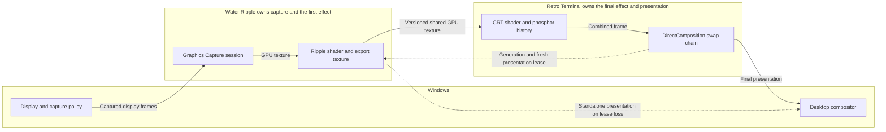
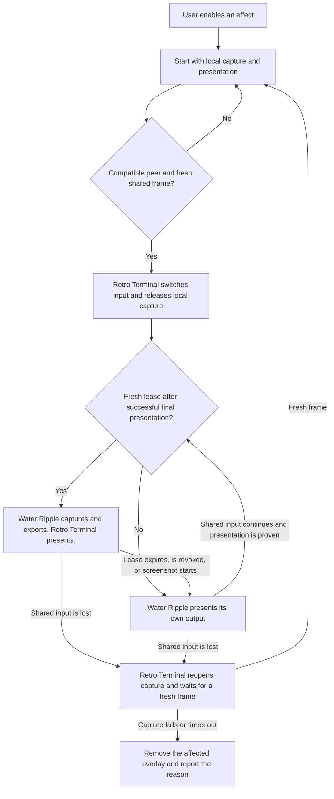

> **File name** `windows-desktop-effects.md` 
> **Full path** `E:\vibekit\docs\windows-desktop-effects.md` 
> **Path relative to the VibeKit repository root** `docs/windows-desktop-effects.md`

# Windows desktop effects architecture

An effect can run on its own or participate in an ordered chain for one display. A healthy chain has one Windows Graphics Capture session and one presenter. Each widget owns its settings, controls, and emergency stop. A widget that leaves the chain releases its shared resources so the remaining widgets can run independently.

Each widget can run several display chains concurrently. The **Monitors** switches store display identities and choose where that widget participates. Each selected display has separate capture, render, and presentation state. Toggling one display updates its chain while the other chains continue. The main **Effect** switch and emergency stop control the widget across all displays.

## Water Ripple and Retro Terminal

Water Ripple captures the display, applies its shader, and exports the result as a shared D3D11 texture. Retro Terminal reads that texture, applies the CRT shader and optional phosphor history, and presents the combined result. The sharing contract is local to the Windows desktop session. The peers must match the display and bounds, run under the same user, and open the texture on a compatible adapter. The transport uses an unnamed, read-only NT handle and zero-wait keyed mutex acquisition. Pixel data stays on the GPU. [Shared transport](../Widgets/Shared/DesktopEffectInterop.h) · [Water Ripple export](../Widgets/WaterRipple/Native/CrtFrameExport.h) · [Retro Terminal input](../Widgets/RetroTerminal/Windows/RippleFrameInput.h)

Starting Retro Terminal on its own uses its local capture. As soon as it accepts shared input, it closes its local capture and resets source-dependent history. Water Ripple continues to render and export its frames. It yields presentation only while Retro Terminal holds the matching lease. The lease requires the shared generation, acknowledgment for that Water Ripple window, and a monotonic timestamp refreshed after successful presentation to an opaque overlay. Its 500 ms expiry bounds the time Water Ripple waits on a stalled peer. A v1 texture acknowledgment alone leaves Water Ripple's presentation active, so older peers keep working. Water Ripple's intentional screenshot path returns to its local presenter before capture. [Retro Terminal renderer](../Widgets/RetroTerminal/Windows/Renderer.cpp) · [Water Ripple renderer](../Widgets/WaterRipple/Native/RippleRenderer.cpp)

## Contract for future effects

| Responsibility | Contract |
| --- | --- |
| Session coordination | Negotiate a versioned, ordered chain per user session and display. Elect one capture owner and one final presenter. Keep a stage's standalone path available when the chain or a required capability is absent. Leave v1 peer behavior available across independent widget upgrades. |
| Capture owner | Own capture cadence, capture consent, and the current display generation. Use the Windows borderless permission flow where supported and granted. Continue with the OS border when consent or support is absent, or when Windows requires it. A new capture owner applies its own permission. [Windows capture border requirements](https://learn.microsoft.com/en-us/uwp/api/windows.graphics.capture.graphicscapturesession.isborderrequired) |
| Effect stage | Consume the preceding GPU texture and produce output for the same display. Negotiate format, color space, bounds, adapter, frame sequence, timestamp, and generation. Recreate incompatible resources and clear temporal history on input changes. Respect the animation cap and session memory budget. |
| Final presenter | Own the capture-excluded, input-transparent overlay and renew its lease after successful final presentation. On stop or handoff, revoke the lease and release output. Keep the previous owner visible until the replacement proves readiness. |
| Failure and recovery | Bound discovery, waits, and GPU memory. Drop stale generations. Skip an unavailable optional stage or return to standalone with fresh input. Hide the affected overlay when no valid capture path remains. Manual and emergency stops cancel automatic recovery. Expose the active input, presenter, and failure in diagnostics. |

## Repeatable 4K validation

1. Keep the same 3840 × 2160 monitor, refresh rate, settings, and deterministic motion scene for each pass. After warmup, record equal 15-second samples for Water Ripple alone, Retro Terminal alone, and both together. Repeat each pass.
2. Count native `Present` calls and successful submissions per effect. Attribute ETW presentations to the widget PID and a nonzero swap-chain address with the DXGI runtime. Exclude `Other` runtime and address-zero composition events from those counts. Report the final swap chain's median and 95th-percentile frame intervals in milliseconds. Identify whether the intervals come from submission or display timestamps. Measure capture sessions, animation, and GPU utilization separately.
3. While the scene runs, start Retro Terminal over Water Ripple and verify that Retro Terminal takes over presentation with one active capture session after handoff. Stop Retro Terminal and verify Water Ripple resumes presentation. Repeat with the opposite launch order and stop Water Ripple to verify Retro Terminal's standalone capture fallback.

Validate mixed versions, different displays and adapters, peer exit or stall, screenshot transitions, session and display changes, and capture permission outcomes separately.

> **File name** `windows-desktop-effects.md` 
> **Full path** `E:\vibekit\docs\windows-desktop-effects.md` 
> **Path relative to the VibeKit repository root** `docs/windows-desktop-effects.md`
