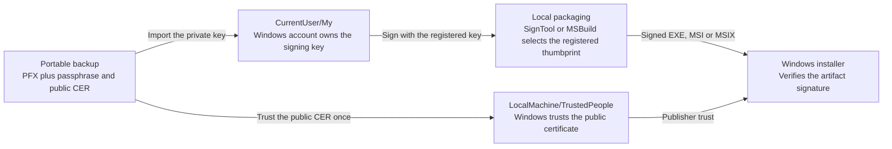

> **File name** windows-development-signing.md 
> **Full path** `E:\vibekit\docs\windows-development-signing.md` 
> **Path relative to the VibeKit repository root** `docs/windows-development-signing.md`

# Shared Windows development signing

Use one VibeWare development certificate with subject `CN=Umberto Giacobbi`
for local Windows packages. Every MSIX keeps its own package name and uses the
certificate subject as its development publisher.

On another Windows PC, copy the entire **VibeWare Development Signing** folder
from the Desktop. Under the Windows account that builds the applications,
open `Import-VibeWareDevelopmentSigning.cmd`. The launcher keeps the console
open so you can read the result. You can also run
`./Import-VibeWareDevelopmentSigning.ps1` from PowerShell in the copied folder.

The console checks the kit files, opens the PFX, and compares its thumbprint
with the public certificate. It then installs or reuses the private key in
`CurrentUser\My`, installs the per-user signing tools, and registers the
thumbprint. Windows prompts once for administrator approval to trust the public
certificate in `LocalMachine\TrustedPeople`. The final lines report signing
and MSIX trust separately. The setup output includes the public thumbprint and
expiration date and keeps the passphrase out of the console.

Run the same import again after a canceled trust prompt. The private key and
signing configuration are reused. Use `-SkipTrust` for a signing-only setup.

| Repository | Local packaging |
| --- | --- |
| Filo | Signs the WinUI and CLI executables before creating the ZIP and MSI. Signs the MSI after WiX builds it. |
| Ram Taskman | Signs the Windows executable before creating the ZIP and MSI. Signs the MSI after WiX builds it. |
| VibeKit apps | HelpMe and WorkTrail Debug MSIX, MarkVibe and VoiceDucker local MSIX, UlanziDeck local MSIX, Windows portable binaries where provided, and RepoRadar and ThermalRight Panel MSIs. |
| VibeKit widgets | Local OpenAI Usage, RetroTerminal, Studio Controls, Vignette and WaterRipple Windows MSIs. |

MSIX Store packaging follows the product's Store identity and signing procedure.
Public CI runs without this private key. Projects with unsigned CI packaging
continue to produce unsigned artifacts.

The [shared signer](../scripts/packaging/Sign-VibeWareDevelopmentFile.ps1)
selects the registered thumbprint from the current user's Windows settings.
The backup contains the PFX with its private key, the public CER and PEM, and
the passphrase. The projects require the imported key for signed MSIX builds.
Use each project's normal Windows packaging command after importing the kit.

> **File name** windows-development-signing.md 
> **Full path** `E:\vibekit\docs\windows-development-signing.md` 
> **Path relative to the VibeKit repository root** `docs/windows-development-signing.md`
